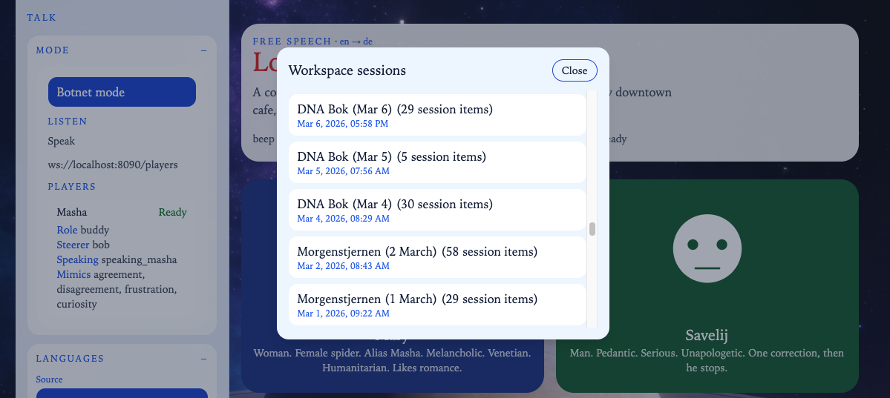

# LogosKittens

LogosKittens is a dual-interface, open-source voice client for the polyglot platform [www.logoscat.com](https://www.logoscat.com).

**Why dual-interface?** It is an experimental system that goes beyond a human simply talking to a server to practice languages. Built as a robot-oriented platform, it allows [N robots to connect and collaborate](https://www.youtube.com/watch?v=mm5qdjpUDf0) on a shared scenario — in this case, helping you learn a language.

You can use the web interface to talk directly to your Mac, Linux, or Windows machine, or use the multi-bot interface to converse with physical robots that take on distinct roles, such as a conversation partner and a teacher.

Everything links to your logoscat.com account, allowing you to use the texts you have translated on the platform as grounding material. This means you can practice speaking directly in the context of the exact material you just translated and studied.

## Web Interface


## Bot-Net Interface


## Use your logoscat materials

You can bring in the sessions you worked on at logoscat.com, so the conversation is about concrete subjects that interest you. New to LogosCat? Read [how to get started with LogosCat](https://portal.logoscat.com/how-to-get-started-with-logoscat/).



## Example Interaction with bots

[](https://www.youtube.com/watch?v=mm5qdjpUDf0)

https://www.youtube.com/watch?v=mm5qdjpUDf0

**Cognitive Edge & Robot Middleware for free conversation and embodied agents.**

The live talk is specified in [`free_conv.md`](free_conv.md). LogosKittens decouples high-level cognitive reasoning from execution media. The same primitives (`Situation`, `Task`, `Actor`, `GroupSolution`, `ElementSolution`) drive both screen avatars and physical robots. The system runs locally by default (Docker, Whisper.cpp, Piper TTS, SQLite) with an OpenAI-compatible LLM abstraction that supports local models and Grok.

## Example Robot Extension

[`lk_body`](https://github.com/ganapetya/masha/tree/main/ros2_ws/src/lk_body) is the robot side for Masha, a hexapod on a Jetson. It dials the hub's `/players` socket, records the human on the robot's microphone, plays the reply on its speaker, and runs the poses the hub names. Use it as the pattern for connecting another robot.

## Models

Some parts always run on your own machine, some run locally by default, and some call a remote model by default.

| Part | Default | Where |
| --- | --- | --- |
| Speech recognition | whisper.cpp (`small.en`; `nb-whisper-large` for Norsk; `large-v3-turbo` for Ukrainian) | Local, on the host GPU |
| Voice | Piper TTS | Local, in Docker |
| Buddy's replies and the lesson subject | Ollama `qwen3:8b` | Local. Set `LLM_BACKEND=grok` to use Grok instead |
| Bob (buddy steering), Rob (teacher corrections), Wren (games) | Grok `grok-4.7` | Remote, xAI. Needs `XAI_API_KEY` in `.env` |
| Prompt training: judge and proposer | Grok `grok-4.7` | Remote, set in `.env_training` |

With no xAI key, free speech still runs fully local: Bob and Rob are skipped, so Savelij makes no corrections, and the games that need Wren are not available. See [Change the model](#change-the-model) for the settings.

## Quick Start

Speech recognition and Ollama run on the host so they can use the GPU. Compose starts Piper, the hub, and the page. Start Ollama and the recognizer first, and leave the recognizer terminal open. Compose does not start either one.

From the repo root:

```bash
cp .env.example .env
```

The default is `LLM_BACKEND=local` and `LLM_MODEL=qwen3:8b`. Leave `XAI_API_KEY` empty unless `LLM_BACKEND=grok`.

The recognizer prints `whisper backend: metal`, `cuda`, `vulkan`, or `cpu` before it listens on port 8082. macOS always builds Metal. Linux and Windows use CUDA when `nvidia-smi` and `nvcc` are available, otherwise Vulkan when a Vulkan GPU is present, otherwise CPU. A CPU start prints `GPU is not in use`. The first start compiles whisper.cpp, downloads the English weight named in `.env_recognition` (default `small.en`), and keeps `nb-whisper-large` for Norsk. Language changes in the page restart that one process through port 8083. Both weights stay on disk, and only one is loaded.

On macOS, Linux, and Windows, work in the browser at http://localhost:5174/. The hub is http://localhost:8090, the audio engine is http://localhost:8081, and the recognizer is http://localhost:8082. `http://127.0.0.1:8081/health` reports `"whisper": true` and `"voice": true` when both sides are up.

### macOS

Install Docker Desktop, Ollama, CMake, and Git. Pull the model:

```bash
ollama pull qwen3:8b
```

```bash
./scripts/host_whisper.sh
docker compose up --build
```

Work in the browser at http://localhost:5174/.

### Ubuntu

Install Docker Engine with the Compose plugin, plus `build-essential`, `cmake`, `git`, and `curl`. An NVIDIA GPU also needs a driver (`nvidia-smi` prints the card) and the CUDA toolkit (`nvcc` on `PATH`). An AMD or Intel GPU needs the Vulkan loader, `glslc`, and a device listed by `vulkaninfo`.

Ubuntu often installs Docker as a Snap (`which docker` prints `/snap/bin/docker`). The daemon can be running and Compose still fails immediately:

```text
permission denied while trying to connect to the docker API at unix:///var/run/docker.sock
```

That message is the socket, not a Compose or build error. The Snap listens on `/var/run/docker.sock` with mode `0660`. If no `docker` group existed when the Snap started, the socket is owned by `root:root`, so only root can open it. A normal user is refused even though `snap services docker` shows `docker.dockerd` active. `ls -l /var/run/docker.sock` then shows `srw-rw---- 1 root root`.

Create the group, join it, and restart the Snap so it recreates the socket as `root:docker`:

```bash
sudo addgroup --system docker
sudo adduser "$USER" docker
sudo snap disable docker
sudo snap enable docker
```

The shell you already have open does not gain the new group. Log out and back in, or run `newgrp docker` and start Compose from that shell. `id` should list `docker`, and `ls -l /var/run/docker.sock` should show `srw-rw---- 1 root docker`. Do not use `sudo docker compose` as the workaround. It connects once and leaves root-owned files in the project.

If Docker Engine came from apt, the `docker` group and a `root:docker` socket are usually already there. The same error only means your user is not in `docker`. Add the user, start a new login, and skip the Snap restart.

```bash
curl -fsSL https://ollama.com/install.sh | sh
sudo mkdir -p /etc/systemd/system/ollama.service.d
sudo tee /etc/systemd/system/ollama.service.d/override.conf >/dev/null <<'EOF'
[Service]
Environment="OLLAMA_HOST=0.0.0.0:11434"
EOF
sudo systemctl daemon-reload
sudo systemctl restart ollama
ollama pull qwen3:8b
```

Ollama on Linux listens on `127.0.0.1` until that override. The hub reaches the host through the Docker bridge, so the override is required. If `ufw` is on and the audio health check stays at `"whisper": false` while `curl http://127.0.0.1:8082/` works on the host, allow ports 8082 and 8083 from the Docker bridge. Port 8083 is the language switch.

```bash
./scripts/host_whisper.sh
docker compose up --build
```

Work in the browser at http://localhost:5174/.

### Windows

Install Docker Desktop with the WSL2 engine, Git, CMake, and the Visual Studio 2022 Build Tools (Desktop development with C++). An NVIDIA GPU also needs the CUDA toolkit (`nvcc` on `PATH`). An AMD or Intel GPU needs the Vulkan SDK (`vulkaninfo` lists the device). Install Ollama from https://ollama.com and pull the model in PowerShell:

```powershell
ollama pull qwen3:8b
```

Leave the recognizer running in its own window. Allow the Windows Firewall prompt for port 8082 on private networks.

```powershell
.\scripts\host_whisper.ps1
docker compose up --build
```

If execution policy blocks the script:

```powershell
powershell -ExecutionPolicy Bypass -File .\scripts\host_whisper.ps1
```

Work in the browser at http://localhost:5174/.

### Check from the host

With the Python package installed (`python3 -m venv .venv && .venv/bin/pip install -e 'cognitive-hub[dev]'`):

```bash
PYTHONPATH=cognitive-hub/src:shared/python .venv/bin/python -m logoskittens.cli --text "The fjords were quiet." --hub ws://localhost:8090/ws
./scripts/check_audio.sh
```

## Talk in the browser

The page is one endless talk with Buddy about a raw material. The first material is "Vacation in Norway" (tunnels and fjords). The Talk panel lists English, Norsk, Українська, Deutsch, and עברית. Choosing עברית mirrors the page right to left. A click starts a new talk in that language.

From the repo root, start three things and leave the first two running:

```bash
ollama pull qwen3:8b
./scripts/host_whisper.sh
docker compose up --build
```

On Windows the recognizer is `.\scripts\host_whisper.ps1`. Copy `.env.example` to `.env` once. The default buddy is local `qwen3:8b`. Set `XAI_API_KEY` only when `LLM_BACKEND=grok`.

Open http://localhost:5174.

- The theme is under the title. On a phone, Talk opens the material list.
- The mode switch starts on Web mode. Hold Speak, then release, and the browser records and plays the reply. Botnet mode is the robot face. Or type a line and press Send. That works in both modes.
- Buddy answers once. The talk does not end. Say another line.
- Reload the page. The same log comes back.
- The Buddy list is Peter or Mary. Peter is the default. Choosing the other person starts a new talk in that voice.
- Reset conversation drops this talk, builds the subject again from the raw material, keeps the buddy you are already on, and starts empty.
- Choosing another raw material starts a new session.
- BOB watches the talk after every third buddy line and may store one short steer for the next local replies. Its settings are `config/bob.json`, separate from `LLM_BACKEND`. The shipped backend is xAI with `XAI_API_KEY` (or `BOB_API_KEY`). The steer follows that buddy's character and a nearby subject. The buddy answers what was said, then uses the new part of the steer. A theme word already in the talk does not count. While QA is on, `altered by BOB` shows only when that new part was spoken, then `Suggested alteration:`. A steer still waiting shows `Next suggestion:`. QA is off until you turn it on.

Hub: http://localhost:8090. Audio: http://localhost:8081. Recognizer: http://localhost:8082. `http://127.0.0.1:8081/health` reports `"whisper": true` and `"voice": true` when both sides are up.

The virtual-stage image does not mount source. After a page change, rebuild it:

```bash
docker compose build virtual-stage && docker compose up -d --no-deps virtual-stage
```

## Talk with Masha

Botnet mode is the robot face. Turn the switch to Botnet mode. Masha is the client. She hears from the Speak button and plays the reply on her speaker. The page shows the words and does not play the sound. Web mode, the switch off, talks in the browser instead and does not need her.

Start the server on this machine first, and leave both running:

```bash
./scripts/host_whisper.sh
docker compose up --build
```

On Windows the recognizer is `.\scripts\host_whisper.ps1`. Copy `.env.example` to `.env` once. Open http://localhost:5174 and turn host mode on. The page shows the dial URL only while host mode is on. It is `ws://<this-machine-lan-address>:8090/players`.

On Masha, bringup is already running. Do not start a second one. Enter LogosKittens mode:

```bash
/home/ubuntu/ros2_ws/src/lk_body/deploy/lk_bot_mode enter
```

She dials `MASHA_HUB_WS` from `/home/ubuntu/ros2_ws/src/lk_body/.env`. That value is the dial URL from the page, the address she can reach. This machine's address changes. When it does, edit that one line and run `enter` again. The player list shows Masha Ready.

To talk, hold Speak for the whole sentence, then release. The microphone stays open for one second after you let go, so the last word is kept. A click is not a turn. One hold is one reply. Choosing Mary or Peter starts a new talk. A reload keeps the buddy you were on. Reset starts a new talk and keeps that buddy.

A suggestion can name one mimic: agreement, disagreement, frustration, or curiosity. With QA on, the BOB card shows `Mimic:` under the suggestion. She speaks first. The mimic runs after the voice, once. The next reply does not repeat it.

Leave LogosKittens mode when you are done. That stops her client and brings the keyword voice launch back. Bringup stays up.

```bash
/home/ubuntu/ros2_ws/src/lk_body/deploy/lk_bot_mode leave
```

## Change the recognizer

Speech recognition does not use the buddy model. Edit `.env_recognition`. If that file is missing, copy `.env_recognition.example`. The comments list every whisper.cpp weight. `RECOGNITION_MODEL` is the one that loads. The default is `small.en`, one step up from `base.en`.

Restart the recognizer after a change. The next start downloads a missing weight and leaves the old file on disk.

```bash
./scripts/host_whisper.sh
```

On Windows: `.\scripts\host_whisper.ps1`.

## Change the model

`LLM_BACKEND` chooses the chat server for the lesson subject and for Buddy's replies. It does not choose the recognizer or the voice. The page has no model picker. Edit `.env`, then recreate the hub so Compose reads the file again:

```bash
docker compose up -d --no-deps cognitive-hub
```

Two values are accepted. Any other value makes the hub raise `Unknown LLM_BACKEND`.

| `LLM_BACKEND` | Who answers | What to set |
| --- | --- | --- |
| `local` | Ollama on this machine. Default `qwen3:8b`. | `LLM_BASE_URL` and `LLM_MODEL`. No API key. |
| `grok` | Grok at `https://api.x.ai/v1`. Default `grok-4.7`. | `XAI_API_KEY`. Optional `GROK_BASE_URL` and `GROK_MODEL`. |

**Another local model.** The name has to be one `ollama list` already shows.

```bash
ollama pull qwen3:1.7b
```

In `.env`:

```bash
LLM_BACKEND=local
LLM_MODEL=qwen3:1.7b
```

Then run the hub recreate command above. `local` calls Ollama `POST /api/chat` with JSON output and a 2048-token context.

**Think level.** `LLM_THINK` sets how long the practice model thinks before the reply. Recreate the hub after changing it.

| Backend | Levels | Default |
| --- | --- | --- |
| Local Ollama | `off`, `on`, `low`, `medium`, `high`, `max` | `off` |
| Grok `grok-4.7` | `low`, `medium`, `high`, `xhigh` | empty, which means `high` |

`off` sends no reasoning and is the fast local setting. `on` asks the local model to think. `low`, `medium`, `high`, and `max` are named levels. The installed `qwen3:8b` honors `off` and `on`. A named level works when `ollama show <model>` lists it. A name that model does not list is not a level it will follow.

Grok cannot turn reasoning off. `off` and `on` are refused when `LLM_BACKEND=grok`. `low` is the fastest Grok level. `xhigh` is the deepest. Leave `LLM_THINK` empty on Grok to keep the model default, `high`.

Training can set the same levels per role with `SIM_TALK_THINK` and `JUDGE_PROPOSER_THINK` in `.env_training`. An empty value uses `LLM_THINK` from the shell, then the default for that backend.

**Grok.** In `.env`:

```bash
LLM_BACKEND=grok
XAI_API_KEY=your-key
GROK_MODEL=grok-4.7
```

Then recreate the hub. While the backend is `grok`, `GROK_MODEL` is the model name and `LLM_MODEL` is ignored. Grok uses `POST /v1/chat/completions`.

`config/languages/en.json` has an `llm_model` field. The hub stores it. Buddy does not call that field.

Practice does not read `.env_training`. Training does not read `LLM_BACKEND` or `LLM_MODEL`.

## Train the prompts

Copy `.env_training.example` to `.env_training`. That file chooses the two training models. Practice keeps using `.env`.

| Role | What it does | Variables |
| --- | --- | --- |
| `BACKEND_SIM_TALK` | Subject card and Buddy's lines in the simulated talks. | `SIM_TALK_BASE_URL`, `SIM_TALK_MODEL`, `SIM_TALK_API_KEY` |
| `BACKEND_JUDGE_PROPOSER` | Scores the talks and writes the next prompt. | `JUDGE_PROPOSER_BASE_URL`, `JUDGE_PROPOSER_MODEL`, `JUDGE_PROPOSER_API_KEY` |

Each backend is `local` or `grok`. `local` needs a base URL and a model name. `grok` needs an API key. An empty grok key uses `XAI_API_KEY` from the shell. The example file speaks with local `qwen3:8b` and judges with `grok-4.7`:

```bash
BACKEND_SIM_TALK=local
SIM_TALK_BASE_URL=http://127.0.0.1:11434/v1
SIM_TALK_MODEL=qwen3:8b
SIM_TALK_API_KEY=

BACKEND_JUDGE_PROPOSER=grok
JUDGE_PROPOSER_BASE_URL=https://api.x.ai/v1
JUDGE_PROPOSER_MODEL=grok-4.7
JUDGE_PROPOSER_API_KEY=
```

Swap either side to the other backend and set that side's model. `improve run` and `approve` read `.env_training` on the next command. The web page does not. `.env_training` stays untracked because it can hold a key.

The trainer replays three frozen English scripts, then asks for one change to either `config/prompts/prompt-of-subject-creation_en.md` or `config/prompts/ongoing_instruction_prompt_en.md`. A `local` role needs Ollama running with that model pulled.

From the repo root, with the package installed:

```bash
PYTHONPATH=cognitive-hub/src:shared/python .venv/bin/python -m logoskittens.sim improve run
```

Read the report it prints. It waits. Then either accept or refuse:

```bash
PYTHONPATH=cognitive-hub/src:shared/python .venv/bin/python -m logoskittens.sim improve approve
PYTHONPATH=cognitive-hub/src:shared/python .venv/bin/python -m logoskittens.sim improve reject
```

`approve` replays the proposal on `BACKEND_SIM_TALK`. When at least one score rose, none fell, and no fail-flag is set, it copies that prompt into `config/prompts/` and asks `BACKEND_JUDGE_PROPOSER` for the next proposal. `reject` records the refusal and does not write a new proposal.

Each round is a folder under `simulations/`. Commit `decision.md` and `scores.json`. Those hold the proposal, the full prompt text, the hypothesis, the scores, and the outcome. Git ignores traces, the copied config checkout, call logs, sqlite, audio, and model binaries inside those folders. See `simulations/README.md`.

## Languages

A language is a config pack. English files end in `_en`. Norwegian Bokmål is `nb`, with files under `config/languages`, `config/prompts`, `config/buddies/nb`, and `config/raw_materials/nb`. The Talk panel lists English, Norsk, Українська, Deutsch, and עברית. Choosing עברית mirrors the page right to left. A click reloads that pack and switches the recognizer. Editing those files does not need an image rebuild. The hub re-reads them on the next catalog or select. Lucas (man) and Ingrid (woman) both speak with `no_NO-talesyntese-medium`. Ukrainian (`uk`, Тарас and Танюша) and German (`de`, Jonas and Lena) are packs of the same shape. German speaks with Piper `de_DE-thorsten-medium` (Jonas, and Savelij as teacher) and `de_DE-kerstin-low` (Lena), and recognition uses `ggml-large-v3-turbo.bin` with `-l de`. Hebrew (`he`, נועם and מאיה) speaks with Piper `he_IL-saspeech-medium`, the only Hebrew Piper voice, so both buddies sound male; recognition uses ivrit.ai's Hebrew-tuned `whisper-large-v3-turbo` (a 1.6 GB download on the next `./scripts/host_whisper.sh`).

## Troubleshooting

### Slow replies

A typed line does not use the microphone. A long wait with no error in the Compose logs is the local model. Each buddy turn calls it once, and the page shows Buddy after that reply is finished. With `qwen3:8b` fully on the GPU, a short line is a few seconds. Tens of seconds means the model does not fit on the card, so most layers run on the CPU.

Check the card, then check that Ollama actually placed the model on it:

```bash
nvidia-smi
ollama ps
```

`nvidia-smi` prints the GPU and its total VRAM. In `ollama ps`, `size` is the loaded model and `size_vram` is the part resident on the GPU. Those two should be nearly the same. A large gap means the rest is on the CPU, and every token waits on that split. `journalctl -u ollama` prints `offloaded N/M layers to GPU`. N should equal M.

Minimum for the default `qwen3:8b` (Q4_K_M, about 5 GB of weights, about 5 GB of device memory with context and scratch): an NVIDIA GPU with **8 GB** of VRAM, and `size_vram` covering `size`. A 4 GB card is not appropriate for this model. On a GeForce GTX 1650 (4 GB) only 14 of 37 layers fit, generation stays near 6 tokens per second, and one typed line takes about 20 seconds per partner after the model is loaded. The first line also spends about 40 seconds loading it.

| Machine | What to run |
| --- | --- |
| NVIDIA, 8 GB VRAM or more | Default `qwen3:8b`. Require `size_vram` ≈ `size`. |
| NVIDIA, 4 GB VRAM | Do not use `qwen3:8b`. Follow [Change the model](#change-the-model) and set `LLM_MODEL=qwen3:1.7b`. |
| No NVIDIA GPU, or `nvidia-smi` missing | Below the minimum for `qwen3:8b`. Use a smaller model, or `LLM_BACKEND=grok`. |

After any model change, run `ollama ps` again. Accept the setup only when `size_vram` is almost all of `size`.

## MVP Task

Free speech with Buddy. The human holds the mic or types. The subject comes from a raw material, summarized once. The first material is a vacation in Norway. `buddy-two` is stored and inactive. The same `ElementSolution` is what a later hexapod adapter executes.

## Technology Highlights

- **STT / TTS:** whisper.cpp (`nb-whisper-large`, on the host GPU) + Silero VAD, Piper TTS (local, zero cost)
- **LLM:** one OpenAI-compatible `httpx` client — local models and Grok as MVP backends
- **Orchestration:** LangGraph (GroupSolution = conversation logic)
- **Persistence:** SQLite + SQLModel (embedded, lightweight, free)
- **Contracts:** Protocol Buffers
- **Frontend:** React + Vite + TypeScript
- **Robotics (later):** ROS 2 + Zenoh bridge

## Status

The free-speech loop runs in Docker Compose: audio engine, cognitive hub, and virtual stage. The talk is specified in `free_conv.md`.

See `logoskittens_architecture.md` for the primitives, the protobuf, and the robot transition.
