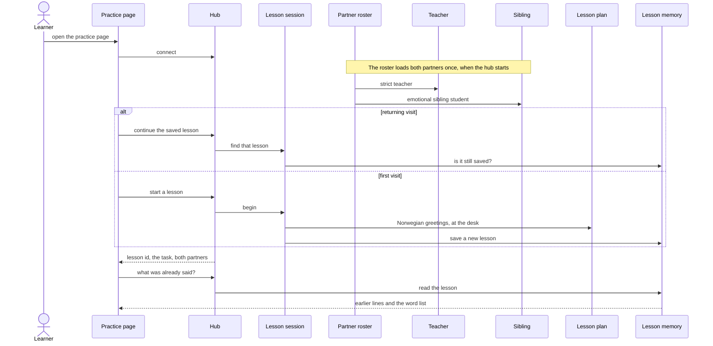
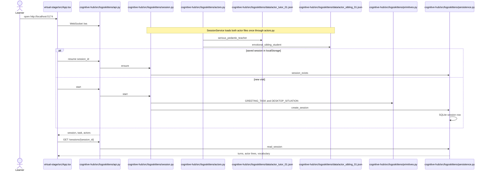
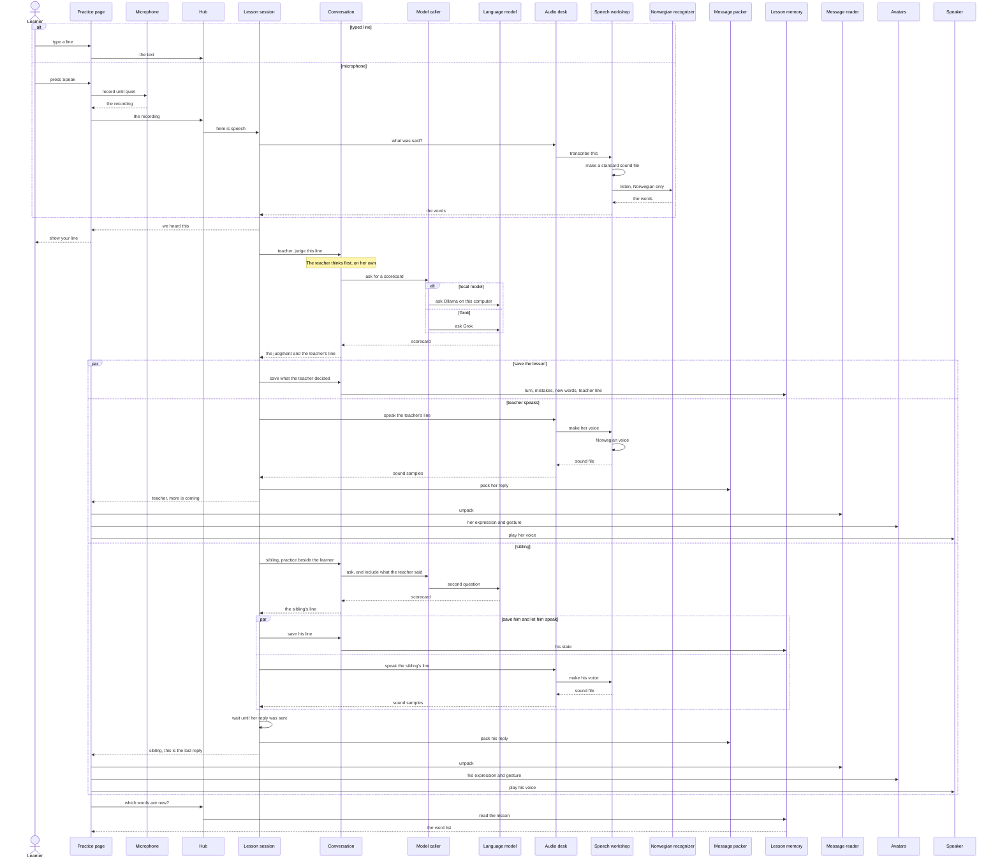
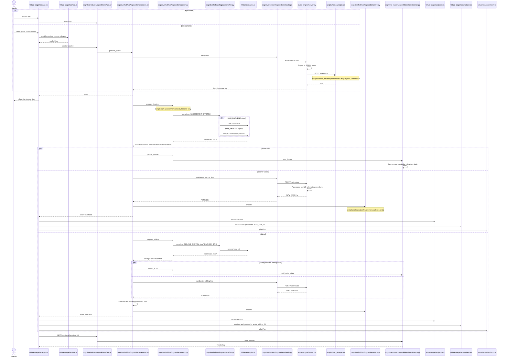

> Retired. `free_conv.md` replaces this document. Do not follow it.

# Current flow

Two views of the same lesson. The first diagram in each section uses ordinary names. The second is the same sequence with the file that does each step.

The command-line tool sends the same messages as the page. It lives in `cognitive-hub/src/logoskittens/cli.py`.

## Open the page

### Who does what

You open the practice page in the browser. It connects to the hub, the program that runs the lesson. The hub already knows the two partners: a strict teacher, and a sibling who is a little further along and shows how he feels.

On a return visit the page asks to continue the saved lesson, and the hub checks that the save is still there. On a first visit the hub starts a greeting lesson and stores it. The page then receives the lesson and both partners, and asks for anything already said, so old lines and the word list come back on screen.

### The same steps, file by file

The practice page is `App.tsx`. It talks to the hub in `api.py`. The lesson itself is `session.py`. Partner descriptions are the two JSON files, loaded by `actors.py`. The greeting task and the desk setting are `primitives.py`. The save is `persistence.py`, which writes one SQLite file. A return visit sends `resume`. A first visit sends `start`, which inserts the session row. The page then reads that row back so the old dialogue can be drawn.

## One turn

A typed line is already words. A spoken line is recorded first and turned into words. After that, both paths are the same lesson turn.

### Who does what

You type a sentence, or you hold Speak and talk. A pause does not send the recording. Releasing the button does. Speech is turned into text by a Norwegian recognizer running on your own computer. The page shows that text as your line.

The teacher goes first. A language model fills in a small scorecard: was the form all right, how formal it sounded, a corrected sentence, the mistakes, words worth keeping, and one coaching sentence. Her spoken line is written from that card. The model is Ollama on this machine, or Grok if you chose that.

Three things then happen together. The lesson is saved: your line, her judgment, the mistakes, the new words, and her reply. Her voice is created and sent to the page, which changes her face, plays the gesture, and plays the sound. At the same time the sibling asks the model for his own scorecard, and he is told what the teacher already said. When his line is ready, it is saved and his voice is created together. His reply reaches the page only after hers has been sent, so you always see and hear the teacher first. Making a voice does not wait for the save to finish.

When both have spoken, the page reads the word list again and shows it.

### The same steps, file by file

`App.tsx` sends either the typed text or a recording made by `vad.ts`. A recording goes to `session.py`, then `audio.py`, then `audio-engine/server.py`. That program cleans the sound and asks `scripts/host_whisper.sh` for Norwegian text. The page shows the line as soon as `heard` comes back.

`session.py` asks `graph.py` for the teacher only. `graph.py` calls `llm.py`, which talks to Ollama or to Grok. The scorecard comes back, and her reply is built from it.

The save, her voice, and the sibling then run side by side. `persistence.py` writes the turn, the mistakes, the new words, and her state. `audio-engine/server.py` speaks with Piper, `wire.py` packs the reply into the shared protobuf message, and the page unpacks it in `proto.ts`, moves her in `avatars.tsx`, and plays the sound in `pcm.ts`. The sibling gets a second model call that includes her line. His save and his voice run side by side too. His packed reply is sent only after hers. `run_turn` in `graph.py` does this in order for tests. The page uses `session.py`, which overlaps the slow parts.
