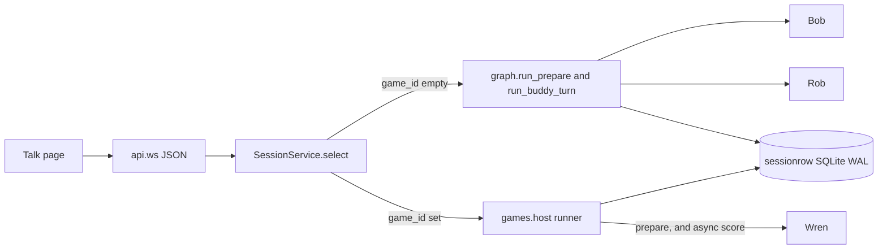
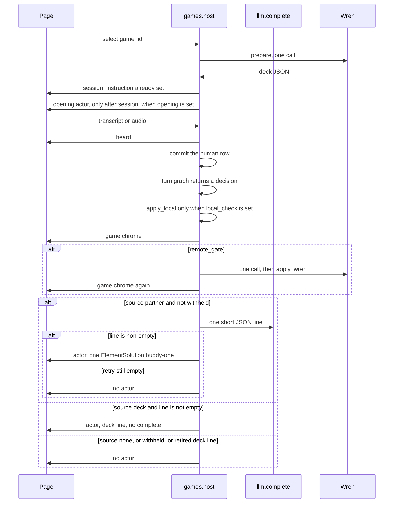
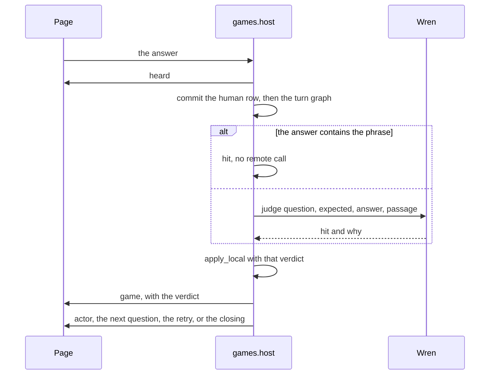
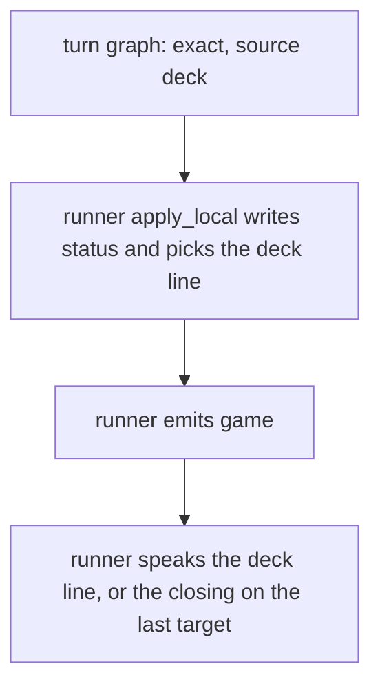
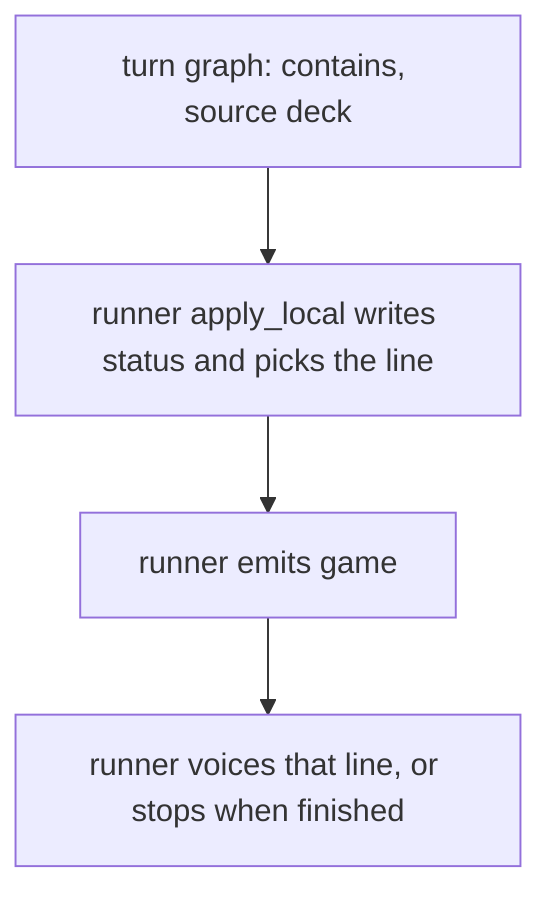

# Talking games

Author: unassigned

Date: 2026-11-11. Revised 2026-11-14: catalogue review, games 11–20, host changes H1–H15, stages E–K, model roles, source and target languages, remote backends.

Status: Draft

This file is the design of record for talking games. It is also the work plan. Free speech stays the live default. Architecture §2, §6, and §8 stay as written.

The pattern for every game is one pair of models. A low-latency local model is the conversational actor, the Partner. A high-reasoning remote model is the state-tracking orchestrator. It manages session state, evaluates vocabulary, and injects a hidden steer into the Partner. The games run from a highly constrained check up to an open talk that still has a deck. Where a line can be written at prepare, it is: a deck line is a string Wren wrote and the host checked, and it needs no partner at all.

# Overview

A talking game is a plugin. The host loads the same raw text the talk already loads, keeps the chosen buddy's voice, and runs that plugin's graph. The twenty games below are the catalogue. The first ten forced the host contract to be wide enough. The review of 2026-11-14 found where it was not, and lists the host changes. A later game of the same kind is a manifest, prompt files, a graph module, a UI module, and a registry line.

EchoChamberGame and InterviewerGame are built. FillInGame is next. Stages E to I schedule the deck games and the first partner game. The rest are specified here and are not scheduled.

Free speech keeps `build_prepare_graph` and `build_turn_graph` in `cognitive-hub/src/logoskittens/graph.py`. A game session does not enter those builders. `GroupSolution.protocol` for a game is `talking_game`. The scene id stored on the session is `talking_game`. `joint_hunting` stays reserved.

# Background and motivation

The live talk is free speech, as `free_conv.md` states it. One human and `buddy-one` take turns. The subject is a lesson card from `run_prepare`. The ongoing prompt forbids a quiz. Bob may store one steer after every third buddy reply. Rob may store one correction for Savelij. Human lines are stored as heard.

People also want to practice phrases from a text they already have. That text is a file under `config/raw_materials/{language}/{id}.txt`, or a LogosCat workspace session stored as `logoscat-{workspaceSessionId}` by `LogosCatClient.import_session`. `MaterialLibrary.load` returns either one. The games differ by the graph that runs on that text.

The orchestrator role in the notes was called the remote Teacher. This repo already uses teacher for Savelij, actor `teacher-one`, steered by Rob. The game orchestrator is a third background role. Its name is Wren.

What hurts if this is bolted onto the free-speech graph:

- `buddy_reply` in `talk.py` answers the human, then adds theme, and refuses to quiz. A drill fights that policy on every turn.
- `LessonSubjectInput.important_words` is a short practice list for free speech. A quest log, a banned list, and a blank do not belong on that card.
- Bob and Rob have their own clocks and their own prompts. A game that called them would mix a correction from Savelij into a drill, and would put a remote call next to the buddy line.
- `talk._norm` keeps only `[a-z0-9']+`. A Norwegian phrase with `æ`, `ø`, or `å` would fail a match written that way.
- The page header in `virtual-stage/src/App.tsx` is the free-speech talk. A game needs its own region. The log, Speak, and Send stay.

Measured cost on this machine, from the project notes: `qwen3:8b` with thinking off is about 1.55 s for 66 tokens, near 42 tokens/s. A Grok call is the slow path. EchoChamberGame's match has to be local and finished before that 1.55 s starts. The on-screen card has to be ready when the game starts, or when the previous target is retired, and not after the user has already spoken.

# Goals and non-goals

## Goals

- One plugin host. EchoChamberGame, InterviewerGame, and FillInGame are plugins on it. A test double named `probe` is the only game in the host stage.
- Every live language, and a language added later the way `en` and `nb` were added. Live packs today are `en` and `nb`.
- The partner line is one `ElementSolution` for `buddy-one`, package `cerm.execution.v1`, compiled by the existing `solution_for`.
- Game chrome is a JSON message. The page paints it in Web mode and in Botnet mode. The hub does not emit CSS.
- A voiced line uses `face.deliver_spoken`. Web mode plays it in the browser. Botnet mode sends the PCM, and at most one mimic token, to that line's body. The page stays quiet for that line.
- Game rows live in the one SQLite file, WAL, via the existing `Store` migration.
- Games 1–3 keep Wren off the turn, with one exception. Wren runs at prepare. InterviewerGame calls Wren once on a turn whose answer the contains-check missed, to judge its meaning before the next question.
- Free-speech tests stay green.

## Non-goals

- Editing architecture §2, §6, or §8.
- Changing `proto/cerm/execution/v1/element_solution.proto` or the hub mirror in `primitives.py`.
- Activating `buddy-two`. Using it as the Partner or as Wren.
- Closing item 9, reordering items 7, 8, or 10–14, or changing `face.py`, `bot-link`, or a body package. A game line uses the face those pieces already provide.
- Putting quiz text into `config/prompts/ongoing_instruction_prompt_*.md`, into Bob's prompts, or into Rob's prompts.
- Putting game prompts on the trainer allow-list in `cognitive-hub/src/logoskittens/sim/schema.py` (`PROMPT_FILES`).
- A second database, a second LLM client, or a new Piper voice.
- Building `joint_hunting`. Accepting material mode `attached`.
- Rewriting the free-speech page. Teacher mode (relaxed, pedantic) is not a game.
- Implementing a partner game (phase 3) before Stage I lands the partner host changes H1, H4, H5, and H7.
- Opening a game before the host changes it needs. A game does not carry a private workaround.

# Proposed design

## Invariants

These match the code that is in the tree now.

- The hub emits semantic and affective directives. Pixels and CSS stay in `virtual-stage`. Servo, Pulse, and ROS stay on the robot. LLM calls stay in `cognitive-hub` and use `httpx` (`llm.complete`, `llm.complete_xai`).
- A voiced partner line is one `ElementSolution`. `actor_id` is `buddy-one`. UI chrome is not an `ElementSolution` and is not a second speaker.
- `require_scene` in `scenes.py` accepts only `free_speech` today. `joint_hunting` raises `SceneNotBuilt` before any model call. The host adds `talking_game` beside `free_speech`. `joint_hunting` stays rejected.
- `require_material_mode("attached")` still raises `LogosCat download is not implemented`. The download path itself is live: `import_session` keeps `text_input` lines, `material_id_for` returns `logoscat-{id}`, and `MaterialLibrary.load` reads that row when the id has that prefix. Games call `MaterialLibrary.load` and pass material mode `detached`. `describe` already reports `material_mode: "detached"`.
- Human speech is stored as heard. In today's `perform_text` the `heard` message goes out before `run_buddy_turn`. The SQLite write starts only after that call returns, and `save_talk` stores the human line and the buddy line together. A game does not use that timing. The game runner emits `heard`, commits the human `SpokenSentence` rows, and only then invokes the turn graph. That commit happens when the exit withholds the partner. A rephrase is a new row. The game may refuse to advance, show chrome, or withhold the partner. It does not rewrite the stored text.
- `SpokenSentence.speaker` is `human`, `buddy`, or `teacher`. Wren is not a speaker. A partner line, including a hint a later game speaks aloud, is `buddy`.
- One SQLite file. `Store.__init__` turns on WAL and calls `_migrate_session`. Game columns are added there. There is no new table.
- WebSocket frames stay JSON. `api.ws` already turns `LLMError`, `AudioError`, and `ValueError` into `{type: "error"}` and keeps the socket. A game error uses that path. Unknown `type` values already get `Unknown message type` and the loop continues.
- `buddy-two` stays inactive. `config/roles.json` stays the two open pairs: buddy/bob and teacher/rob. Wren is not a role and does not attach.
- A game session does not call `_schedule_bob` or `_schedule_rob`. Free speech does not call Wren.
- Bob and Rob skip a missing `{expert}_{language}.md` through `expert_prompt`. They do not load the English file. A missing game prompt is the same rule, with one difference at the socket: the runner raises `ValueError` whose message is the file name. `api.ws` catches `ValueError` and keeps the loop. `FileNotFoundError` does not cross `api.ws`.
- The trainer may replace only `config/prompts/prompt-of-subject-creation_en.md` and `config/prompts/ongoing_instruction_prompt_en.md`. Game files stay off `PROMPT_FILES`.
- Only Start, Reset conversation, and the end-of-round buttons call `beginFresh`, which sends one `select` and starts a session. A click in the Talk panel, including a game click, edits the draft (`free_conv.md`, Starting a session). Reset keeps every setting of the running talk, the game included.
- Item 9 stays open. A game does not change `face.py`, `bot-link`, or a body package. The runner calls `_deliver_voiced`, which calls `deliver_spoken`. That is the same face free speech uses. Embodiment work is not rewritten.

## Names

| Name | Kind | Speaks | Where it lives |
|---|---|---|---|
| Peter, Mary, Lucas, Ingrid | Profiles of `buddy-one` | Yes, as the Partner | `config/buddies/{language}/` |
| Bob | Background expert for free-speech `buddy-one` | No | `config/bob.json` |
| Savelij | Profile of `teacher-one` | Yes, when Rob has a correction | `config/teachers/savelij.json` |
| Rob | Background expert for Savelij | No | `config/rob.json` |
| Wren | Background orchestrator for a talking game | No | `config/wren.json` |

Wren is the remote half of the pair. The notes call that half the Teacher. In this repo the teacher is Savelij. Wren has no actor file, no voice, no card on the stage, and no row in `config/roles.json`.

The Partner is the buddy already chosen for the talk. The game uses that profile's `voice_id` and speaks as I, through the language pack's `language_specifics`. The game system prompt replaces `ongoing_instruction_prompt_{language}.md` for that session. Mood, stance, likes, summary, nature, and alias stay out of the game prompt, so a drill does not inherit Mary's nature line or Peter's steak. The name and the gender still go in, because `solution_for` needs the voice and the person block needs the gender. A game session does not answer a nature question. There is no host intercept for it, and the turn does not call `buddy_reply`. Nature stays a free-speech reply. The profile is not a second graph.

No new Piper id. English stays `en_US-ryan-medium` or `en_US-lessac-medium`. Norsk stays `no_NO-talesyntese-medium`.

## How a session starts

`SessionService.select` is the switch.

- `game_id` empty: today's path. `require_scene("free_speech")`, `MaterialLibrary.load`, `run_prepare`, `topic_id` `free_speech`. Bob and Rob stay on their clocks.
- `game_id` set: `require_scene("talking_game")`. Same material load. The plugin's prepare graph runs. `run_prepare` does not run. `topic_id` is `talking_game`. `game_id`, `deck_json`, and `game_state_json` are stored. Bob and Rob are not scheduled.

`ensure` is what `resume`, `transcript`, and `audio` call. It never creates a session. A missing one is an error. When the stored row has a `game_id`, `ensure` returns that id and does not call `_ensure_subject`. `_ensure_subject` returns immediately when `game_id` is set, so an empty `subject_json` does not enter `run_prepare`. Resume reloads `deck_json` and `game_state_json` through `describe`. `perform_text` branches on `game_id` above the check that raises `This conversation has no lesson subject.`

`Task` for a game session is built in the host, `task_id` `talking_game`, language copied onto it the way `FREE_SPEECH_TASK.model_copy` already copies `language_code`. `DESKTOP_SITUATION` stays the situation. `primitives.py` does not gain a new public task constant that free speech would import.

`GroupSolution` for a game is built in memory by the host: `protocol` `talking_game`, `turn_order` one slot, `actor_id` `buddy-one`, `purpose` `practice`. `TurnSlot.purpose` already allows `practice`. The group is not a new protobuf.

Start with a changed game, language, raw material, or buddy sends `select` and starts a new session, with a new deck. Reset sends `select` with the running talk's settings.

A failed prepare raises before `create_session`. The socket keeps the previous session id. The page clears the log only when a `session` message arrives. An error during start leaves the previous log on screen.

## Plugin contract

A game is a Python object registered at startup, plus one JSON manifest, plus prompt files, plus a React view. The JSON file is the only manifest. The plugin loads it in `load_manifest` and does not repeat `titles`, `max_attempts`, `min_targets`, `max_targets`, `opening`, `listed`, or `capabilities` on the class. `catalog` and `select` call `load_manifest`, so a title edit under the mounted `config/` is visible without an image rebuild. `probe` ships `config/games/probe.json` with `listed: false`. A missing manifest file is an error. Tests do not keep a second copy in Python.

```python
class GameCapabilities(BaseModel):
    instruction: bool = False
    hint: bool = False
    exact_match: bool = False
    contains_match: bool = False
    hidden_steer: bool = False
    deck_line: bool = False
    async_score: bool = False
    remote_gate: bool = False
    withhold: bool = False
    buzzer: bool = False
    mimic: bool = False
    quest: bool = False
    end_score: bool = False
    finish: bool = False
    judge: bool = False


class GameManifest(BaseModel):
    id: str
    phase: int
    listed: bool = True
    titles: dict[str, str]
    min_targets: int = Field(ge=1, le=12)
    max_targets: int = Field(ge=1, le=12)
    max_attempts: int = 0
    reveal_phrase: bool = False
    phrase_grounding: Literal["substring", "unchecked"] = "substring"
    partner: bool = True
    opening: Literal["none", "partner", "stem", "phrase"] = "none"
    deck_text: Literal["stem", "phrase"] = "stem"
    closing: dict[str, str] = {}
    capabilities: GameCapabilities


class TurnExit(BaseModel):
    """A decision. The turn graph does not call a model and does not write status."""

    line: str = ""
    emotion: str = "neutral"
    source: Literal["partner", "deck", "none"] = "none"
    withhold: bool = False
    buzzer: bool = False
    feedback: Literal["", "match", "miss", "hint", "buzzer", "score", "quiet"] = ""
    show_hint: bool = False
    schedule_wren: bool = False
    wren_user: str = ""
    remote_gate: bool = False
    local_check: Literal["", "exact", "contains", "banned"] = ""
    judge: bool = False
    match: Literal["active", "any"] = "active"
    prompt_suffix: str = ""
    mimic: str = ""
    finished: bool = False
    state: dict = Field(default_factory=dict)
```

`partner` false means the game never calls the local partner model. It ships no partner prompt, `listed_games` does not look for one, `opening` cannot be `partner`, and `check_exit` refuses `source: "partner"`. EchoChamberGame sets it false.

`deck_text` is the target field a `source: "deck"` line speaks. `stem` speaks `stem` and, on a retry, `retry_line`. FillInGame. `phrase` speaks the target `phrase` itself, both for the next target and for a retry. EchoChamberGame. With `phrase`, grounding does not require a stem or a retry line.

`closing` maps a language id to one line spoken when a `source: "deck"` turn retires the last target. `{hits}` and `{total}` are replaced with the count of `hit` targets and the deck size. A language with no entry says nothing at the end, which is FillInGame's shipped behavior.

`match` is which phrase `apply_local` compares. `active` checks the active target. `any` checks every target. RoleplayGame sets `any`. FillInGame, EchoChamberGame, and PlayDumbGame stay `active`. `prompt_suffix` is the hidden steer for this call. Empty means the active target's `prompt_to_partner`. The graph still does not write deck status.

`min_targets` and `max_targets` are the grounded deck size for that game. Both sit between 1 and 12, and `min_targets` is not above `max_targets`. `max_attempts` of 0 means the active target stays until a hit. A positive cap marks the target `missed` and advances after that many scored misses. The heard lines stay. `finished` may be true while some targets are still `pending` when the manifest sets `end_score`.

The host refuses a `TurnExit` that sets a flag the manifest left false. Stage A tests each flag with a constructed exit. `probe` itself does not turn them on.

```python
class GamePlugin(Protocol):
    id: str

    def load_manifest(self) -> GameManifest:
        """Read config/games/{id}.json from disk."""

    def state_type(self) -> type[BaseModel]: ...

    def build_prepare_graph(self, wren: WrenFn): ...

    def build_turn_graph(self): ...

    def apply_wren(
        self, deck: GameDeck, state: BaseModel, payload: dict
    ) -> tuple[GameDeck, BaseModel, str]:
        """The str is wren_note. Writes status and attempts for a Wren result."""

    def finish(
        self, deck: GameDeck, state: BaseModel, wren: WrenFn
    ) -> tuple[GameDeck, BaseModel, str]:
        """The str is wren_note. Games 1–3 do not call wren."""
```

`build_prepare_graph` returns a compiled LangGraph, the same shape as `graph.build_prepare_graph`. It may call Wren once. That call is prepare, before the user speaks.

`build_turn_graph` takes no `CompleteFn` and no `WrenFn`. `invoke` returns a `TurnExit`. LangGraph does not yield between nodes, so the graph cannot emit chrome, then speak, then score. The graph does not call `llm.complete` or Wren. It does not write `DeckTarget.status` or `attempts`. `session.py` does not grow a branch per game. It calls `run_game_prepare` or `run_game_turn`.

Directories:

```text
cognitive-hub/src/logoskittens/games/registry.py   register, builtin, load_builtin
cognitive-hub/src/logoskittens/games/host.py       runner, fold, chrome, partner frame
cognitive-hub/src/logoskittens/games/models.py     GameDeck, TurnExit, GameManifest
cognitive-hub/src/logoskittens/games/wren.py       settings and one remote call
cognitive-hub/src/logoskittens/games/probe.py
cognitive-hub/src/logoskittens/games/echo_chamber.py
cognitive-hub/src/logoskittens/games/interviewer.py
cognitive-hub/src/logoskittens/games/fill_blank.py
config/games/{id}.json
config/prompts/games/{id}_partner_{language}.md   only when the manifest sets partner true
config/prompts/games/{id}_wren_{language}.md
config/wren.json
virtual-stage/src/games/registry.ts                gameViews
virtual-stage/src/games/{id}.tsx
```

`register(plugin)` stores the plugin by manifest id. `builtin()` returns the classes that ship. `load_builtin()` calls `register` on each. A new game adds one class to `builtin()` and one view to `gameViews`. Those two lines are the only existing files that game may edit.

`config/games/probe.json` sets `listed` false. The Talk panel does not show it. Tests call it by id. `load_manifest` is what the catalog reads, not a flag stored on the class at import.

## Host capabilities

The host implements every row now. Games 1–3 call the ones marked yes. The catalogue review found rows that are missing or too narrow for games 4–20. Those are host changes H1–H13, in Catalogue review. Each adds its row here when it lands.

| Capability | What the host does | Games 1–3 |
|---|---|---|
| Instruction | `game` message field `instruction`, from the active target | EchoChamberGame yes. InterviewerGame and FillInGame may set it |
| Hint | Field `hint`, shown only when the turn sets `show_hint` | FillInGame yes |
| Exact match | `fold(heard) == fold(phrase)` in the host, before any model on that turn | EchoChamberGame yes |
| Contains-check | Folded phrase is a substring of the folded heard line. `match: "active"` checks the active target. `match: "any"` marks every target whose phrase occurs. RoleplayGame sets `any`. FillInGame, EchoChamberGame, and PlayDumbGame stay `active` | InterviewerGame does not use it to score. FillInGame yes |
| Hidden steer | The runner appends `prompt_suffix` when it is non-empty, and otherwise the active target's `prompt_to_partner`. On a contains miss with `match: "active"`, `apply_local` stores that target's `hint` on the plugin state as `pending_hint` when the hint is non-empty. The next turn's graph copies `pending_hint` into `prompt_suffix`. The graph does not write deck status | InterviewerGame yes. EchoChamberGame no |
| Deck line | `source: "deck"` speaks a string already on the target. `complete` is not called | FillInGame yes |
| Async score | After the actor message is emitted, one Wren call. `apply_wren` writes status. A newer call drops the older result | No. InterviewerGame used it first and now uses Judge |
| Judge | `TurnExit.judge` with `local_check` `exact` or `contains`. When the local check misses the active phrase, the runner calls Wren once with `config/prompts/games/{id}_judge_{language}.md` and the question, the expected phrase, the answer, and the passage. Wren returns `{"hit": bool, "why": str}`. `apply_local` takes that verdict in place of its own check. A failed or unreadable call leaves the local miss. It runs before the `game` message and before the line is chosen | InterviewerGame yes |
| Remote gate | After the first `game` message, one Wren call and `apply_wren`. The runner then withholds or speaks. `complete` runs only if the gate left a partner line | No |
| Withhold | The human row is already committed. No buddy sentence. No `ElementSolution` | No |
| Buzzer | `buzzer: true` on the game message. The page plays a short beep. The hub sends no buzzer PCM and no mimic for it. The beep is there in both modes | No |
| Mimic | `TurnExit.mimic` is one token. `keep_tokens` drops a name that is not in `config/mimic_tokens.json`. The kept token is `SpokenTurn.tokens` on `_deliver_voiced`. The body plays it after the voice. The page does not draw it. Games 1–3 leave the capability off, so a token on their exit is refused | No |
| Quest log | `quest` list on the game message, statuses from the deck | No |
| End score | Tagged `score` on the game message. `finished` may be true while targets are still `pending` | No |
| Finish | Inbound `{type: "game-end"}`. `finish` returns `wren_note` | Accepted by 1–3. They do not call Wren |
| Attempt cap | `max_attempts` on the manifest. `apply_local` and `apply_wren` enforce it. The turn graph does not | EchoChamberGame 2. InterviewerGame 2. FillInGame 2 |
| Reveal on miss (H3) | Manifest `reveal_on_miss`. `each` marks every miss `The line was: {phrase}` with `expected`. `final` marks a miss that leaves the target `active` `Not quite. Try again.` with no phrase, and reveals only when the target turns `missed`: the passage sentence when `show_source` is true, otherwise the phrase with `expected`. `never` reveals nothing. Grounding blanks a hint that holds the whole phrase unless the game is `each` | EchoChamberGame `each`. InterviewerGame `final`. FillInGame `final` |
| Judge note | Manifest `show_why`: `never` (default), `miss`, or `final`. Where the judge's `why` reaches the miss note. `miss` puts it on every judged miss in place of `Not quite. Try again.`. `final` puts it in front of the reveal on the miss that closes the target. The judge user message carries `last_try: yes|no`, so a prompt reveals a model answer only on the last try | InterviewerGame `never`. PlayDumbGame `miss`. AskBackGame `final` |
| Accepted forms (H2) | `DeckTarget.forms`, at most 6, each at most 120 characters, not grounded. `_target_hit` accepts the phrase or a form with the same fold, for `exact`, `contains`, and `match: "any"`. Grounding drops a target whose stem or retry line says a form. The judge user message carries `forms:`. `forms_of` cleans Wren's list | Decks before H2 load with none |
| Banned, then contains (H6) | `local_check: "banned"`. A banned word buzzes, withholds, and leaves `attempts` alone. A clean line runs the active contains check, with forms, and writes status, attempts, and the deck line | TabooGame |
| Local prepare (H9 `local`) | Manifest `prepare` `local`: no Wren prompt in `listed_games` or `run_game_prepare`, no Wren-off reason, no prefetch. The plugin's Wren function raises `WrenSkipped` if it is called | WordOrderGame |
| Manifest variants (H11) | `register(cls, manifest_id)` builds the class for a second id. `EchoPlugin(manifest_id)` reads `config/games/{id}.json` and stamps that id on its deck. `builtin()` may list `(class, id)` | ListenGame |
| Card options (H12) | Manifest `quest_text`, `mask_lines`, `next`, on the `game` message. A quest row shows its phrase once closed. `masked_lines` holds only the open target's deck lines, and the page shows a buddy line in it as `…` | ListenGame, every game for `next` |
| Judge only (H13) | Capability `judge_only`, `local_check: "judge"`. The judge runs every turn with no local short-circuit, and a failed call is a miss. Grounding keeps a stem that holds the phrase | AskBackGame |
| Turn timing | One stderr line per game turn, `game timing id={id} stt= check= judge= partner= tts= first_audio=`, `-` for a slot that did not run, on every path including a refused turn. One `game timing prepare id={id} wren=` line per prepare. The clock is `games/speed.clock` | Every game |
| Deck-line cache | After the opening, one background pass voices every deck string of the session (`deck_strings`: stems and retry lines, or phrases, and the closing for each tally) into a per-session cache keyed by voice, language, and text, at most 64 entries or 20 MB. `_voice_and_store` reads it before Piper. The next `select` drops it. Free speech does not read it | Every deck-line game |
| Round prefetch | When the last target turns active, one background `run_game_prepare` with the same user, game, material text, source, targets, options, and buddy. `select` uses it once when every key matches and it is under 30 minutes old. It is never stored before that. `wren.json` `prefetch`, `WREN_PREFETCH` | Every Wren-prepared game |
| Speech-recognition bias (H17) | Manifest `stt_bias`. `expected`: the passage sentence that holds the active answer. `deck`: words from every stem, retry line, instruction, and other phrase, minus any word found only in the active phrase. `off`: no prompt | Echo `expected`. Interviewer `expected`. FillIn `deck` |
| Catalog metadata (H16) | Manifest `summary`, `requires`, `options`, `next`. `listed_games` returns `summary`, `tags`, `available`, `reason`, `next`, `last`, and `options` for the source, the targets, and Wren's enabled flag and key, with no network call. `last` is the newest closed round per game for this user and material, from one query. `select` refuses a game that requires targets when there are none, and keeps only declared option values | Every game |
| Glosses (H14) | `select` `target_languages`, stored on `sessionrow.target_languages_json`, never the source, at most 4. The Wren prepare message adds `glosses: {codes}`. `DeckTarget.gloss` keeps only those codes, each at most 200 characters. The `game` message's `glosses` lists closed targets only. The judge user message carries `feedback_language`, the first target or the source | Every game |

`probe` uses instruction only. Its turn returns `source: "none"` and an instruction. The runner emits `{type: "game"}` and no actor. `solution_for` is not called.

## Dispatch



Free speech never enters `games.host`. A game never enters `run_buddy_turn`.

One human and one partner. A turn schedules at most one Wren call. Prepare schedules one Wren call. The host does not fan out.

## Prepare and turn

Prepare, inside `select`, before the user speaks:

1. `load_manifest` reads `config/games/{id}.json`.
2. Load `RawMaterial` through `MaterialLibrary.load`. File and `logoscat-*` both work. Mode stays `detached`.
3. Load `config/prompts/games/{id}_wren_{language}.md`, and the partner prompt when `opening` is `partner`. A partner turn loads its prompt at that turn. The loader opens that path and no other. A missing file becomes `ValueError` with the file name. The English file is not opened.
4. Invoke the prepare graph. Games that need a deck call Wren once.
5. Validate `GameDeck` and the plugin state model. Ground phrases. Drop a target that fails grounding. If the grounded count is outside `min_targets`..`max_targets`, retry Wren once with that rejection in the user message. A second count outside the range fails `select`. The short deck is not stored. `create_session` has not run.
6. Mark the first target `active`. Store `deck_json` and `game_state_json`.
7. Build the opening line, if the manifest asks for one. Persist that buddy sentence on the new row.
8. Return from `select`. `api.ws` then runs `_publish`, which sends the `session` message. The active instruction is already on it. The opening sentence is in `sentences`. `select` does not emit the actor frame.
9. After `_publish` returns, the socket handler synthesizes the opening and delivers it with `_deliver_voiced`, role `buddy`. `beginFresh` sets `acceptActors` false until the `session` handler clears it, so an actor frame sent earlier is dropped and the PCM is lost. The face for that opening is the switch state at the end of `select`.

Opening values:

- `none`. `probe`. The card is the instruction. No actor frame at prepare.
- `phrase`. EchoChamberGame. The line is the active target's `phrase`. `llm.complete` is not called. The actor frame follows the `session` message, so the user hears the first line before repeating it.
- `partner`. A later game. One local `complete` with the hidden steer for the active target. Wren has already returned. The actor frame follows the `session` message.
- `stem`. FillInGame and InterviewerGame. The line is `target.stem` from the deck. `llm.complete` is not called. The actor frame follows the `session` message.

Turn. The human row is committed before the graph runs:

0. If no target is `pending` or `active`, the round is over. Emit one `game` message with `finished` true and empty feedback, and stop. The human line is not stored, the graph does not run, and no model is called. The page locks Send and Speak on a finished card, so this guards Botnet mode and a stale tab.
1. Emit `heard`.
2. Commit the human `SpokenSentence` rows. This write finishes before the turn graph, including when the partner will be withheld.
3. Invoke the turn graph. It returns a `TurnExit`. It does not call `complete` or Wren.
4. If `local_check` is set, `apply_local` writes `status` and `attempts`. It reads `match`. `active` checks the active phrase. `any` marks every target whose phrase is in the heard line. On a contains miss with `match: "active"`, it stores the active target's `hint` in `pending_hint` when that hint is non-empty. A hit clears `pending_hint`. `apply_local` is the only writer of `pending_hint`. It may clear `line`, set `withhold`, set `finished`, or choose `retry_line` versus the next stem. The graph does not do that write.
5. Emit `{type: "game"}` from the decision and the updated deck. This is before Piper and before `complete`.
6. If `remote_gate` is set, call Wren once and `apply_wren`. That call writes `status` and `attempts` and returns `wren_note`. The runner then chooses. A target that is not `hit` sets `withhold` and `source` `none`. A target that is `hit` keeps `source` `partner`. Emit a second `game` message with the gate's feedback, still before `complete`. Games 1–3 leave `remote_gate` false.
7. If `withhold` is set, stop. The human row is already in SQLite. No buddy row. No solution.
8. If `source` is `none`, stop before `solution_for`. Do not append a buddy row. `probe`'s turn returns `source: "none"` and an instruction. That emits `{type: "game"}` and no actor. A `source: "partner"` decision still calls `complete` once, including ContextualDisruptionGame's cap turn. The wire `finished` flag is copied onto the `game` message from the deck or from `end_score`. It is not a reason to skip that call.
9. If `source` is `partner`, one `llm.complete`. One retry when the line is empty. Not a second call on top of a graph that already spoke. `finished` does not skip this step. If the retry is still empty, stop before `solution_for`. Do not append a buddy row.
10. If `source` is `deck` and the advance retired the last target, so `finished` is true and `line` is empty, the line becomes the manifest `closing` for the session language, with the tally. EchoChamberGame says it. If there is no closing, stop before `solution_for` and do not append a buddy row. That is the last FillInGame target. Otherwise the line is the deck string. `complete` is not called. `retry_line` is used only while that target stays `active`.
11. Compile with `solution_for` and the profile `voice_id` only when the line is non-empty. Call `_deliver_voiced` with role `buddy`, the kept mimic token, and `steer` `""`. The emit wrapper sets `game: true`. Append `speaker="buddy"`. Web mode leaves the PCM on the page. Botnet mode sends the PCM and the token to the buddy body and leaves the page quiet.
12. If `schedule_wren` is set, start one daemon thread after that emit. A turn that stopped with no actor does not start it. The actor message does not wait. The late result calls `apply_wren` and emits `game`. It does not speak.

`apply_local` and `apply_wren` are the only writers of `status` and `attempts`. A turn graph that returns a mutated deck does not get those fields applied. The runner keeps the stored statuses, then one of those two functions updates them. `max_attempts` lives in those two functions. The graph does not increment `attempts`, so a cap of 2 cannot fire twice.

Free-speech `perform_text` is unchanged: its writer thread still starts after `run_buddy_turn`. The game path does not use that thread for the human row. Wren takes the talk lock only to store the deck status it is allowed to change.



`probe` takes the `source none` branch. The chrome is the instruction. There is no actor frame.

EchoChamberGame takes the deck branch and never reaches `Local`. `apply_local` and the `game` message come first, then Piper on a deck string. The turn graph has no speak node.

InterviewerGame judging:



The score is not a node inside `invoke`. A Wren result whose sentence id is not the latest heard line is dropped. The same rule Bob uses: a newer call replaces the token, and the late thread exits without writing.

## Deck

The deck is not `important_words`. `create_subject` and `LessonSubjectInput` stay the free-speech card. A game session leaves `subject_json` empty. `choose_reading_word` does not run.

`GameDeck` is Pydantic, stored as `deck_json`.

```python
class DeckTarget(BaseModel):
    model_config = ConfigDict(extra="forbid")

    id: str
    phrase: str = Field(min_length=1, max_length=120)
    instruction: str = Field(default="", max_length=300)
    hint: str = Field(default="", max_length=200)
    stem: str = Field(default="", max_length=400)
    retry_line: str = Field(default="", max_length=200)
    prompt_to_partner: str = Field(default="", max_length=400)
    banned: list[str] = Field(default_factory=list, max_length=24)
    status: Literal["pending", "active", "hit", "missed"] = "pending"


class GameDeck(BaseModel):
    model_config = ConfigDict(extra="forbid")

    deck_version: int = 1
    game_id: str
    language: str
    material_id: str
    targets: list[DeckTarget] = Field(min_length=1, max_length=12)
```

Exactly one target is `active` while the game is in play and `finished` is false. A game whose manifest sets `end_score` may set `finished` true while targets are still `pending`. Every other game is finished when no target is `pending` or `active`. The page stays on that game until the human resets or picks another game, language, material, or buddy.

Game-specific state is a second document, `game_state_json`, validated by `plugin.state_type()`. `extra` is forbid. `state_version` is 1. A version mismatch on resume raises, and the page can start a new talk. A new game adds fields to its own model. It does not add a column or a table.

Shared state the runner understands is the deck status plus whatever the plugin stores. Typical plugin state:

```python
class CursorState(BaseModel):
    model_config = ConfigDict(extra="forbid")

    state_version: int = 1
    active_id: str
    attempts: dict[str, int] = Field(default_factory=dict)
    scoring_sentence_id: str = ""
    hint_on: bool = False
    pending_hint: str = ""
```

`pending_hint` is the nudge `apply_local` stored on a contains miss. The next turn's graph may copy it into `prompt_suffix`. The graph does not write this field.

EchoChamberGame, InterviewerGame, and FillInGame can use this model as-is. A later game may use a richer model in its own module. The column is still one JSON string.

### Fold and grounding

`games/host.py` owns `fold`:

- Unicode NFKC
- `casefold`
- drop characters whose Unicode category starts with `P` or `S`
- collapse whitespace

`same_phrase` is equality of the two folds, and the phrase fold must be non-empty. `contains_phrase` pads both folds with spaces. This is the match for every language. Python does not branch on English wording, and it does not call `talk._norm`.

A test phrase `kjølig` matches `Kjølig`. A test phrase with `ø` survives. `Jeg er sliten.` matches `jeg er sliten`.

`phrase_grounding: substring` requires `contains_phrase(raw_text, target.phrase)`. Games 1–3 set that. `unchecked` is on the manifest for a later game whose phrase is a derived line. Banned strings are never grounded against the text. TabooGame's banned list is beginner words, and those words are supposed to be absent. Each banned string is at most 40 characters.

Hints, instructions, stems, and retry lines are not required to be substrings. A FillInGame stem must be non-empty and must not contain the phrase. A FillInGame `retry_line` must be non-empty and must not contain the phrase. The host checks that with `fold` before it stores the deck.

Wren's prepare payload is:

```json
{
  "targets": [
    {
      "id": "t1",
      "phrase": "",
      "instruction": "",
      "hint": "",
      "stem": "",
      "retry_line": "",
      "prompt_to_partner": "",
      "banned": []
    }
  ]
}
```

The host assigns ids when Wren leaves them blank, assigns status, and drops a target that fails grounding. Phrases Wren invented are not kept. A grounded count below `min_targets` or above `max_targets` is not a deck. EchoChamberGame is 4 to 8. InterviewerGame is 4 to 6. FillInGame is 3 to 5. One invented phrase that leaves EchoChamberGame with a single grounded line fails `select` after the one retry. The row is not written.

## Wren

`config/wren.json` follows `config/bob.json` and `config/rob.json`:

```json
{
  "enabled": true,
  "backend": "xai",
  "base_url": "https://api.x.ai/v1",
  "model": "grok-4.7",
  "think": "low",
  "timeout_s": 60
}
```

This is the shipped file. H15 below makes the backend a choice. Empty `WREN_ENABLED`, `WREN_BACKEND`, `WREN_BASE_URL`, `WREN_MODEL`, `WREN_THINK`, and `WREN_TIMEOUT` leave the json value. The key is `WREN_API_KEY`, or `XAI_API_KEY` when that is empty. The key is not in the json file. Wren does not read `LLM_BACKEND`. The call is `llm.complete_xai`: `POST /v1/chat/completions`, `reasoning_effort` from `think`. Shipped think is `low`.

Wren checks the key and the `enabled` flag before it calls `complete_xai`. A missing key raises `WrenSkipped`. Prepare turns that into a `ValueError` the socket already renders as `{type: "error"}`. An async score that is skipped emits game chrome with `feedback: "quiet"` and leaves the deck where it was. The partner line already sent stays.

`docker-compose.yml` passes the `WREN_*` variables through the way it passes `BOB_*` and `ROB_*`, default empty.

When the hub's own `LLM_BACKEND` is `grok`, the partner call is also remote. The split still holds. EchoChamberGame's match is still local and still emitted first. The turn is slower because the partner is slower, which is the hub setting the operator already chose.

`wren_note` is the string `apply_wren` and `finish` return, at most 240 characters, stored on `sessionrow.wren_note`. It is the score's `why` or the finish summary's short note. It is not the hidden steer. It is not a sentence in the log.

### Backends (H15)

Grok is the shipped orchestrator, not a requirement. Wren's call goes through one adapter in `llm.py`, `complete_remote(settings, user, system)`. The adapter speaks three wire protocols. Any provider that speaks one of them can be Wren.

| `backend` | Wire | Providers it covers |
|---|---|---|
| `chat_completions` | `POST {base_url}/chat/completions`, bearer key | xAI, OpenAI, Mistral, DeepSeek, Groq, OpenRouter, Together, Gemini's OpenAI-compatible endpoint, a vLLM or LM Studio server |
| `anthropic` | `POST {base_url}/v1/messages`, `x-api-key`, `anthropic-version` | Claude |
| `ollama` | `POST {base_url}/api/chat`, no key | a local model, including a larger one on another machine |

`config/wren.json` grows `provider` and `purposes`:

```json
{
  "enabled": true,
  "backend": "chat_completions",
  "provider": "xai",
  "base_url": "https://api.x.ai/v1",
  "model": "grok-4.7",
  "think": "low",
  "timeout_s": 60,
  "purposes": {
    "judge": {"think": "off", "timeout_s": 8}
  }
}
```

- `backend: "xai"` in an old file reads as `chat_completions` with `provider` `xai`. Nothing breaks on upgrade.
- `provider` is a label for the trace and the key lookup. The key is `WREN_API_KEY`, then `{PROVIDER}_API_KEY` (`XAI_API_KEY`, `OPENAI_API_KEY`, `ANTHROPIC_API_KEY`, `GEMINI_API_KEY`, …). `ollama` needs none. The key is never in a json file and never in a trace.
- `think` is `off`, `low`, `medium`, or `high`. The adapter maps it to the provider's own reasoning switch, or drops it where there is none. The mapping is a table in the adapter, not in a game.
- `purposes` overrides any field for one purpose: `prepare`, `judge`, `gate`, `score`, or `finish`. The judge sits on a turn, so it may use a faster model or less thinking than prepare. Prepare happens before the user speaks and may use the strongest model. `WREN_{PURPOSE}_MODEL` and the other `WREN_*` variables override the file the same way the plain ones do.
- JSON. The adapter asks for JSON where the protocol has a switch, and the host parses the first JSON object in the reply, as prepare already does with `raw_decode`. `host._object`, which today needs the whole reply to be JSON, uses the same tolerant parse.
- A failed call is `LLMError`. Prepare, judge, and score handle it as they handle a Grok failure today.

The adapter is for Wren first. Bob and Rob call `complete_xai` directly, and so does the trainer's remote role in `sim/training_env.py`. They should move onto the same adapter, later, in Stage J2, after Stage J has proved it on Wren:

- Grok is optional only when nothing requires it. Free speech is the default mode, and Bob and Rob are its only remote models. With Wren alone on the adapter, a desk without an xAI key still loses Bob's steers and Savelij's corrections.
- `bob.json`, `rob.json`, and `wren.json` are the same settings shape, each with its own loader and key fallback. One adapter keeps one vocabulary. The copies already drift: `complete_xai` names `BOB_API_KEY` in its error when Rob or Wren is the caller.
- One path to harden: timeouts, the tolerant JSON parse, the `think` mapping, key redaction, the trace.
- Each expert may then use its own model. Bob steers in the background every third reply and can be cheap. Rob's sentence is spoken by Savelij and pedantic mode judges every human sentence, so Rob needs the best model for the language. `purposes` fits Rob's relaxed and pedantic calls.
- With `ollama`, the whole desk can run with no internet.

Stage J2 moves the transport with `xai` still the default, so behaviour does not change and the Bob and Rob tests pass unedited. Their prompts were tuned on `grok-4.7`. A change of vendor for either is a later, measured step: the same transcripts through both models, compared, before the default moves. Game stages do not edit `bob.py` or `rob.py`.

## Partner

The partner call uses `llm.complete` with the hub's backend, model, and `LLM_THINK`. Local default remains Ollama `qwen3:8b`, `POST /api/chat`, `format: json`, `num_ctx` at most 2048. The game passes `num_predict` 128. Temperature stays the hub default.

System prompt, in this order:

1. `config/prompts/games/{id}_partner_{language}.md`
2. The person block from the language file's `language_specifics`, formatted with that profile's gender. A language file that omits the template keeps the English pronoun block. That is the rule already in `talk._language_specifics`. It is not a fallback for the game prompt file.
3. One line, `name: {profile.name}`.
4. The hidden steer. A non-empty `prompt_suffix` is that text. An empty `prompt_suffix` is the active target's `prompt_to_partner`, when the manifest allows a hidden steer.

The game does not call `buddy_reply`, `ongoing_for`, `steer_block`, or `_as_first_person`. The English verb rewrite stays on the free-speech path.

The partner returns `{"line": "...", "emotion": "neutral"|"curiosity"|"amusement"|"encouragement"}`. Unknown emotions become `neutral`. `solution_for` maps those four onto the existing enum. `physical_gestures` stay empty. `animation_id` stays `nod`, which `solution_for` already sets. A body mimic is not that screen cue. It is the token in the next section.

Expected wait, one local partner line, think off: on the order of 1.5 s, then Piper, the same as a free-speech turn. EchoChamberGame's match is in-process. Budget for `fold` and the chrome emit is under 5 ms, before `complete` is entered. InterviewerGame's Wren score is off that path. A turn that can be decided from the deck does not call Grok.

## Model roles

The question is not local or remote. It is what may stand between the user's last word and the next spoken line. Every step of a game turn sits in one of five slots.

| Slot | When | Who decides | Budget |
|---|---|---|---|
| Prepare | Inside `select`, before the user speaks | The orchestrator, one call | Seconds are fine. The user is reading the card |
| Turn check | Between `heard` and the next line | Code: `fold`, forms, banned words | Under 5 ms |
| Turn line | The next spoken line | A deck string, or the local partner when the line must answer free speech | 0 ms for a deck string, about 1.5 s for the partner |
| Judge | On the turn, only when the code check missed | The orchestrator's judge purpose | 1 to 3 s, on those turns only |
| After the line | After the actor message, or at Finish | The orchestrator: background score, finish rubric | Not on the path of any line |

The rules that follow from it:

- The fastest model is no model. Anything that can be decided before the user speaks is written at prepare by the strongest model and checked by code. Fourteen of the twenty games speak only deck lines.
- Everything checkable is code. Exact match, contains, accepted forms (H2), banned words. A form list written at prepare turns most meaning checks into string checks.
- The local model speaks only when the line must react to what the user just said, which a deck cannot know: RoleplayGame, CollaborativeStoryWeavingGame, DevilsAdvocateGame, ContextualDisruptionGame, and InfoGapGame. One call per turn. Never a second.
- The orchestrator sits on a turn only as the judge, only after a code miss, and only when a wrong verdict would teach the wrong thing. AskBackGame is the one game that judges every turn, because a question cannot be string-matched.
- A slow call that does not change the next line runs after it. Its result applies to the next turn or to the score. It never edits a line already spoken. That is Bob's late-result rule.

Local model use per game:

| Games | Local calls per turn | Remote calls per turn |
|---|---|---|
| 1, 3, 8, 11, 12, 13, 19, 20 | 0 | 0 |
| 2, 4, 6, 17, 18 | 0 | 0, or 1 judge on a code miss |
| 14 | 0 | 1 judge |
| 15 | 0 | 0. One at Finish |
| 5, 7, 10, 16 | 1 partner line | 0 |
| 9 | 1 partner line | 0. One at Finish |

So the strategy holds: local for speed, remote for reasoning that can wait. The review adds three refinements.

- Prefer prepare to async. Async is right for scoring and steering. It is wrong for a judgement the next line depends on, because the line would be chosen before the verdict. InterviewerGame's first version proved that.
- The local model is the riskiest part of the plan, not the cheapest. Its Norwegian, its obedience to a hidden steer, and its JSON have not been measured in a game. Stage I measures them on RoleplayGame before the other partner games open. If they are poor, the partner can be a fast remote model through the hub's `LLM_BACKEND`. The turn gets slower, and nothing else in the plan changes.
- Role, not location. The actor is latency-bound and the orchestrator is quality-bound. Any backend may fill either role (H15). An offline desk can run Wren on a larger local model through `ollama`. Grounding still protects the deck. The judge is weaker there, and the card says nothing different.

## Two faces

Cards stay on the page. A body receives a voice and a mimic, and nothing else. The switch is the one the talk already has. `host_mode` off is Web mode. `host_mode` on is Botnet mode. The face is chosen when the human turn is accepted, by `service.botnet`, the same way free speech chooses it.

| What | Web mode | Botnet mode |
|---|---|---|
| Instruction, phrase, hint, feedback, quest, score, QA steer | Page region | Same page region |
| TabooGame beep | Page | Page. No PCM and no token go to a body |
| Partner line | Browser plays the PCM | Buddy body plays the PCM. The page frame has empty PCM and `play_on_page` false |
| One mimic token | Not drawn. The page has no pose for it | Buddy body plays it after the voice |
| Teacher line | Browser, if a line existed | Teacher body, if a line existed |
| Hold Speak | Browser microphone | Ready buddy records. The teacher body does not open a microphone |

Every voiced game line, including an opening, goes through `_deliver_voiced` and then `deliver_spoken`. The runner does not build a second actor frame and does not call `deliver_pcm` itself. `face.py` stays as it is. The runner's emit wrapper sets `game: true` on that actor message. Playback does not read `game`. `showSolution` keeps the check that is there today: `playOnPage && pcm.length > 0 && !hostModeRef.current`. A frame with `game: true` does not play in Botnet mode.

The role comes from the actor. `buddy-one` is role `buddy`. `teacher-one` is role `teacher`. Every game except OverhearGame compiles only `buddy-one`, so only the buddy body speaks. OverhearGame adds scripted `teacher-one` lines through H8. Wren has no body. A game session does not run Rob, so Savelij does not speak a correction during a game and the teacher body stays quiet. A line whose actor is `teacher-one` uses the same function with role `teacher`. It does not need a new sender. OverhearGame is that line. Rob still does not run. `config/roles.json` stays the two open pairs.

`TurnExit.mimic` is one name. `keep_tokens` keeps it when it is listed in `config/mimic_tokens.json` (`agreement`, `disagreement`, `frustration`, `curiosity`) and drops anything else. The turn still speaks. The kept name is `SpokenTurn.tokens`. The body maps the token to its own action after the voice, which is what a free-speech pose already does. Games 1–3 leave `capabilities.mimic` false and send no token. ReactGame is the first game that sets the capability. Its token rides on the target (H8). It does not edit `face.py`.

The player queue is the one `bot-link` already runs. A game line waits until the body sends `played`. The page log still shows the words. The card above the log does not move onto the body.

Hold Speak is unchanged. In Botnet mode `forward_speak` asks the ready buddy to record. That recording returns as audio, `perform_audio` transcribes it, and `perform_text` enters the game runner because the session has a `game_id`. Typed Send stays on the page in both modes.

## Language

Prompt loader for games:

```text
config/prompts/games/{game_id}_{role}_{language_id}.md
```

`role` is `partner` or `wren`. The loader reads that path and no other. A missing file raises `ValueError` with that file name. It does not call `prompt_text` for the English name. `FileNotFoundError` stops at the loader.

Norwegian files are original Bokmål. A test asserts the `nb` file's text differs from the `en` file for each prompt a stage adds.

`content.language_gaps` is not extended. A new talk language is not blocked by missing game prompts. The Talk panel lists a game when `listed` is true and both prompt files exist for the current language. A language added later shows a game after those two files exist and the catalog is reloaded. The existing language click already reloads config and switches the recognizer in `_publish`.

### Source and target languages (H14)

LogosCat keeps two sets per user, on the server: `inputLanguagesSet` and `outputLanguagesSet`, each 1 to 10 lowercase codes with no duplicates, defaults `en`, `no`, `de`. `GET /api/language-settings` returns them under `settings`. `POST` replaces them. The browser keeps the current choice: one source in `lang_sourceLanguage`, and the checked targets in `lang_targetLanguages`, at most 4, never the source. LogosCat's own game bootstrap already sends the output set, minus the source, as `hintTranslationLanguages`.

This hub takes the same model and the same words. The source is the language of the text and of the talk: `language_id` today. A target is a language the learner translates into, which is their own language or one they already know. These are LogosCat's meanings, not the textbook ones.

- Sets. Logged in, the hub reads the two sets through its LogosCat proxy, as it reads workspace sessions. The page never calls LogosCat. Logged out, the sets are the local defaults `en`, `nb` for source and `en`, `nb`, `de` for targets. The sets are edited in LogosCat. A later review may add an edit through the hub's `POST` proxy, with LogosCat's validation.
- Choice. The page keeps the source in `logoskittens.source` and the targets in `logoskittens.targets` in `localStorage`, the way LogosCat uses IndexedDB. The first visit takes the first entry of each set. A target equal to the source is unchecked and disabled. At most 4 targets.
- Codes. LogosCat writes Norwegian as `no`. The hub writes `nb`. `live_language` already maps `no`, `nb`, and `nob` to `nb`. Targets go through the same map. Other codes pass unchanged.
- Live source. A source must have a language pack: a recognizer, a Piper voice, the prompts. Today that is `en` and `nb`. The Talk panel lists every source in the set and disables the ones with no pack, with the reason. A target needs no pack.
- The session. `select` gains `target_languages`, an ordered list, and `game_options`, a small object a game's manifest declares (CueCardGame's `cue_mode`). `sessionrow` gains `target_languages_json`, `TEXT NOT NULL DEFAULT '[]'`, through `_migrate_session`. The `session` message echoes it. Reset keeps it. Start with changed targets starts a new talk and a new deck, as a changed source does.

What a game does with targets:

- Spoken and heard lines are in the source only. Speech recognition stays on the source recognizer for the whole round. The whisper supervisor's switch stops one weight and loads another, which is far too slow inside a turn. A target is written on the card, never spoken or heard.
- Wren gets the target list in the prepare user message. It writes `DeckTarget.gloss`, a map from target code to a short translation of the phrase, at most 4 entries and 200 characters each. Glosses are not grounded and not folded.
- Prompt files stay per source language. A target does not add a prompt file. `{id}_wren_{source}.md` says how to write the glosses for whatever list arrives.
- The card shows the gloss in the first target after the target closes, hit or missed. A learner who checks more targets sees each. Gloss text renders with `dir="auto"`, so Hebrew or Arabic reads right to left.
- Feedback written for the learner (the judge's `why`, a finish summary, a hint the game marks as `support`) is in the first target when there is one, and in the source otherwise. The judge prompt receives the language code.
- CueCardGame gains a cue mode. `meaning` is the shipped mode: a plain paraphrase in the source. `translation` shows the gloss in the first target as the cue (`Si det på norsk: very tired`). That is the translation game. It needs no new game, no new prompt file, and no recognizer switch. LightningGame and ReviewGame inherit the mode.
- A session with no target behaves as today. Every gloss is empty and nothing on the card changes.

Display titles live in `config/games/{id}.json` under `titles`. A game name is one token and ends in Game. A missing title shows the id. That is not a prompt fallback. Shipped titles:

| id | en | nb |
|---|---|---|
| echo_chamber | EchoChamberGame | EkkoGame |
| interviewer | InterviewerGame | IntervjuetGame |
| fill_blank | FillInGame | UtfyllingGame |
| play_dumb | PlayDumbGame | RettMegGame |
| roleplay | RoleplayGame | RollespillGame |
| paraphrase | ParaphraseChallengerGame | OmskrivGame |
| story_weave | CollaborativeStoryWeavingGame | FortellingGame |
| taboo | TabooGame | TabuGame |
| devils_advocate | DevilsAdvocateGame | DjevelensAdvokatGame |
| disruption | ContextualDisruptionGame | AvsporingGame |
| cue_card | CueCardGame | StikkordGame |
| word_order | WordOrderGame | OrdstillingGame |
| listen | ListenGame | LyttGame |
| ask_back | AskBackGame | SpørTilbakeGame |
| retell | RetellGame | GjenfortellGame |
| info_gap | InfoGapGame | InfohullGame |
| overhear | OverhearGame | OverhørtGame |
| react | ReactGame | ReagerGame |
| review | ReviewGame | RepetisjonGame |
| lightning | LightningGame | LynGame |

Rows below `fill_blank` ship with their game's stage.

## Page

`App.tsx` stays the free-speech shell. The game work adds a list and a slot.

Talk panel, under Raw material: a Game list. The first row is Free speech, `game_id` empty. Then each listed game whose prompts exist, in phase order, then id order. A click calls `beginFresh` with that `game_id`. The `select` body gains `game_id`. Today's body is `type`, `user_id`, `language_id`, `material_id`, `personality_id`, `teacher_mode`.

The eyebrow in the header stays `Free speech` when `game_id` is empty. A game session shows the title from the manifest.

A region in `main`, above the transcript, `aria-label="Game"`, full width of the column. At a narrow viewport the Talk panel is already the full-screen aside. The new list scrolls with it. The region stacks above the log. The host renders instruction, hint, feedback, quest, and score as text when `gameViews` has no view for the id. A game view replaces the interior of that region. It reads the same fields. It does not receive CSS from the hub.

While `game_id` is set, the teacher card and the Teacher mode buttons are hidden. Savelij's profile is unchanged. Rob does not run, so the card would imply the wrong person. Returning to Free speech shows the card again. The QA switch stays. `App.tsx` tracks a choice with `qaChosen`. It starts true only when `rememberedQa()` read `logoskittens.qa` as `on` or `off`. `toggleQa` sets `qaChosen` true and sends `{type: "qa", on}`.

`socket.onopen` sends nothing. QA is a field on `select`, stored for that session, and echoed as `qa` on the `session` message. A `select` without it uses `config/bob.json` `qa`.

In a game, the `game` message carries `steer`. The hub sets it to the text that was appended to the partner prompt for that turn when QA is on. When QA is off, `steer` is `""`. The actor frame's `steer` stays `""`. The hub does not paste that string into the spoken line. `wren_note` stays the score note. Bob is not running, so the Bob block stays empty. InterviewerGame's `prompt_to_partner` does not contain the target `phrase`, and the hub does not copy `phrase` into `steer`. A test checks that InterviewerGame `steer` lacks the active phrase.

Speak and Send stay. Hold-to-talk is unchanged. Typed text is still `{type: "transcript"}`. Both enter the game runner when the session has a `game_id`. Empty audio still emits `heard` with `No speech detected.` and does not run the graph.

The Botnet switch stays on the page. It chooses the face for a game line the same way it chooses the face for free speech. The card stays in the page region either way. Item 9 is not closed by that, and `face.py` is not edited.

### Talk panel and game card (Stage U)

Twenty games and two language lists do not fit the panel as it is: one flat column of Mode, QA, Language, Teacher, Buddy, Raw material, and a flat Game list. Stage U keeps every control and changes the order and the grouping. Tailwind classes and the existing colours stay.

Panel order, top to bottom. Each section is collapsible. A closed section shows its choice on one line. At a narrow viewport every section but the one being edited starts closed.

1. Mode. Web or Botnet, as today, with the player list in Botnet mode.
2. Languages. Source: one choice from the input set. A source with no language pack is listed, disabled, with `No speech pack yet`. Targets: up to 4 checkboxes from the output set, with a `2 of 4` count, the source's own entry disabled. A line under the section says where the lists came from: `From LogosCat`, or `Local defaults` when logged out. The closed line reads like `Norsk → English, עברית`.
3. Raw material. As today.
4. Activity. Free speech first. Then the games, grouped under `Phase 1 · Guided`, `Phase 2 · Apply`, and `Phase 3 · Free`. A game row shows its title, its one-line `summary` in the source language, small tags, and the last result on this material (`4 of 6`). Tags come from `requires`: `Translate` when it uses targets, `Two voices`, `Partner`, `Judge`. A game that cannot start is listed, disabled, with its reason (`Choose a target language`, `Wren is off`). The suggested next game, from the last round's manifest `next`, carries a `Next` tag.
5. Options. Shown only when the chosen game declares options, for example CueCardGame's Meaning or Translation. Sent as `game_options`.
6. People. Buddy as today. Teacher and Teacher mode only for free speech, and the Teacher card, read-only, for OverhearGame.
7. QA, then Start.

Main region:

- The header eyebrow shows the game title, or Free speech, and the language pair: `EkkoGame · nb → en`.
- `GameCard` is one shared component above the log. It renders, top to bottom: a progress bar of closed targets out of the deck, the match and miss tally, the game's prompt slot, the gloss row, the feedback badge with its text, the hint, the quest list, the score, and on a finished round the actions New round, Next: {title}, and Back to free talk. A game view supplies only the prompt slot: the phrase for Echo, the passage for Interviewer, the shuffled words for WordOrder. `GameView` becomes that slot.
- Glosses render with `dir="auto"`, each labelled with its language's display name.
- Read the text. The Raw material section has a `Read the text` button for the chosen material, before Start, for every game. It opens a window that fetches `GET /materials/{id}?language_id=` from the hub; the catalog list still carries no sentences. Manifest `read_text` decides the card's button. `play` shows it for the whole round, for games whose answers are the text's own words: Echo, Interviewer, FillIn, CueCard, Taboo, Paraphrase, PlayDumb, AskBack, React, Roleplay. A card that already shows the passage (`show_source`) does not repeat the button. `between`, the default, shows it only on Round over, for games where hearing or rebuilding the text is the exercise: Listen, Overhear, WordOrder. ReviewGame plays chunks from several texts and shows each chunk's origin, so its card has no button.
- While a round is prepared (from `select` until the `session` message or an error) and while a LogosCat session is imported, the main region shows a progress bar and one rotating line in the form `…kittens are unrolling the text like a ball of yarn…`. The hub sends no progress, so the bar is a guess that slows near the end. The old game card is hidden until the new round arrives.
- Feedback, buzzer, and hint changes are announced in an `aria-live="polite"` region. The beep is never the only signal.
- Send and Speak stay where they are. After a turn the text box gets focus again.

The page's own labels stay English in this stage. Labels in the learner's first target are later work, with a strings table per language.

## Catalogue review, 2026-11-14

Games 1–10 came from an outside proposal: a local partner as the actor, a remote orchestrator as the state tracker, ten graphs from constrained to free. This pass checked each one against `games/host.py`, `games/models.py`, the two live plugins, their tests, and the shipped raw texts. Games 1–3 keep their design. Games 4–10 change. Games 11–20 are new. Thirteen host changes, H1–H13, are listed below. Each one is its own review, before the first game that needs it.

### What the code says

- The raw texts are short. The six files under `config/raw_materials/` are 88 to 116 words each, and they hold few idioms. The proposal assumed an idiom-rich text. A target here is a chunk: a short span the text really uses (`lange tunneler`, `den kalde luften`, `worn out`). Every Wren prompt asks for chunks, not idioms. Every manifest keeps `min_targets` at 3 or below, so a short passage still starts. A LogosCat row may be longer. The range is the same.
- The deck line is the proven path. EchoChamberGame and InterviewerGame both run with `partner` false. Every line is a string Wren wrote at prepare and the host checked. The local partner has never run in a live game. Echo's first version showed what it does with a loose steer: it echoed the human forever. A game that can be a deck-line game is one. Fourteen of the twenty are.
- The partner has no memory. `_resolve_line` sends only the latest heard line as the user message. Free speech gets the recent log from `buddy_user`. The game path does not. A roleplay, a story, a debate, or an open talk cannot work without it. H1.
- The contains-check is a surface check. `contains_phrase` pads with spaces, so `tunnel` does not match `tunnelen`, and `burn the midnight oil` does not match `burned the midnight oil`. Norwegian inflects nouns for definiteness and adjectives for gender and number. Every game where the user builds a sentence of their own would miss right answers. The judge fixes that only for the active target and only at the price of a Grok call. `match: "any"` has no judge. H2 adds accepted forms, so most right answers stay local.
- `_verdict_note` reveals the phrase on every miss when `show_source` is false. That is right for Echo, whose phrase is on the card. It is wrong for FillInGame: the first miss would print the answer the hint is meant to lead to. Stage D needs H3 before it lands.
- `local_check: "banned"` returns right after the banned test. It never checks the phrase. A clean TabooGame answer can never be a hit. H6.
- A finished round is computed from the deck alone (`_deck_finished`). A game with `end_score` that finishes while targets are `pending` is open again on the next turn, on resume, and in `session_chrome`. Step 0 lets that turn through. The turn graph also has no turn count: `TurnExit.state` is never applied by the runner, so a plugin cannot keep `turn_cap` or `pivot_after`. H4.
- `finish` receives the deck, the state, and Wren. It does not receive the transcript and cannot return a score. `finish_game` emits `score: null`. DevilsAdvocateGame's rubric has nothing to read and nowhere to go. H5.
- The passage reaches the partner only when `show_source` is true. An information gap, where the robot knows the text and the user does not, cannot be expressed. H7.
- `remote_gate` and `async_score` are built and tested, and no game uses them after the Interviewer redesign. The judge replaced both: it runs only on a local miss, before the line is chosen, and a failed call falls back to the local verdict. ParaphraseChallengerGame, the only planned gate user, moves to the judge. Both capabilities stay in the host. No planned game uses them. A later host cleanup may remove them.
- `mimic` and a teacher voice have no user. The project exists to build situations with attached robots. ReactGame and OverhearGame use them. H8.
- The log shows every buddy line as text. A listening game would print its own answer. H12 lets a manifest mask the partner's lines until the target closes.
- `word_diff.tsx` compares word sets. A word-order mistake has every word present, so the diff shows nothing. WordOrderGame's view needs an order-aware diff (longest common subsequence). That is in the game's own view.

### Verdicts on the proposal

| # | Game | Verdict | Why |
|---|---|---|---|
| 1 | EchoChamberGame | Keep, built | The proposal's partner mirrored the user. That loop is the bug Stage B removed. Its instruction, "say that you are exhausted using the idiom", is cued recall, not an echo. That is CueCardGame (11) |
| 2 | InterviewerGame | Keep, built | Leading either-or questions became reading-interview questions written at prepare, with a judge on a miss |
| 3 | FillInGame | Keep, fix the reveal | The proposal's "starts with cold…" hint is the deck `hint`. Needs H3 |
| 4 | PlayDumbGame | Redesign | The partner had to misread unpredictable input on a hidden steer, and the user had no cue for which idiom to reach for. Now she misstates a fact from the text as a deck line, and the user corrects her |
| 5 | RoleplayGame | Keep, host first | Needs memory, forms, a closed round, and a finish score. The first partner game |
| 6 | ParaphraseChallengerGame | Redesign | The remote gate put Grok on every turn. Now a deck stem, a contains-check with forms, and the judge on a miss. No partner |
| 7 | CollaborativeStoryWeavingGame | Keep, host first | The pool is shown, because nobody can weave a word they cannot see. The nudge is computed in the graph, not from `pending_hint`, which only works with `match: "active"` |
| 8 | TabooGame | Redesign, phase 2 | Questions become deck lines. Banned, then contains. It is cheap, so it moves to phase 2 |
| 9 | DevilsAdvocateGame | Keep, host first | Density is counted by the host from the deck. Wren writes fluency and the summary once, at Finish |
| 10 | ContextualDisruptionGame | Keep, host first | The turn count comes from the host. The pivot is unchanged |

### Host changes

| Id | Change | Needed by |
|---|---|---|
| H1 | Partner history. The partner user message is the last 8 log lines as `- human: …` and `- buddy: …`, then the latest heard line. The same block shape as `buddy_user`. | 5, 7, 9, 10, 16 |
| H2 | Accepted forms. `DeckTarget.forms: list[str]`, at most 6, each 1 to 120 characters. Wren writes the inflected or tense forms a learner may say. Forms are not grounded. `_phrase_hit` accepts the phrase or any form, with the same `fold`. Grounding refuses a stem or retry line that contains a form. Old decks validate with an empty list. | 4–8, 9, 10, 11, 15–20 |
| H3 | Reveal policy. Manifest `reveal_on_miss`: `each`, `final`, or `never`. Default `final`. `each` marks every miss `The line was: {phrase}` with `expected` (Echo today). `final` reveals only when the target turns `missed`: the passage sentence when `show_source` is true (Interviewer today), otherwise the phrase. `never` reveals nothing. It replaces the `show_source` branch in `_verdict_note`. | 3, and every later deck game |
| H4 | Closed round and turn count. `GameDeck.closed: bool = False`. The runner sets it when a turn or `finish` returns `finished`. Step 0, `session_chrome`, and `finish_game` read `closed` or `_deck_finished`. The turn graph input gains `turn`, the number of human responses including this one, counted by the host from the stored log. | 5, 7, 9, 10, 15, 16 |
| H5 | Finish with a transcript and a score. `finish(deck, state, wren, transcript)` returns `(deck, state, note, score)`. `transcript` is the stored lines as `(speaker, text)`. `finish_game` emits that score and sets `closed`. Games 1–3 ignore the transcript and return no score. | 5, 9, 10, 15, 16 |
| H6 | Banned, then contains. With `local_check: "banned"`, a banned word buzzes and withholds as now and does not count an attempt. Otherwise the active-target contains logic runs, with forms, and writes status, attempts, and the deck line. | 8 |
| H7 | Partner passage. Manifest `partner_passage: bool`. When true, the partner system prompt carries the passage whatever the card shows. `show_source` becomes the card switch only. | 5, 7, 9, 10, 16 |
| H8 | Richer deck lines. `DeckTarget.lead`, at most 4 items `{speaker, line}`, voiced in order before the stem. `speaker` is `buddy` or `teacher`. A `teacher` line compiles `teacher-one` with Savelij's voice and goes through `_deliver_voiced` with role `teacher`. `DeckTarget.emotion` and `DeckTarget.mimic` ride on that target's stem. The mimic still passes `keep_tokens`. Rob does not run. `buddy-two` stays inactive. `config/roles.json` is unchanged. | 17, 18 |
| H9 | Prepare source. Manifest `prepare`: `wren` (default), `local`, or `history`. `local` builds the deck in the plugin with no remote call, and `listed_games` and `run_game_prepare` stop asking for a Wren prompt. `history` gives the prepare graph this user's earlier targets in this language, missed ones first, then hits older than 3 days, each with its source passage. Grounding then runs against those passages. | 12, 19 |
| H10 | Timeout. Manifest `time_limit_s`, 0 for off. The page counts down from the end of the actor's playback and stops when Speak is held or Send is pressed. Inbound `{type: "game-timeout", target_id}` is one scored miss on the active target with no heard row. A stale `target_id` is ignored. | 20 |
| H11 | Manifest variants. `register` may take one plugin class under a second manifest id. The plugin reads `config/games/{id}.json` for the id it was registered with, and stamps that id on the deck. | 13 |
| H12 | Card options, on the manifest and copied to the `game` message. `quest_text`: `phrase` or `instruction`, the text a quest row shows before it is hit. `mask_lines`: the page shows the game's buddy lines as `…` until that target closes. `next`: a game id the Round over card offers beside New round. | 12, 13, 15, 16, every game for `next` |
| H13 | Judge only. `local_check: "judge"`. The runner calls the judge on every turn, with no local short-circuit, and `apply_local` takes the verdict. Grounding then allows a stem that contains the phrase. Use it only when the phrase is a meaning check, not a span to say. | 14 |
| H14 | Source and target languages. The two LogosCat sets through the hub proxy, the page's choice in `localStorage`, `target_languages` on `select` and on `sessionrow`, `DeckTarget.gloss`, and feedback in the first target. See Language. | glosses in every game, CueCardGame's `translation` mode, 19, 20 |
| H15 | Remote backends. `llm.complete_remote` with `chat_completions`, `anthropic`, and `ollama`. `wren.json` gains `provider` and `purposes`. A tolerant JSON parse in `host._object`. See Wren. | every game that calls Wren. No game behaviour changes |
| H16 | Catalog metadata. Manifest `summary` per language, `requires` (`wren`, `targets`, `teacher_voice`, `partner`), and `options` (name, values, default, per-language labels). `listed_games` returns `summary`, `tags`, `available`, `reason`, `next`, and `last` for the session's source, targets, and Wren state. Wren state is the enabled flag and the key, with no network call. | the game picker, every game |
| H17 | Speech-recognition bias policy. Manifest `stt_bias`: `expected`, `deck`, or `off`. `_stt_prompt` reads it. Today every game biases whisper toward the sentence that holds the active answer, which can make an exact-match game hear the right answer it is checking. | 1, 12, 13 first. Every game declares one |

The capability table in Host capabilities stays the shipped host. A host change adds its rows when it lands. A game that needs a change waits for it. It does not carry a private workaround.

### Progression

The Talk panel sorts by phase, then id. `next` (H12) is the suggested path. It is a suggestion. Every listed game stays one click away.

| Step | Game | What it trains |
|---|---|---|
| 1 | ListenGame (13) | Hear a line and hold it |
| 2 | EchoChamberGame (1) | Say a line you can see |
| 3 | WordOrderGame (12) | Build a sentence from its words. Norwegian verb-second order |
| 4 | CueCardGame (11) | Recall a chunk from its meaning |
| 5 | FillInGame (3) | Recall a chunk from its context |
| 6 | InterviewerGame (2) | Find a fact and say it |
| 7 | TabooGame (8), ParaphraseChallengerGame (6), PlayDumbGame (4) | Choose the text's chunk over a plain word |
| 8 | AskBackGame (14), ReactGame (18), OverhearGame (17) | Build a question, react in a situation, listen to two robots |
| 9 | ReviewGame (19) | Bring back what was missed in earlier rounds |
| 10 | LightningGame (20), RoleplayGame (5), InfoGapGame (16) | Recall under time and in an open scene |
| 11 | CollaborativeStoryWeavingGame (7), RetellGame (15), DevilsAdvocateGame (9), ContextualDisruptionGame (10) | Use the chunks with no scaffold |

### Catalogue

| # | id | Phase | Partner | Turn check | Wren on a turn | Host needs | Stage |
|---|---|---|---|---|---|---|---|
| 1 | `echo_chamber` | 1 | no | exact | no | — | built |
| 2 | `interviewer` | 1 | no | contains, judge | on a miss | — | built |
| 3 | `fill_blank` | 1 | no | contains | no | H3 | built |
| 4 | `play_dumb` | 2 | no | contains, judge | on a miss | H2, H3 | built |
| 5 | `roleplay` | 3 | yes | contains, any | no | H1, H2, H4, H5, H7 | built |
| 6 | `paraphrase` | 2 | no | contains, judge | on a miss | H2, H3 | built |
| 7 | `story_weave` | 3 | yes | contains, any | no | H1, H2, H4, H7 | later |
| 8 | `taboo` | 2 | no | banned, then contains | no | H2, H3, H6 | built |
| 9 | `devils_advocate` | 3 | yes | contains, any | no. One at Finish | H1, H2, H4, H5, H7 | later |
| 10 | `disruption` | 3 | yes | contains, any, from the pivot | no | H1, H2, H4, H5, H7 | later |
| 11 | `cue_card` | 1 | no | contains | no | H2, H3. H14 for `translation` mode | built |
| 12 | `word_order` | 1 | no | exact | no. No Wren at all | H3, H9, H12 | built |
| 13 | `listen` | 1 | no | exact | no | H3, H11, H12 | built |
| 14 | `ask_back` | 2 | no | judge only | every turn | H3, H13 | built |
| 15 | `retell` | 3 | no | contains, any | no. One at Finish | H2, H4, H5 | later |
| 16 | `info_gap` | 3 | yes | contains, any | no | H1, H2, H4, H5, H7, H12 | later |
| 17 | `overhear` | 2 | no. Two deck voices | contains, judge | on a miss | H2, H3, H8 | built |
| 18 | `react` | 2 | no | contains, judge | on a miss | H2, H3, H8 | built |
| 19 | `review` | 2 | no | contains | no | H2, H3, H9 | built |
| 20 | `lightning` | 3 | no | contains | no | H2, H10 | later |

## The twenty games

Each game's turn graph is a decision. The diagrams label runner steps as runner. Speak, score, emit, and `apply_local` are runner steps. They are not nodes inside `invoke`.

Win for a game that does not set `end_score`: no target is `pending` or `active`, and `finished` is true. Win for a game that sets `end_score`: the `game` message has `finished` true and a `score`, even if some targets are still `pending`. The page stays there. No automatic return to free speech.

### 1. EchoChamberGame

id `echo_chamber`. Phase 1.

State: `CursorState`. `max_attempts` is 2. `reveal_phrase` is true, so the card shows the phrase. The raw sentences stay on the hub (`menu_item` does not send them), so a hidden phrase would be a match the user cannot see. `partner` is false. `opening` is `phrase`. `deck_text` is `phrase`. Capabilities: `instruction`, `exact_match`, `deck_line`.

Deck: `min_targets` 4, `max_targets` 8. `phrase` is a span from the raw text. `instruction` tells the user to say that line. `hint`, `stem`, `retry_line`, `banned`, and `prompt_to_partner` stay empty.

The turn graph returns `local_check: "exact"` and `source: "deck"`. It does not match and it does not speak.



Calls: Wren once at prepare. No model on any turn. There is no partner prompt. Every line she says is a deck string: the first phrase at the opening, then the next phrase, the same phrase again, or the closing. No Wren on the turn. No remote gate. `match` stays `active`.

Wren returns the target list. The turn does not ask Wren again. A grounded count outside 4 to 8 does not start the session.

Opening: she says the first phrase after the `session` message. The user hears the line, then repeats it.

UI: instruction region and the phrase. Feedback `match` or `miss`. No quest, no score, no buzzer. Every miss, including the second try and a later phrase, marks that human line wrong and keeps the phrase as `expected` on the stored sentence and on `miss_note`. The page shows `Wrong. The line was: {phrase}` with the phrase words that were not heard underlined, and the heard words that were not in the phrase struck through. The diff folds words the same way as the match. The red dot opens the explanation text.

Advance: `apply_local` sets the target `hit`, activates the next `pending` target, and the line is that next phrase. The same game message carries the next instruction. The first miss leaves the target `active` and she repeats that phrase. The second miss marks it `missed`, activates the next `pending` target, and she says that next phrase. The stored line is the line that was heard. The graph does not write that status.

Win: no target is `pending` or `active`. A phrase is `hit`, or `missed` after two failures. The turn that retires the last target, by a hit or by a second miss, speaks the `closing` line with the tally (`Det var siste linje. Du klarte {hits} av {total}.`). It does not repeat the last phrase. The card shows `Round over` and the count. Send and Speak are disabled. The card offers New round, which selects the same game for a new deck, and Back to free talk. A turn that still arrives is refused by step 0 of the turn.

### 2. InterviewerGame

id `interviewer`. Phase 1.

A reading interview. The card shows the passage the whole time (open book). Ingrid asks questions about it in the language being learned. The user answers in a word or a sentence.

State: `CursorState`. `max_attempts` is 2. `reveal_phrase` is false. `show_source` is true. `partner` is false. `opening` is `stem`. `deck_text` is `stem`. Capabilities: `deck_line`, `contains_match`, `judge`.

Deck: `min_targets` 4, `max_targets` 6, built by Wren at prepare from `interviewer_wren_{language}.md`, in the order the facts appear. `phrase` is the answer, a word or short span copied from the text. `stem` is one natural question in the learning language that the text answers with `phrase`. `retry_line` is the same question asked more simply, with a small clue. Neither contains `phrase`; grounding drops a target whose question names its answer. No yes-or-no questions. One question per sentence.

The turn graph returns `local_check: "contains"`, `match: "active"`, `source: "deck"`, and `judge: true`. It does not speak and it does not score.

Calls: Wren at prepare. On a turn, no call when the answer contains the phrase. Otherwise one Wren judge call, `interviewer_judge_{language}.md`, before the verdict and the next line. That costs about 1 to 3 seconds on those turns only. `llm.complete` is never called. Every spoken line is a deck string or the closing.

Judging: one word is a full answer. Other word forms, a synonym, a sentence around the fact, and small recognition slips count. A different fact, a contradiction, or no answer is a miss. A judge that fails or returns no boolean leaves the local miss.

Advance: a hit marks the target `hit` and she asks the next `stem`. The first miss leaves it `active` and she asks its `retry_line`. The second miss marks it `missed` and she asks the next `stem`. The judge is told which question was on the log, the stem or the retry.

UI: the passage on the card, the `match` or `miss` badge, and `misses:` and `match:`. A hit marks the human line Correct. A first miss marks it Wrong with `Not quite. Try again.`, without the answer. A second miss shows `The passage says: {sentence}`. The phrase is never on the card or in a first-miss note.

Win: no target is `pending` or `active`. The last turn speaks the closing (`Det var siste spørsmål. Du klarte {hits} av {total}.`). The round is then terminal, as in EchoChamberGame.

Removed in this redesign: the hardcoded English `What is missing?` blank and `That is the end of this passage.`, the rule that an answer needs two content words of the sentence (which marked every one-word answer wrong), the English yes/no and keyword heuristics, the partner prompts, and the background score whose result was discarded.

### 3. FillInGame

id `fill_blank`. Phase 1.

State: `CursorState`, including `hint_on`. `max_attempts` is 2. `reveal_phrase` is false. `opening` is `stem`.

Deck: `min_targets` 3, `max_targets` 5. `phrase` is the completion, a span from the text. `stem` is the partner's unfinished lead-in and does not contain the phrase. `hint` is the nudge Wren writes in the session language, for example a leading fragment. The host does not build that fragment from an English table. `retry_line` is the short line the partner speaks on a miss while that target stays `active`. It does not contain the phrase. `BuddyReply.line` and `SpokenSentence.text` both require a non-empty string, so the runner does not compile an empty line.

The cutoff is on the deck because a live model that must stop mid-sentence will not stop in a stable place. The partner is still `buddy-one` in the chosen voice. The words were fixed at prepare.

Graph:

The turn graph returns `local_check: "contains"` and `source: "deck"`. It does not choose the line and it does not speak.



Calls: Wren once at prepare. The opening stem is a deck string, voiced after the `session` message. Later turns use `source: "deck"`. `llm.complete` is not called on the stem, on `retry_line`, or on the next stem. No Wren on the turn. A synonym fails the contains-check, and the hint is the deck field.

UI: the stem is the buddy line in the log. Hint region when `hint_on`. Feedback `match` or `miss`. The phrase stays hidden.

Advance: `apply_local` does the contains-check. A hit clears the hint and marks `hit`. When another target becomes `active`, the one partner line is that target's stem. When the hit retires the last target, `finished` is true and the runner does not synthesize. A miss that leaves the target `active` sets `hint_on` and speaks `retry_line`. A miss that marks the target `missed` and activates another speaks that next stem. A miss that retires the last target sets `finished` and does not synthesize. `retry_line` is spoken only while the target stays `active`.

Win: no target is `pending` or `active`.

### 4. PlayDumbGame

id `play_dumb`. Phase 2. Needs H2, H3.

She plays dumb by getting the text wrong. Each of her lines is a confident misstatement of one fact from the passage. The user corrects her with the text's chunk. (`So the tunnels were short, right?` `No, they were long tunnels cut into the mountain.`)

Revised. The proposal had the local partner misread whatever the user had just said, so that the user would reach for an idiom. The user could not know which idiom was wanted, the misreading depended on an 8B model following a hidden steer on unpredictable input, and the contains-check would have missed every inflected answer. The joke stays. Every line moves onto the deck.

State: `CursorState`. `partner` false. `opening` `stem`. `deck_text` `stem`. `max_attempts` 2. `reveal_phrase` false. `show_source` false. `reveal_on_miss` `final`. Capabilities: `deck_line`, `contains_match`, `judge`. Titles `PlayDumbGame`, `RettMegGame`.

Deck: 3 to 6 targets, from `play_dumb_wren_{language}.md`, in text order. `phrase` is the true chunk. `forms` are its inflections. `stem` is her wrong statement, which puts a false chunk where this one belongs. `retry_line` is the same mistake again, more stubborn, with a small clue. Neither contains the phrase or a form.

The turn graph returns `local_check: "contains"`, `match: "active"`, `source: "deck"`, and `judge: true`. The same runner path as InterviewerGame.

Calls: Wren at prepare. On a turn, nothing when the answer contains the phrase or a form. Otherwise one judge call, `play_dumb_judge_{language}.md`. The judge hits an answer that corrects her with the chunk in any word form. A correction in other words is a miss whose `why` asks for the text's words. A bare `no` is a miss.

UI: no passage. Badge and tally. The second miss shows the phrase.

Win: no target `pending` or `active`. Closing per language: `I clearly need to read it again. You fixed {hits} of {total}.`

### 5. RoleplayGame

id `roleplay`. Phase 3. Needs H1, H2, H4, H5, H7. The first partner game. It proves the partner host changes.

A scene drawn from the theme of the text: buying ferry tickets, asking a friend about breakfast. The partner stays in character. The user weaves the quest chunks in.

State: `RoleplayState`, `CursorState` plus `turn_cap` (shipped 12). `partner` true. `partner_passage` true. `opening` `partner`. `max_attempts` 0. `reveal_phrase` false. `quest_text` `phrase`. Capabilities: `contains_match`, `hidden_steer`, `quest`, `end_score`, `finish`. Titles `RoleplayGame`, `RollespillGame`.

Deck: 3 to 5 chunks, grounded, with forms. Wren writes one scene sentence and the host copies it onto every target's `instruction` at prepare, so the card keeps the scene whatever target is active. `prompt_to_partner` on each target keeps her in the scene, asks her to open a moment where that chunk fits, and forbids her to say any quest chunk before the user has.

The turn graph returns `local_check: "contains"`, `match: "any"`, and `source: "partner"`. When `turn` reaches `turn_cap`, it also returns `finished` true. `apply_local` marks every chunk that occurs, before chrome and before the one `complete` call. The partner sees the last 8 lines (H1) and the passage (H7).

Calls: Wren at prepare. One local partner line a turn, about 1.5 s. No Wren on the turn. Finish does not call Wren.

UI: the scene, the quest list with statuses, the score at the end. No buzzer.

Win: every quest row `hit`, or `turn_cap`, or Finish. All three set `closed` (H4). The score is `{kind: "hits"}`. A chunk the partner said first and the user then repeated still counts. Saying it is the practice.

Risk: the partner ignores the scene. One retry on an empty line stays the only repair. A test with a fake `complete` checks the history block and the steer. A live check is the browser check.

### 6. ParaphraseChallengerGame

id `paraphrase`. Phase 2. Needs H2, H3.

She says something plain. The user agrees with her in the text's own words.

Revised. The proposal put a remote gate on every turn, so Grok sat between every user line and every partner line. Now the plain line is a deck stem, the check is local with forms, and the judge runs only on a miss. There is no partner. The `remote_gate` capability has no planned user after this.

State: `CursorState`. `partner` false. `opening` `stem`. `deck_text` `stem`. `max_attempts` 2. `reveal_phrase` false. `reveal_on_miss` `final`. Capabilities: `instruction`, `hint`, `deck_line`, `contains_match`, `judge`. Titles `ParaphraseChallengerGame`, `OmskrivGame`.

Deck: 3 to 5 targets. `stem` is her plain version of one moment in the text (`We drove a long way in the dark.`). `instruction` says to agree in the words the text uses. `hint` is the first word of the chunk. `retry_line` repeats her point with a clue. `phrase` is the text's chunk, with `forms`.

The turn graph returns `local_check: "contains"`, `match: "active"`, `source: "deck"`, and `judge: true`.

Calls: Wren at prepare. The judge on a miss, `paraphrase_judge_{language}.md`: a hit uses the chunk in any form and agrees with or restates her line. Repeating her plain words is a miss.

UI: instruction, the hint after the first miss, badge, tally.

Win: no target `pending` or `active`. A closing per language.

### 7. CollaborativeStoryWeavingGame

id `story_weave`. Phase 3. Needs H1, H2, H4, H7.

They tell a story one turn each, from the setting of the text. A shared pool of chunks must all end up in it.

State: `StoryState`, `CursorState` plus `turn_cap` (shipped 14). `partner` true. `partner_passage` true. `opening` `partner`. `max_attempts` 0. `quest_text` `phrase`. Capabilities: `contains_match`, `hidden_steer`, `quest`, `end_score`, `finish`. Titles `CollaborativeStoryWeavingGame`, `FortellingGame`.

Deck: 4 to 8 chunks, grounded, with forms. The pool is shown. Nobody can weave a word they cannot see. `prompt_to_partner` names the active chunk and tells her to set it up, not to say it. `hint` is the nudge she speaks when the user's turn used no pool chunk (`Wait, didn't it get cold right then?`).

Revised. The proposal relied on `pending_hint`, which `apply_local` writes only with `match: "active"`. This game scores with `match: "any"`. So the turn graph itself folds the heard line against the pool, which it may do because it writes no status. When nothing from the pool occurs, it sets `prompt_suffix` to the active target's `hint`. The runner appends it, and the nudge is her next sentence. It is still one `ElementSolution` for `buddy-one`.

The turn graph returns `local_check: "contains"`, `match: "any"`, `source: "partner"`, and `finished` at `turn_cap`.

Calls: Wren at prepare. One local line a turn.

UI: a one-line instruction, the pool as the quest, the score at the end. When QA is on, `steer` shows the suffix.

Win: every pool chunk `hit`, `turn_cap`, or Finish. Score `{kind: "hits"}`.

### 8. TabooGame

id `taboo`. Phase 2. Needs H2, H3, H6.

She asks about the text. The plain beginner word is banned. The user has to use the text's richer chunk.

Revised. The proposal's broad questions came from a partner. Now they are deck stems. H6 makes a clean answer reach the contains-check, which the shipped `apply_local` never does. The game needs no partner, so it is cheap and moves to phase 2.

State: `CursorState`. `partner` false. `opening` `stem`. `deck_text` `stem`. `max_attempts` 2. `reveal_phrase` false. `reveal_on_miss` `final`. Capabilities: `instruction`, `hint`, `deck_line`, `contains_match`, `buzzer`, `withhold`. Titles `TabooGame`, `TabuGame`.

Deck: 3 to 6 targets. `phrase` is the chunk, with `forms`. `banned` is 1 to 4 plain words a beginner would say instead (`tired`, `very`). They are not grounded and are at most 40 characters each. `instruction` names the banned words, so the ban is on the card. Wren writes it. It is data, not a Python table. `stem` is her question. `retry_line` asks again with a clue. `hint` is a fragment of the chunk.

The turn graph returns `local_check: "banned"` and `source: "deck"`. A banned word: buzzer, withhold, no attempt, and the user speaks again. The new line is a new stored row. A clean miss: an attempt, the hint, the retry line. A hit: the next stem.

Calls: Wren at prepare only.

UI: the banned list in the instruction, a beep on a buzzer (page only, no PCM, no token), the hint after a miss, badge, tally.

Win: no target `pending` or `active`. A closing per language.

### 9. DevilsAdvocateGame

id `devils_advocate`. Phase 3. Needs H1, H2, H4, H5, H7.

She takes the side against the text: the tunnels ruin the view, the breakfast was fine. The user defends the text with its chunks.

State: `DebateState`, `CursorState` plus `turn_cap` (shipped 10). `partner` true. `partner_passage` true. `opening` `partner`. `max_attempts` 0. `quest_text` `phrase`. Capabilities: `contains_match`, `hidden_steer`, `quest`, `end_score`, `finish`. Titles `DevilsAdvocateGame`, `DjevelensAdvokatGame`.

Deck: 4 to 8 chunks, grounded, with forms. One opposing claim per target in `prompt_to_partner`. She disagrees and keeps the argument going. The chunks are shown. The proposal hid them and scored their density, which scores the user on a list they never saw.

The turn graph returns `local_check: "contains"`, `match: "any"`, `source: "partner"`, and `finished` at `turn_cap`. Hits are counted live.

Calls: Wren at prepare. Finish, or the cap turn, calls Wren once with the transcript (H5), the passage, and the deck. Wren returns `{fluency, summary}`. Fluency is 1 to 5. The summary is at most 400 characters. The host fills `density` itself from the deck: distinct chunks hit over the deck size, scaled to 1–5. A failed or bad Wren call emits `{kind: "hits"}` and no rubric. That call is not on the path of any partner line.

UI: the claim she argues, the chunks, the rubric at the end.

Win: `closed`, with the score shown.

### 10. ContextualDisruptionGame

id `disruption`. Phase 3. Needs H1, H2, H4, H5, H7.

An ordinary talk about the text, until she changes topic, tone, or angle without warning. The chunks only count after that point.

State: `DisruptionState`, `CursorState` plus `pivot_after` (Wren chooses 2 to 4) and `turn_cap` (shipped 8). `partner` true. `partner_passage` true. `opening` `partner`. Instruction and hint stay empty. No quest. Capabilities: `contains_match`, `hidden_steer`, `end_score`, `finish`. Titles `ContextualDisruptionGame`, `AvsporingGame`.

Deck: 3 to 5 chunks, grounded, with forms. `prompt_to_partner` on the pivot target is the pivot. Earlier targets carry an ordinary talk steer.

The design stands. Before, the plugin had no way to count turns. With H4, the graph reads `turn`. Before `pivot_after` it returns `source: "partner"` and no check. From the pivot on it returns `local_check: "contains"` and `match: "any"`. On the pivot turn it sets `prompt_suffix` to the pivot steer. At `turn_cap` it sets `finished`, and the runner still calls `complete` once.

Calls: Wren at prepare only. Finish does not call Wren.

UI: the log is the whole surface. `steer` under QA.

Win: `closed`. Score `{kind: "hits"}`, counting only marks from the pivot on.

### 11. CueCardGame

id `cue_card`. Phase 1. Needs H2, H3.

The proposal's own Echo instruction ("say that you are exhausted, using the idiom from the text") is cued recall. It gets its own game. The card and her line give a meaning. The user says the chunk.

State: `CursorState`. `partner` false. `opening` `stem`. `deck_text` `stem`. `max_attempts` 2. `reveal_phrase` false. `reveal_on_miss` `final`. Capabilities: `instruction`, `hint`, `deck_line`, `contains_match`. Titles `CueCardGame`, `StikkordGame`.

Mode: `cue_mode` on the plugin state, set from `game_options.cue_mode` on `select`. The Talk panel shows the choice under the game when the session has a target (H14). `meaning` cues in the source. `translation` cues with the gloss in the first target (H14), and is offered only when the session has a target. That mode is the translation game.

Deck: 4 to 8 targets. `phrase` is the chunk, with `forms` and `gloss`. `instruction` is its plain meaning in the source, without its words. In `translation` mode the card shows the gloss in its place, and `stem` says `Say it in {source}`, written by Wren in the source. `stem` is her cue (`How does the text say "very tired"?`). `retry_line` gives the cue again with the first letters. `hint` is the first word.

The turn graph returns `local_check: "contains"`, `match: "active"`, and `source: "deck"`. No judge. The meaning is fixed, and a synonym is the miss this game exists to catch.

Calls: Wren at prepare only.

Win: no target `pending` or `active`. A closing per language.

### 12. WordOrderGame

id `word_order`. Phase 1. Needs H3, H9 (`local`), H12.

The card shows the words of the next sentence of the text, shuffled. She reads the sentence before it. The user says the sentence in order. Norwegian verb-second order is the main thing it trains (`Mellom tunnelene åpnet fjordene seg`).

State: `CursorState`. `partner` false. `prepare` `local`. `opening` `stem`. `deck_text` `stem`. `max_attempts` 2. `reveal_phrase` false. `reveal_on_miss` `each`. `next` `cue_card`. Capabilities: `instruction`, `exact_match`, `deck_line`. Titles `WordOrderGame`, `OrdstillingGame`.

Deck, built in the plugin with no Wren call: `split_sentences` on the passage, keep sentences of 5 to 12 words, up to 6 in text order, 3 at least. `phrase` is the sentence. `instruction` is its words, folded and shuffled with a seed from the session id, joined by ` / `. `stem` is the sentence before it in the text, or the title for the first. `retry_line` is the same as `stem`. Neither contains the phrase. The game starts when Wren has no key.

The turn graph returns `local_check: "exact"` and `source: "deck"`.

UI: the shuffled words. After a miss, the word diff from the stored `expected`. This view uses an order-aware diff (longest common subsequence), because a word-order mistake has every word present.

Win: no target `pending` or `active`. A closing per language.

### 13. ListenGame

id `listen`. Phase 1. Needs H3, H11, H12.

EchoChamberGame with the phrase hidden. She says a line. The user says it back from memory.

State: `CursorState`. The plugin class is `EchoPlugin`, registered a second time under `listen` (H11). Manifest: `partner` false, `opening` `phrase`, `deck_text` `phrase`, `max_attempts` 2, `reveal_phrase` false, `reveal_on_miss` `each`, `mask_lines` true, `next` `echo_chamber`. Capabilities: `instruction`, `exact_match`, `deck_line`. Titles `ListenGame`, `LyttGame`.

Deck: 4 to 8 lines, 4 to 10 words each, from `listen_wren_{language}.md`. `instruction` is one generic sentence: say what she said.

The log masks her line as `…` until that target closes (H12), or the log would print the answer. After a miss, the word diff shows what was missed. That is where the listening lesson is.

Calls: Wren at prepare only. No model on a turn.

Win: as EchoChamberGame, with its own closing.

### 14. AskBackGame

id `ask_back`. Phase 2. Needs H3, H13.

InterviewerGame turned round. She says an answer from the text. The user asks the question the text answers with it. It trains question order, which Norwegian inverts (`Hvor så vannet nesten svart ut?`).

State: `CursorState`. `partner` false. `opening` `stem`. `deck_text` `stem`. `max_attempts` 2. `show_source` true. `reveal_on_miss` `final`. Capabilities: `deck_line`, `judge`. Titles `AskBackGame`, `SpørTilbakeGame`.

Deck: 4 to 6 targets. `phrase` is the answer span, grounded. `stem` says that answer as a line (`In the shadow.`). Here the stem does contain the phrase. Grounding allows that when the manifest's check is `judge`. `retry_line` adds a question word as the clue. `hint` stays empty.

The turn graph returns `local_check: "judge"` (H13) and `source: "deck"`. The contains-check cannot score a question, and a question that repeats the answer is not a good one.

Calls: Wren at prepare, and one judge call on every turn, `ask_back_judge_{language}.md`, with the answer, the question heard, and the passage. That is 1 to 3 s a turn, on purpose. A failed judge is a miss.

UI: the passage, badge, tally. The final miss shows a model question from the judge's `why`.

Win: no target `pending` or `active`. A closing per language.

### 15. RetellGame

id `retell`. Phase 3. Needs H2, H4, H5.

The user reads the passage, hides it, and tells it back in a few turns, in their own words. She does not interrupt.

State: `CursorState`. `partner` false. `opening` `none`. `show_source` true. `max_attempts` 0. Capabilities: `contains_match`, `end_score`, `finish`. Titles `RetellGame`, `GjenfortellGame`.

Deck: 4 to 6 key chunks, grounded, with forms, in text order. Not shown.

The view shows the passage until the first heard line, then folds it away. That is in the view. The turn graph returns `local_check: "contains"`, `match: "any"`, and `source: "none"`. Every turn emits chrome and no actor. Chunks are marked live and silently.

Calls: Wren at prepare. Finish calls Wren once with the transcript, the passage, and the deck. Wren returns `{fluency, summary, hits}`. `hits` adds ids for key points told in other words. The host fills `density`, as in DevilsAdvocateGame.

UI: the passage, then a quiet card with a Finish button, then the rubric and the missed chunks.

Win: Finish. `closed`.

### 16. InfoGapGame

id `info_gap`. Phase 3. Needs H1, H2, H4, H5, H7, H12.

The robot knows the text. The user does not. The card is a form with slots: When? Where did they stop? What did the water look like? The user asks her, then confirms each answer back in a full sentence. An information gap is the classic speaking task. It is a situation a robot on the desk makes real.

State: `CursorState`. `partner` true. `partner_passage` true. `show_source` false. `opening` `partner`. `max_attempts` 0. `quest_text` `instruction`. Capabilities: `instruction`, `contains_match`, `hidden_steer`, `quest`, `end_score`, `finish`. Titles `InfoGapGame`, `InfohullGame`.

Deck: 3 to 5 slots. `instruction` is the slot label, shown on the card. `phrase` is the chunk that fills it, with forms. `prompt_to_partner`: answer only what is asked, one fact per line, in the text's words, and never fill a slot nobody asked about.

The turn graph returns `local_check: "contains"`, `match: "any"`, and `source: "partner"`. A slot fills when the user's own line holds the chunk. Hearing it from her is not enough. Saying it back is the point.

Calls: Wren at prepare. One local line a turn. Finish does not call Wren.

UI: the form. A filled slot shows the chunk.

Win: every slot `hit`, or Finish. Score `{kind: "hits"}`.

### 17. OverhearGame

id `overhear`. Phase 2. Needs H2, H3, H8.

Savelij and the buddy talk to each other about the text, two or three short lines. Then the buddy turns to the user with a question about what they heard. In Botnet mode two robots talk on the desk and one turns to the human. This is the situation the project was built for, and no other game uses the second voice.

State: `CursorState`. `partner` false. `opening` `stem`. `deck_text` `stem`. `max_attempts` 2. `show_source` false. `reveal_on_miss` `final`. Capabilities: `deck_line`, `contains_match`, `judge`. Titles `OverhearGame`, `OverhørtGame`.

Deck: 3 to 5 targets. `lead` is 2 to 4 lines, `teacher` and `buddy` turns, that Wren writes from the passage. `phrase` is grounded in the passage and must also occur in one `lead` line, so the answer is heard. `stem` is the buddy's question. `retry_line` replays the lead line that holds the answer, then asks again.

The turn graph returns `local_check: "contains"`, `match: "active"`, `source: "deck"`, and `judge: true`. The runner voices `lead` before each stem (H8), each through `_deliver_voiced` with its own role.

Calls: Wren at prepare. The judge on a miss.

UI: no passage. The teacher card is visible while this game runs. Savelij speaks only deck lines. Rob does not run. The teacher mode buttons stay hidden.

Win: no target `pending` or `active`. A closing per language.

### 18. ReactGame

id `react`. Phase 2. Needs H2, H3, H8.

She says something with feeling, and in Botnet mode the body shows it: frustration, agreement, curiosity. The user answers with a fitting reaction chunk from the text. This is the first game that sends a mimic token.

State: `CursorState`. `partner` false. `opening` `stem`. `deck_text` `stem`. `max_attempts` 2. `show_source` true. `reveal_on_miss` `final`. Capabilities: `instruction`, `deck_line`, `contains_match`, `judge`, `mimic`. Titles `ReactGame`, `ReagerGame`.

Deck: 3 to 6 targets. `phrase` is a reaction chunk the text really uses (`that sounds lovely`, `jeg tenker fortsatt på`), with forms. `stem` is a situation line that calls for it. `emotion` and `mimic` (H8) are one of the four emotions and one token from `config/mimic_tokens.json`. `instruction` names the situation on the card. A text with fewer than 3 usable reactions does not start this game. The error says so.

The turn graph returns `local_check: "contains"`, `match: "active"`, `source: "deck"`, and `judge: true`. The judge hits a fitting reaction that uses the chunk in any form.

Calls: Wren at prepare. The judge on a miss.

UI: the situation, the passage (`show_source` true, in a block that starts open and can be folded), badge, tally. Open book: the learner reads the text before the first line and picks the reaction that fits. Web mode shows the emotion on the stage avatar. The page never draws the token.

Win: no target `pending` or `active`. A closing per language.

### 19. ReviewGame

id `review`. Phase 2. Needs H2, H3, H9 (`history`).

Spaced retrieval across sessions. Missed chunks from earlier games come back days later as cue cards. It is the game with the most effect on recall a week later.

State: `CursorState`. `partner` false. `prepare` `history`. `opening` `stem`. `deck_text` `stem`. `max_attempts` 2. `reveal_on_miss` `final`. Capabilities: `instruction`, `hint`, `deck_line`, `contains_match`. Titles `ReviewGame`, `RepetisjonGame`.

Deck: up to 8 earlier targets of this `user_id` in this language, missed ones first, then hits older than 3 days. Wren gets each chunk with its source passage and writes a CueCardGame stem, retry line, hint, and forms. Grounding runs against those passages. The material chosen in the panel is not read. The card names each chunk's source. Fewer than 3 earlier targets fails `select` with `Play a few rounds first.`

The turn graph returns `local_check: "contains"`, `match: "active"`, and `source: "deck"`.

Calls: Wren at prepare only. The history read is one query on `sessionrow.deck_json` in the same SQLite file. No new table.

Win: no target `pending` or `active`. A closing per language.

### 20. LightningGame

id `lightning`. Phase 3. Needs H2, H10.

CueCardGame against the clock. Each cue gives 6 seconds before the user starts to speak. Speed of recall is the skill.

State: `CursorState`. `partner` false. `opening` `stem`. `deck_text` `stem`. `max_attempts` 1. `time_limit_s` 6. `reveal_on_miss` `final`. Capabilities: `instruction`, `deck_line`, `contains_match`. Titles `LightningGame`, `LynGame`.

Deck: 6 to 10 cues, as in CueCardGame. `retry_line` is unused, because one miss closes the target. Grounding still requires it non-empty, so it repeats the stem.

The turn graph returns `local_check: "contains"` and `source: "deck"`. A `game-timeout` (H10) is one scored miss and moves on. The timer stops when Speak is held or Send is pressed. Recognition time does not count.

Calls: Wren at prepare only.

UI: the cue, a countdown bar, the tally. Missed chunks feed ReviewGame.

Win: no target `pending` or `active`. A closing per language.

## Adding a game later

The twenty-first game uses the same path as the twentieth. A game that only changes manifest values, as ListenGame does, needs no module: it registers an existing plugin class under its own id (H11).

1. `config/games/{id}.json`, the only manifest. The module loads it and does not repeat those fields.
2. `config/prompts/games/{id}_wren_{language}.md` for every language the game should offer, and `{id}_partner_{language}.md` when the manifest sets `partner` true. Original text in that language.
3. `cognitive-hub/src/logoskittens/games/{id}.py` with the prepare graph, the turn graph, `apply_wren`, and `finish`.
4. `virtual-stage/src/games/{id}.tsx` for the regions that game uses.
5. One line in `builtin()` in `cognitive-hub/src/logoskittens/games/registry.py`.
6. One line in `gameViews` in `virtual-stage/src/games/registry.ts`.

A new game must not edit:

- `graph.py` (`build_prepare_graph`, `build_turn_graph`, `run_prepare`, `run_buddy_turn`, `free_speech_group`)
- `talk.py` buddy policy (`buddy_reply`, `ongoing_for`, `create_subject`, `choose_reading_word`, `_norm`, `_as_first_person`)
- `bob.py`, `rob.py`, `expert.py`
- `proto/cerm/execution/v1/element_solution.proto` and `wire.py`
- `config/prompts/ongoing_instruction_prompt_*.md`, `prompt-of-subject-creation_*.md`, `bob_*.md`, `rob_*.md`
- `sim/schema.py` `PROMPT_FILES`
- `face.py`
- `config/roles.json`, `config/actors/*`

The first host implementation may edit `session.py`, `persistence.py`, `api.py`, `scenes.py`, `App.tsx`, `docker-compose.yml`, and the new `games/` packages. That is the host. A later game does not edit those files again. If a later game needs a capability that is not in the table, that capability is a host change of its own, in its own review, before the game plugin.

## Shared services

Every game uses the services already in the repo. A plugin does not open its own database, its own whisper process, its own Piper, or its own LogosCat client.

| Service | Where |
|---|---|
| Raw text, file and LogosCat row | `MaterialLibrary.load` |
| Language pack and recognizer switch | `content.language`, `_publish` / `switch_recognizer` |
| Speech recognition | `SessionService.perform_audio` |
| Piper | `AudioClient.synthesize` inside the runner, the same client `perform_text` uses |
| Compile `buddy-one` | `talk.solution_for`, `talk.active_buddy` |
| SQLite session | `Store` |
| Hold-to-talk and typed Send | the existing `speak`, `audio`, and `transcript` messages |

# API and interface changes

Inbound messages that stay: `start`, `resume`, `select`, `transcript`, `audio`, `teacher-mode`, `speak`.

`select` gains `game_id`, a string. Empty `game_id` means free speech. `qa` is a boolean field on `select` and belongs to that session.

New inbound messages:

```json
{"type": "game-end"}
{"type": "qa", "on": true}
```

`{type: "qa", on}` still sets QA for the socket's running session. The page does not send it. The QA switch edits the Start draft.

The runner calls `plugin.finish`. Games 1–3 return the current chrome and do not call Wren. A session with an empty `game_id` replies `{type: "error", message: "No game is open."}` and leaves the talk running.

Outbound messages that stay: `session`, `heard`, `actor`, `error`, `bob`, `rob`, `teacher-notes`, `teacher-mode`.

`session` gains:

```json
{
  "game_id": "",
  "games": [{"id": "echo_chamber", "phase": 1, "title": "EchoChamberGame"}],
  "game": null
}
```

`game` is null on free speech. On a game it is the chrome object below.

New outbound message, beside the actor frame, not inside `solutions`:

```json
{
  "type": "game",
  "session_id": "sess-0123456789ab",
  "game_id": "echo_chamber",
  "finished": false,
  "instruction": "Say this line.",
  "phrase": "I am worn out.",
  "hint": "",
  "feedback": "miss",
  "feedback_text": "",
  "quest": [],
  "score": null,
  "steer": "",
  "withheld": false,
  "buzzer": false
}
```

`phrase` is empty when `reveal_phrase` is false. `quest` items are `{id, text, status}` with status `pending`, `active`, `hit`, or `missed`. An empty list means the region is hidden. `steer` is empty when QA is off. When QA is on it is the prompt suffix for that turn. It is never InterviewerGame's hidden phrase. `score` is null or one of:

```json
{"kind": "rubric", "fluency": 4, "density": 3, "summary": "..."}
{"kind": "hits", "hit": 2, "total": 5}
```

`feedback` is `match`, `miss`, `hint`, `buzzer`, `score`, `quiet`, or empty. `finished` may be true while `quest` still has `pending` rows when `end_score` is set.

The actor frame for a game line:

```json
{
  "type": "actor",
  "session_id": "sess-0123456789ab",
  "final": true,
  "altered": false,
  "steer": "",
  "play_on_page": true,
  "game": true,
  "solutions": ["<base64 ElementSolution>"]
}
```

One solution. `actor_id` `buddy-one`. `play_on_page` is the field `deliver_spoken` already sets. In Web mode it is true and the PCM stays in the solution. In Botnet mode it is false and the solution PCM is empty. The bytes and the mimic token went to the body. The wrapper adds `game: true`. Free-speech frames omit `game`. The game frame's `steer` stays `""`. `showSolution` does not treat `game: true` as a reason to play.

Catalog `GET` payload from `SessionService.catalog` gains the same `games` list for the requested language.

A game error is `{type: "error", message: "..."}`. The receive loop in `api.ws` continues.

# Data model changes

`sessionrow` gains three columns, through `_migrate_session`, the same `ALTER TABLE` pattern as `bob_steer` and `teacher_mode`:

| Column | DDL | Empty on free speech |
|---|---|---|
| `game_id` | `VARCHAR NOT NULL DEFAULT ''` | yes |
| `deck_json` | `TEXT NOT NULL DEFAULT ''` | yes |
| `game_state_json` | `TEXT NOT NULL DEFAULT ''` | yes |
| `wren_note` | `TEXT NOT NULL DEFAULT ''` | yes |

Four columns. Old rows keep working because the default is empty. `topic_id` is `talking_game` or `free_speech`. `material_id`, `language_id`, `personality_id`, and `sentences_json` stay. `subject_json` stays `""` on a game session.

No new table. Teacher notes stay `teacher_note` and stay Savelij's. A game does not write them.

`create_session` accepts the new fields. `save_talk` is not the writer for the deck. A small `save_game(session_id, deck_json, game_state_json, wren_note)` updates those columns under the talk lock.

Resume reads the stored deck and state. `ensure` and `_ensure_subject` return immediately when `game_id` is set. They do not call `run_prepare`. An empty deck on a `talking_game` row raises on the next turn. The user starts a new talk. A resume of a stored deck does not call `run_prepare`. That is a Stage A test.

A deck of 12 targets is well under 20 KB. Game state of the cursor kind is under 2 KB. One session, one row. Expected load is one human and one partner on one page socket. Other sessions sit in the same file and are idle.

Migration is the existing startup `ALTER`. There is no backfill. Rollback leaves the columns in place. Empty strings are free speech.

# Alternatives considered

## One parameterized graph inside `build_turn_graph`

`TurnState` would grow a `game_id`, and `speak` would branch. Prepare would still be `create_subject`, with the deck stuffed into `important_words` or a new field on `LessonSubjectInput`.

This keeps one file to debug, and it reuses `perform_text` with no runner. It also puts drills in the function `free_conv.md` says must not quiz. Every new game would edit `graph.py` and `talk.py`. A match written next to `_norm` would drop Norwegian letters. Bob's clock would need a special case so a drill did not also store a free-speech steer. The free-speech tests would be one refactor away from a quiz.

The plugin host leaves those functions on the free-speech path. The cost is a runner and a registry. That cost is the product.

## Use Bob as the orchestrator and Rob as the scorer

Bob already calls Grok, stores a steer, and drops a late result. Rob already returns a judgement. A game could append its deck to `bob_steer` and read `rob_line` as the score.

Bob's prompt is a nearby subject in character, and the trainer's neighbor is the free-speech allow-list. A drill steer in that prompt would show up on a free-speech QA block. Rob's sentence is what Savelij says, compiled as `teacher-one`. Using it as a silent score would either speak Savelij in the middle of a drill or special-case ` _speak_teacher`. The clocks (`every_n` 3) do not match a game that must score one answer or none. The name Teacher would keep colliding with the card on the stage.

Wren copies the settings shape and the late-result rule, and it has its own prompts. Bob and Rob stay on free speech.

## A separate game service

A new container would own the graphs and call the hub for audio. The raw-text load, the language switch, Piper, the protobuf compile, and the session socket would be duplicated or wrapped. The page would open a second socket. One SQLite file would be shared across processes. The host in this design is a package inside the hub that already has those services. A second service does not remove the need for the plugin contract.

# Security and privacy

The deployment is the local desktop edge. One user, `user-local`. No new login.

| Threat | Handling |
|---|---|
| Wren's key leaked into a prompt, a log, or the page | The key stays in the environment. `wren.json` has no key field. Traces follow `llm.complete`: backend, model, latency, token counts. The key is not printed. The page never receives it. |
| Hidden steer shown as the buddy's spoken line | The steer is a system-prompt suffix. The actor frame sends `steer` empty. The `game` message sends `steer` only while QA is on. `wren_note` is the score note, not that suffix. InterviewerGame's phrase is not copied into either string. |
| Raw LogosCat text sent back to LogosCat, or the browser token read by a game | Games call `MaterialLibrary.load` on rows already stored. They do not read `localStorage` key `logoskittens.logoscat`. They do not call `LogosCatClient`. |
| Prompt injection from the raw text | Wren is told, in its language file, to treat the raw text as source sentences. The host does not eval deck strings. The page renders them as React text. `plain_sentence` already strips tags before a LogosCat row is stored. |
| A game prompt edited by the trainer | `mutation_allowed` only accepts the two free-speech `_en` files. A test asserts a path under `config/prompts/games/` is refused. |
| Cross-session chrome | Game messages carry `session_id`. The page already drops actor events whose session id does not match. The game handler does the same. |

Human lines stay in SQLite as heard, including failed attempts. That is the same store as the talk. There is no extra retention rule and no upload.

# Observability

Architecture §11 is still a placeholder. This design does not add a metrics service.

Stderr, one flushed line each, the same habit as `first-audio` and the Grok trace:

```text
game prepare id=echo_chamber language=nb ms=8421 targets=6
game turn id=echo_chamber feedback=match remote=0
game wren id=interviewer purpose=judge HTTP 200 ms=2100
```

`remote=0` means the turn did not call Wren. Prepare's Wren line is the existing `complete` trace plus the `game prepare` line. A missing game prompt logs the file name and raises `ValueError`. The socket stays open. A skipped async Wren logs `game wren skipped` and emits `feedback: "quiet"`.

`first-audio` stays the partner latency line, including the recognizer and the voice id.

Pytest is the check. A red test is the alert. There is no pager. A game error on the socket is the user-visible signal, and the socket stays open so Reset still works.

# Rollout

No flag service. `game_id` empty is free speech, which is the default row in the Game list.

`wren.json` `enabled: false`, or an empty key, refuses game start with `{type: "error"}` and leaves free speech runnable. EchoChamberGame, InterviewerGame, and FillInGame all need Wren at prepare, so a disabled Wren means those three do not start. Their turns do not need Wren except InterviewerGame's late score, which degrades to `quiet`.

Config is mounted at `./config:/app/config:ro`. A prompt edit is visible to a running hub. Python and the page are baked into their images. A hub change needs the `cognitive-hub` image rebuilt. A page change needs the `virtual-stage` image rebuilt. The page socket drops on recreate, so the browser is reloaded.

Stages land in order, A then B then C then D. Each stage is one review. Rollback of a single game is reverting its registry lines. The columns stay. A session whose plugin was removed resumes with `{type: "error", message: "That game is not on this hub."}` and the human can select Free speech.

Games 3–20 are not in the rollout until their stage. Their manifests are not shipped until their own stage is opened. A host change ships before the first game that needs it, in its own review.

# Risks

| Risk | Severity | Mitigation |
|---|---|---|
| Wren returns a phrase that is not in the text, or too few phrases ground | Medium | Substring grounding. A count outside `min_targets`..`max_targets` retries once, then `select` fails. A short deck is not stored |
| EchoChamberGame's exact match rejects a harmless punctuation difference | Medium | `fold` strips punctuation and case. The phrase is on the card. The letters still have to match |
| The local model ignores the steer or leaks a FillInGame answer | Medium | EchoChamberGame and InterviewerGame have no partner. One retry on an empty line. FillInGame speaks deck strings the host already checked for the phrase |
| A game turn also runs Bob or Rob | High | `perform_text` branches before the clocks. A test asserts neither `suggest` is called |
| A missing `nb` prompt loads the English file, or closes the socket | High | The loader opens one path and raises `ValueError` with the file name. A test records the paths opened, then `select` with an empty `game_id` on the same socket |
| A match drops `æ`, `ø`, `å` | High | `fold` is Unicode. A test uses `kjølig`. The code must not call `talk._norm` |
| Chrome is pushed into `ElementSolution` or a second actor | High | The proto is not edited. Chrome is `{type: "game"}`. Review refuses a new `actor_id` |
| A game line plays on the page and on the body, or the card is sent to the body | Medium | Chrome is only the `game` message. Voice goes through `deliver_spoken`. Botnet mode clears page PCM. `game: true` does not start playback. The beep is not a body token. `face.py` stays |
| A failed prepare wipes the on-screen log | Medium | The page clears the log only after a `session` message. `select` writes the row only after prepare succeeds |

# Work plan

This is the order for talking games. Do not mark a stage done in this file until its exit criteria are true, and do not mark them done in the design pass that adds this file.

When implementation starts, `work-plan.md` gains a pointer to `games.md`. That pointer does not close item 9 and does not reorder items 7, 8, or 10–14. Item 9 stays on `masha-02-work-plan.md`.

Do not edit architecture §2, §6, or §8. Do not activate `buddy-two`. Do not put quiz text into the free-speech prompts. Do not edit `face.py` or a body package. A game line uses `deliver_spoken`. Cards stay on the page.

Start a stage only after every stage it depends on has met its exit criteria.

## Build order

Revised 2026-11-14. The focus is, in this order: languages, games, efficiency, and a UI that carries the choices. Stage letters are names, not order. Build in this order:

| # | Stage | What | Status |
|---|---|---|---|
| 1 | A, B, C | Host, EchoChamberGame, InterviewerGame | Built. Two browser checks open |
| 2 | K | Source and target languages (H14). The Languages block of the Talk panel | Built. Browser check open |
| 3 | D | FillInGame, with H3, and with glosses from the start | Built. Browser check open |
| 4 | U | UI for many games and languages (H16): grouped game picker, game options, shared game card | Built. Browser checks open |
| 5 | X | Efficiency: timing trace, pre-synthesized deck lines, round prefetch, speech-recognition bias policy (H17) | Built. Measurements open |
| 6 | E | Host for the remaining deck games (H2, H6, H9 `local`, H11, H12, H13) | Built |
| 7 | F | ListenGame, WordOrderGame, CueCardGame | Built. Browser check and Whisper measurement open |
| 8 | G | TabooGame, ParaphraseChallengerGame, PlayDumbGame, AskBackGame | Built. Browser check open |
| 9 | H | Robot situations and review (H8, H9 `history`): OverhearGame, ReactGame, ReviewGame | Built. Browser check open |
| 10 | I | Open-talk host (H1, H4, H5, H7) and RoleplayGame. Measures the local partner | Built. Browser check open |
| Later | J | Remote backends for Wren (H15) | Specified |
| Later | J2 | Bob, Rob, and the trainer on the same adapter | Specified |
| Later | — | Phase 3 games after RoleplayGame. LightningGame with H10. Page text in the learner's language | Specified |

Each stage is one review, or a few small ones in the PR plan. A stage starts when the stages above it in this table have met their exit criteria, unless its own Depends line says less.

How to work a stage: read its section and the design sections it names, write the tests from its exit criteria first, change only the files its PR lists, run `pytest` from the repo root, and tick a box only when its check is true. Browser checks are ticked by a person.

## Stage A — Plugin host

Depends on: the live free-speech loop (work-plan stages 1–5) and the LogosCat material load (item 12). Item 9 may stay open. This stage does not edit a body package. It does call the face item 9 already uses.

Goal: a `game_id` selects a plugin. Free speech is the empty id. The only registered game is `probe`, and it is unlisted.

Tasks:

- [x] Add `scenes` acceptance for `talking_game`. Leave `joint_hunting` and material mode `attached` rejected.
- [x] Add `game_id`, `deck_json`, `game_state_json`, and `wren_note` through `_migrate_session`.
- [x] Add `games/registry.py`, `games/host.py`, `games/models.py`, `games/wren.py`, and `games/probe.py`.
- [x] Branch `select` and `perform_text` on `game_id`. In `ensure` and `_ensure_subject`, return immediately when `game_id` is set. Free speech still calls `run_prepare`, `run_buddy_turn`, `_schedule_bob`, and `_schedule_rob`.
- [x] Commit the human sentence before the turn graph. A withhold leaves that row in SQLite.
- [x] Add `game_id` on `select`, the `game` message, `game-end`, and `game: true` on a game actor frame. The frame is the one `deliver_spoken` emits. `play_on_page` is that function's field. After `onopen` sends `resume` or `select`, send `{type: "qa", on}` when `qaChosen` is true. Do not send it on the first visit.
- [x] Publish `session` before an opening actor frame. Deliver that opening with `_deliver_voiced`, role `buddy`.
- [x] Add the Game list and the empty region in `App.tsx`. Clear the log only after a `session` message. Playback stays `playOnPage && pcm.length > 0 && !hostModeRef.current`. A `game: true` frame does not override it. The card region renders in both modes.
- [x] Add `config/wren.json`, `config/games/probe.json` (`listed: false`), and the `WREN_*` pass-through on the hub service. `probe` loads that JSON. It does not carry a second manifest in Python.
- [x] A missing game prompt raises `ValueError` with the file name.
- [x] Add a pointer in `work-plan.md` to `games.md`. Leave item 9 open and leave items 7, 8, and 10–14 where they are.
- [x] Unit-test every host capability with a constructed `TurnExit`. The turn graph does not receive `complete` or Wren. `probe` stays instruction-only. `apply_local` and `apply_wren` are the only status writers.

Exit criteria:

- [x] `pytest` is green, including the existing free-speech tests.
- [x] `select` with an empty `game_id` does not call Wren and still summarizes.
- [x] `select` with `probe` stores a deck and a state document, does not call `run_prepare`, and does not schedule Bob or Rob. A `probe` turn emits `{type: "game"}` and no actor, and does not call `solution_for`.
- [x] Resume of that stored deck does not call `run_prepare`. An empty deck on a `talking_game` row still errors on the next turn.
- [x] A missing game prompt names that file, does not open the English file, and raises `ValueError`. The same socket then accepts `select` with an empty `game_id`.
- [x] `fold` matches a phrase that contains `ø`.
- [x] A withheld exit has already committed the human line and emits no actor message.
- [x] A remote-gate exit calls the fake Wren once after the first `game` message and before `complete`. `apply_wren` returning a miss withholds the partner. A hit calls `complete` once. An async exit calls Wren only after the actor emit. The turn graph itself calls neither.
- [x] An opening actor frame is ordered after the `session` message and carries the new `session_id`. The fixture manifest sets `opening` to `partner`. `probe.json` stays `opening` `none`. With the switch off, the page PCM is that line and `deliver_pcm` is not called. With the switch on, `deliver_pcm` receives the PCM for role `buddy` and the page solution has empty PCM.
- [x] A constructed exit with `capabilities.mimic` and token `curiosity` delivers that token beside the PCM when the switch is on. A token that is not in `config/mimic_tokens.json` is dropped and the line still plays. Games 1–3 leave the capability off. A buzzer emits no PCM and no token.
- [x] A grounded count outside `min_targets`..`max_targets` does not write a session.
- [x] `joint_hunting` still raises `SceneNotBuilt`. Material mode `attached` still raises. A `logoscat-` id still loads.
- [x] `mutation_allowed` refuses a path under `config/prompts/games/`.
- [x] A bad `game_id` returns `{type: "error"}` and a later `transcript` on the same socket still gets a reply.
- [x] `probe` is absent from the catalog list.

## Stage B — EchoChamberGame

Depends on: Stage A.

Goal: `echo_chamber` is a listed plugin for `en` and `nb`.

Tasks:

- [x] Manifest, `echo_chamber.py`, the view, and the two registry lines.
- [x] Wren prompts in English and in Norwegian Bokmål. The Bokmål files are their own text. Echo has no partner prompt (see the redesign below).
- [x] Prepare builds 4 to 8 grounded phrases. A shorter grounded list fails `select` and does not write the row. The session message shows the first instruction and the phrase before any human line.
- [x] The turn graph returns the exact-match decision. `apply_local` writes status. The runner emits chrome, then speaks the deck line. No model is called on the turn.

Exit criteria:

- [x] A fake-Wren test keeps a deck only when 4 to 8 phrases ground. Fewer than 4, or an invented phrase that drops the count under 4, fails `select` and does not call Wren on a turn.
- [x] `Jeg er sliten.` hits `jeg er sliten`. A line that does not match leaves the target active and still stores the heard text.
- [x] The `nb` prompt files are not copies of the `en` files.
- [ ] Browser check at desktop width and at a narrow viewport: pick EchoChamberGame, hear the first phrase, see the card, type a matching line, see the match badge, hear the next phrase, type a miss, see the word diff and the same card still active. Finish the deck, hear the closing once, see `Round over` with Send and Speak disabled, then New round starts a new deck. Free speech from the same page still returns one ordinary reply.

Redesign after the repeat bug (`partner` false, deck lines, closing, terminal round, word diff):

- [x] `GameManifest` gains `partner`, `deck_text`, `closing`, and `opening` `phrase`. Echo's partner prompts are deleted. `listed_games` and `select` do not ask for a partner prompt the game does not have.
- [x] The Echo turn returns `source: "deck"`. The host's Echo special case is gone.
- [x] Turn step 0 refuses a turn on a finished deck. The page locks input on a finished card and offers New round and Back to free talk.
- [x] `SpokenSentence.expected` and `miss_note.expected` carry the phrase. The page renders the word diff.
- [x] pytest: the opening is the first phrase. The last hit speaks the closing and the last phrase is said once. A second miss on the last target also closes with the tally. Two turns after the round store nothing, emit only `game`, and call no model. A miss keeps `expected`.

## Stage C — InterviewerGame

Depends on: Stage A. Land it after Stage B so the panel already has one real game.

Goal: `interviewer` is a listed plugin for `en` and `nb`.

The first version (local partner questions, async Wren score, then a blank-filling patch) is replaced. See the Key Decisions entry.

Tasks:

- [x] Manifest with `partner` false, `opening` and `deck_text` `stem`, `judge`, and a closing per language. Partner prompts deleted.
- [x] `interviewer_wren_{en,nb}.md` write the stem and retry questions. `interviewer_judge_{en,nb}.md` judge an answer. Original text in each language.
- [x] The turn returns `source: "deck"`, `contains`, `judge`. The runner judges before `apply_local`. The English heuristics and the blank question are gone from the host.
- [x] The view shows the passage, the badge, and Round over.

Exit criteria:

- [x] The opening is the first stem in the learning language. No `complete` call.
- [x] `Italia.` is a hit with no Wren call and marks the line Correct.
- [x] A reworded answer is judged by Wren with the question, the expected phrase, the answer, and the passage, before the next question.
- [x] A miss asks the retry and hides the answer. A second miss shows the passage sentence, marks the target `missed`, and asks the next stem. `misses` counts both.
- [x] The last answer speaks the closing. A later turn is refused.
- [x] A failed judge call is a miss. A question that names its answer is dropped at prepare.
- [ ] Browser check at both widths, on `nb`: the first question plays in Norwegian, a one-word right answer is Correct, a wrong answer hears the retry, the last answer hears the closing and shows Round over.

## Stage K — Source and target languages

Depends on: Stage C. It is the next stage, before Stage D, so FillInGame and every later game are written with glosses from the start.

Goal: the Talk panel offers LogosCat's source and target sets, and a game card shows glosses in the chosen targets (H14).

Tasks:

- [x] Hub proxy `GET /logoscat/language-settings`, through the client that already proxies workspace sessions. Codes through `live_language`'s map.
- [x] Talk panel: Source (one, from the input set, disabled with a reason when there is no pack) and Targets (up to 4 checkboxes from the output set, never the source). Choice kept in `localStorage`. Local defaults when logged out.
- [x] `select` `target_languages`, `sessionrow.target_languages_json`, the echo on `session`.
- [x] `DeckTarget.gloss`. The Wren prompts of Echo and Interviewer ask for glosses for the list they receive. Original text in each source language. FillIn adds its own in Stage D.
- [x] The Languages block of the Talk panel, as Stage U describes it. Stage U then reorders the rest of the panel around it.
- [x] Judge `why` in the first target when there is one.
- [x] The card shows glosses after a target closes, with `dir="auto"`.

Exit criteria:

- [x] A fake LogosCat with input `["en","no","de"]` and output `["no","en","he"]` lists sources `en` and `nb` live and `de` disabled, and targets `nb`, `en`, `he`, with the source's own entry disabled.
- [x] Logged out, the panel uses the local defaults and the talk starts.
- [x] A round never switches the recognizer away from the source.
- [x] A session with no targets stores no gloss and renders the card as today.
- [x] Decks stored before this stage load with empty glosses.
- [ ] Browser check, source `nb`, targets `en` and `he`: a closed target shows both glosses, and the Hebrew one reads right to left.

## Stage D — FillInGame

Depends on: Stage K.

Goal: `fill_blank` is a listed plugin for `en` and `nb`.

Tasks:

- [x] H3 first, in this stage. Add `reveal_on_miss` to `GameManifest`, default `final`. Echo sets `each`. Interviewer keeps `final`. `_verdict_note` reads it in place of the `show_source` branch. FillInGame sets `final`.
- [x] Manifest, graph, view, registry lines, and original prompts in both languages. `fill_blank_wren_{en,nb}.md` asks for glosses (H14). The card shows the gloss when a target closes.
- [x] The stem, the hint, and the retry line come from the deck. The stem and the retry line do not contain the phrase.
- [x] The opening stem and every later line are deck strings. `llm.complete` is not called on them. The turn does not call Wren.

Exit criteria:

- [x] A contains-check hit emits the next stem as the only partner line. A hit on the last target sets `finished` and does not synthesize. A miss that leaves the target `active` shows the hint and speaks `retry_line`.
- [x] A first miss on FillInGame does not put the phrase in `miss_note`, `feedback_text`, or the stored sentence. A second miss does.
- [x] The Echo and Interviewer miss-note tests stay green with no edit to their expectations.
- [x] A synonym that does not contain the phrase is a miss. The heard text is stored either way.
- [x] The `nb` prompts differ from the `en` prompts.
- [ ] Browser check at both widths: the opening stem's PCM plays, a miss shows the hint, a hit plays the next unfinished line, and the last hit plays nothing further. The completion phrase is not printed on the card.

## Stage U — UI for many languages and games

Depends on: Stage K and Stage D.

Goal: the Talk panel and the game region stay usable with two language lists, twenty games, game options, and two bodies. The design is in Page, under Talk panel and game card.

Tasks:

- [x] H16. Manifest `summary` per language, `requires`, `options`. `listed_games` takes the session's targets and whether Wren is ready, and returns each game's `summary`, `tags`, `available`, `reason`, `next`, and `last`.
- [x] `last`: one query over this user's closed `talking_game` rows for this material, newest first per game.
- [x] Talk panel sections in the new order, each collapsible, each showing its current choice when closed.
- [x] Game picker grouped by phase, with summaries, tags, a disabled reason, the suggested next game, and the last result.
- [x] Game options under the chosen game, sent as `game_options` on `select`.
- [x] `GameCard` in `virtual-stage/src/games/card.tsx`. Echo and Interviewer views shrink to their prompt slot.
- [x] Feedback in an `aria-live="polite"` region. After a turn, focus returns to the text box.

Exit criteria:

- [x] A game whose prompt files exist but whose requirement is missing (no target, Wren off) is listed, disabled, and shows the reason. Free speech is never disabled.
- [ ] Round over shows New round, Next with the manifest's `next` title when that game is available, and Back to free talk.
- [ ] Echo and Interviewer look and play as before inside `GameCard`. Their tests stay green.
- [ ] Browser check at 1280 px and at 390 px: choose a source, two targets, a material, a game, and a game option with the keyboard alone, start, play one target, and see the gloss.

## Stage X — Efficiency

Depends on: Stage D. It may run beside Stage U.

Goal: measure every turn slot, take Piper and Wren off the turn where the deck allows it, and stop speech recognition from helping the answer it is checking.

Status: the code and its tests are in. The timing trace prints, but the baseline and the bias measurement need live runs on the desk machine (real recognition, Piper, and Wren, and recorded answers), so the Measured table is still empty.

Tasks:

- [ ] Timing trace. One stderr line per game turn: `game timing id={id} stt={ms} check={ms} judge={ms} partner={ms} tts={ms} first_audio={ms}`. A slot that did not run prints `-`. One line per prepare with `wren={ms}`. Record a baseline for Echo, Interviewer, and FillIn, `en` and `nb`, in the Measured table below.
- [x] Pre-synthesis. After the opening is delivered, one background thread synthesizes every deck string of the session (stems, retry lines, phrases a deck line speaks, the closing with each possible tally) in the session's voice. PCM goes into a per-session cache keyed by voice and text, at most 64 entries or 20 MB, dropped on the next `select`. The game runner's `_voice_and_store` reads the cache before it calls Piper. A miss synthesizes as today. Free speech does not read the cache.
- [x] Round prefetch. When the last target turns active, start one background prepare with the same game, material, source, targets, and options. New round uses it when every key matches and it is under 30 minutes old. Otherwise New round prepares as today. `wren.json` `prefetch`, shipped `true`. A prefetched deck is never stored as a session until New round uses it.
- [x] H17. Manifest `stt_bias`: `expected` (today's behaviour for every game: the passage sentence that holds the answer), `deck` (words from every target and stem, with no preference for the active answer), or `off`. Echo and Interviewer stay `expected` until the measurement below says otherwise. FillIn ships `deck`. Listen and WordOrder will ship `off`.
- [ ] Bias measurement. Record 20 wrong and 20 right Echo answers per language. Score them with `expected`, `deck`, and `off`. Write the false-accept and false-reject counts in the Measured table. Change Echo's setting only if `expected` accepts wrong answers.

Exit criteria:

- [x] Every game turn prints one timing line. The tests read it with a fake clock.
- [x] On a cache hit, a deck-line turn's `tts` is under 10 ms and its PCM is byte-equal to a fresh synthesis.
- [x] A New round with a matching prefetched deck starts without a Wren call. A changed target list does not use it.
- [x] `stt_bias` `off` sends no prompt to the recognizer. `deck` sends no word that occurs only in the active phrase.
- [ ] The Measured table has numbers.

### Measured

Filled by Stage X. Milliseconds, median of 10 turns, on the desk machine.

| Game | Language | stt | check | judge | tts (cold) | tts (cached) | first_audio | wren prepare |
|---|---|---|---|---|---|---|---|---|
| echo_chamber | en | | | | | | | |
| echo_chamber | nb | | | | | | | |
| interviewer | en | | | | | | | |
| interviewer | nb | | | | | | | |
| fill_blank | en | | | | | | | |
| fill_blank | nb | | | | | | | |

| Bias | Language | false accepts of 20 | false rejects of 20 |
|---|---|---|---|
| expected | en | | |
| expected | nb | | |
| deck | en | | |
| deck | nb | | |
| off | en | | |
| off | nb | | |

## Stage E — Host for deck games

Depends on: Stage D. Build it after Stages U and X, as the Build order says.

Goal: the host changes the remaining deck games need, with no new listed game. H2, H6, H9 (`local` only), H11, H12, H13.

Tasks:

- [x] H2. `DeckTarget.forms`. `_phrase_hit` accepts the phrase or a form. Grounding refuses a stem or retry line that holds a form. The judge user message lists the forms.
- [x] H6. `local_check: "banned"` falls through to the active contains logic when no banned word is heard.
- [x] H9. Manifest `prepare` with `wren` and `local`. `local` skips the Wren prompt in `listed_games` and `run_game_prepare`.
- [x] H11. `register` takes a manifest id. `EchoPlugin` reads and stamps the id it was registered with.
- [x] H12. Manifest `quest_text`, `mask_lines`, and `next`, copied onto the `game` message. The host view and `App.tsx` read them.
- [x] H13. `local_check: "judge"`. No local short-circuit. Grounding allows a stem that holds the phrase for that check only.
- [x] Add each change's row to the capability table. Constructed-exit tests, the way Stage A tested each flag.

Exit criteria:

- [x] `pytest` is green. Echo, Interviewer, and FillIn decks stored before this stage still load and play.
- [x] `tunnelene` hits a target whose phrase is `tunneler` when `forms` holds it, with no Wren call.
- [x] A banned word buzzes, withholds, and leaves `attempts` alone. A clean line holding the phrase is a hit and speaks the next stem.
- [x] A `local` manifest lists and starts with Wren disabled. A `wren` manifest still refuses.
- [x] A second manifest id on `EchoPlugin` stores decks under that id.
- [x] A judge-only exit calls the fake judge on every turn, including one whose line holds the phrase.

## Stage F — Phase 1 additions

Depends on: Stage E and Stage K.

Goal: `listen`, `word_order`, and `cue_card` are listed for `en` and `nb`. Phase 1 then holds six games.

Tasks:

- [x] ListenGame: `config/games/listen.json`, `listen_wren_{en,nb}.md`, the registry line from H11, and `mask_lines`. No new module.
- [x] WordOrderGame: `word_order.py` with a local prepare, the view with an order-aware diff. No Wren prompt.
- [x] CueCardGame: module, manifest, `cue_card_wren_{en,nb}.md`, view.
- [x] `next` on all six phase 1 manifests, in the Progression order.

Exit criteria:

- [x] ListenGame's buddy line shows as `…` in the log until that target closes. Its miss shows the word diff.
- [x] WordOrderGame starts with no Wren key. A Norwegian sentence said in the wrong order is a miss, and its diff marks the order.
- [x] CueCardGame hits a form with no Wren call. A synonym is a miss.
- [ ] Browser check at both widths, on `nb`: each of the three plays a round to Round over, and Round over offers its `next`.

Tests: `tests/test_game_phase1.py`. ListenGame and WordOrderGame ship `stt_bias: off` (H17). The Open Questions item on Whisper smoothing Norwegian toward correct text is still to measure on recorded speech.

## Stage G — Phase 2 deck games

Depends on: Stage E. Land it after Stage F.

Goal: `taboo`, `paraphrase`, `play_dumb`, and `ask_back` are listed for `en` and `nb`. None of them calls the local partner.

Tasks:

- [x] One module, manifest, view, and test file per game. Wren prompts per language. Judge prompts for `paraphrase`, `play_dumb`, and `ask_back`.
- [x] TabooGame's view plays the beep on `buzzer`. The hub sends no PCM and no token for it.

Exit criteria:

- [x] No turn in these four games calls `complete`. A test with a fake `complete` that raises proves it.
- [x] Taboo: a banned word is a buzzer with no attempt. A clean miss shows the hint and speaks the retry line.
- [x] Paraphrase and PlayDumb: a line with a form is a hit with no Wren call. A reworded right answer is judged.
- [x] AskBack: every turn is judged. A failed judge is a miss.
- [x] The `nb` prompts differ from the `en` prompts.
- [ ] Browser check at both widths, on `nb`, for each game.

Tests: `tests/test_game_taboo.py`, `test_game_paraphrase.py`, `test_game_play_dumb.py`, `test_game_ask_back.py`, `test_game_phase2.py` (shared fixtures in `tests/phase2.py`). The four modules are thin subclasses of `games/deck_game.py` (`DeckGame`: the Wren prepare, the target parser, and a fixed `TurnExit`). Taboo drops a banned word that is inside its own chunk or a form, and a target whose card has no ban or says the answer. The judge `why` reaches the note by the manifest's `show_why` (see Shared services). `ask_back.next` is `react`, which the page hides until Stage H lists it.

## Stage H — Robot situations and review

Depends on: Stage G.

Goal: H8 and H9 (`history`), then `overhear`, `react`, and `review`.

Tasks:

- [x] H8. `DeckTarget.lead`, `emotion`, and `mimic`. Lead lines are voiced in order through `_deliver_voiced`, `teacher` lines as `teacher-one` with Savelij's voice and role `teacher`. The teacher card shows during OverhearGame. Rob is not scheduled.
- [x] H9 `history`. One query over this user's earlier `deck_json` rows in this language. Grounding against their passages.
- [x] The three games, each with its module, manifest, prompts, view, and tests.

Exit criteria:

- [x] With the switch on, OverhearGame's `teacher` lead line reaches role `teacher` and its `buddy` lines reach role `buddy`, in order, and the page plays nothing. With the switch off, the page plays them in order.
- [x] A game session still does not call Rob, Bob, or `buddy-two`. `config/roles.json` is unchanged.
- [x] ReactGame's token is delivered with the stem when the switch is on. A token not in `config/mimic_tokens.json` is dropped and the line still plays.
- [x] ReviewGame with fewer than 3 earlier targets fails `select` with no row written. With enough, missed targets come first.
- [ ] Browser check with both bodies attached: a full OverhearGame round.

Tests: `tests/test_game_overhear.py`, `test_game_react.py`, `test_game_review.py`. The three modules are `DeckGame` subclasses. `DeckGame` gained `user_message` and `adjust` hooks and parses `lead`, `emotion`, and `mimic`. A deck line that is a target's stem is preceded by its whole lead; a retry line by the one lead line that holds the phrase. The opening's lead is stored before the opening, which select already stored. Buddy lead lines are deck strings for the PCM cache; Savelij's are cached in his voice. Grounding clears an emotion the avatar does not know and keeps the mimic, which `keep_tokens` checks at delivery. `requires: teacher_voice` lists the game disabled with `No teacher voice for this language` when no teacher file has a voice, and select also needs `teacher-one` active. `DeckTarget.origin` and the game message's `origin` name a review chunk's source. `history_targets` skips ReviewGame's own rounds, and the newest closed verdict on a chunk wins. Manifest `too_few` replaces the count in the select error (ReactGame). `run_game_prepare` takes `user_id`.

## Stage I — Host for open talk, and RoleplayGame

Depends on: Stage E. It may land before Stage H.

Goal: H1, H4, H5, and H7, proved by `roleplay`, the first game that calls the local partner.

Tasks:

- [x] H1. The partner user message carries the last 8 log lines, then the latest heard line.
- [x] H4. `GameDeck.closed`, set by a finished turn or by `finish`. Step 0, `session_chrome`, and `finish_game` read it. The turn graph input gains `turn`.
- [x] H5. `finish(deck, state, wren, transcript)` returns a score. `finish_game` emits it.
- [x] H7. Manifest `partner_passage`.
- [x] RoleplayGame: module, manifest, partner and Wren prompts per language, view with the quest list and a Finish button.

Exit criteria:

- [x] A fake `complete` receives the history block and the passage, and the steer for the active target.
- [x] A closed round with `pending` targets refuses the next turn, stays closed on resume, and shows its score.
- [x] Finish emits `{kind: "hits"}` and sets `closed`. The turn at `turn_cap` still speaks once.
- [x] Echo, Interviewer, and FillIn ignore the transcript argument and behave as before.
- [ ] Browser check at both widths, on `nb`: a scene plays, quest rows turn `hit`, Finish shows the score.

Tests: `tests/test_game_roleplay.py`. The partner user message is `recent:` with the last 8 stored lines before this response (`- speaker: text`), then `latest_human:`. The opening's user message stays the scene. `finish_game` passes the transcript and accepts an older plugin's three-item return. Only a game with the `finish` capability is closed by Finish; Echo, Interviewer, and FillIn finish as before. The game message carries `finish` (the card shows a Finish button, which sends `game-end`) and, for an `end_score` game whose round is closed, `{kind: "hits"}` on every message, resume included. A `match: "any"` game with `max_attempts` 0 has no misses: a line with no chunk gets no badge and no verdict.

## Stage J — Remote backends

Depends on: Stage A. It does not wait for a game. It may land at any point, and should land before a second orchestrator vendor is tried.

Goal: Wren works with any provider that speaks `chat_completions`, `anthropic`, or `ollama` (H15). Grok stays the shipped default.

Tasks:

- [ ] `llm.complete_remote` and the three protocols. A table maps `think` per protocol.
- [ ] `wren.json` `provider` and `purposes`. `backend: "xai"` still loads. `WREN_{PURPOSE}_*` overrides.
- [ ] Key lookup: `WREN_API_KEY`, then `{PROVIDER}_API_KEY`. `docker-compose.yml` passes the new names through, default empty.
- [ ] `host._object` takes the first JSON object in the reply.

Exit criteria:

- [ ] A fake transport per protocol receives the right path, headers, and body, and its reply reaches prepare and the judge.
- [ ] The shipped `wren.json` and the old `backend: "xai"` file make the same request as before this stage.
- [ ] A judge purpose override sends the judge model and the prepare model to their own calls.
- [ ] No key appears in stderr, `calls.log`, or a `game` message.
- [ ] Echo and Interviewer play a round with Wren on `ollama` against a fake server.

## Later, not scheduled

These stay unstarted. They are specified above. Do not open one before the stage that lands its host changes. Do not add one to the Game list until its prompts exist.

After Stage I, or whenever remote backends are wanted:

- [ ] Stage J — remote backends for Wren (H15)
- [ ] Stage J2 — Bob, Rob, and the trainer's remote role on the adapter, `xai` still the default. Then one measured vendor comparison per expert before any default changes
- [ ] Page labels in the learner's first target, with a strings table per language

Phase 3, after Stage I:

- [ ] `story_weave`
- [ ] `devils_advocate`
- [ ] `disruption`
- [ ] `info_gap`
- [ ] `retell`
- [ ] `lightning`, with H10 in its own host review first

A twenty-first game uses the same steps. It does not get a new protocol.

## Do not do

- Do not edit the proto, `graph.py`'s free-speech builders, or `talk.py`'s buddy policy.
- Do not call Bob or Rob from a game session, or Wren from free speech.
- Do not fall back to an English game prompt.
- Do not correct a stored human line.
- Do not mark item 9 done, and do not edit `face.py` or a body package. Do send a voiced game line through `deliver_spoken`.
- Do not draw a card on a body. Do not send the TabooGame beep as PCM or as a mimic.
- Do not put game prompts on the trainer allow-list.
- Do not open a game before the host changes it needs. Do not work around a missing host change inside a plugin.
- Do not use the local partner where a deck line works.
- Do not put Wren on every turn except in a game whose check is a meaning (AskBackGame, H13).
- Do not treat this work plan as done when the design lands. The boxes above start empty.

## PR Plan

### PR 1 — Add the talking-game plugin host

Stage A.

Files: `cognitive-hub/src/logoskittens/games/` (`registry.py`, `host.py`, `models.py`, `wren.py`, `probe.py`), `session.py`, `persistence.py`, `api.py`, `scenes.py`, `config/wren.json`, `config/games/probe.json`, `docker-compose.yml`, `virtual-stage/src/App.tsx`, `virtual-stage/src/games/registry.ts`, `tests/test_games_host.py`, and a pointer line in `work-plan.md`.

Depends on: nothing in this plan. Free speech and the LogosCat import are already in the tree.

`probe` is the only game. The Game list shows Free speech and an empty region. Free-speech files `graph.py`, `talk.py`, `bob.py`, `rob.py`, and the proto are not modified.

### PR 2 — Add EchoChamberGame for English and Norwegian Bokmål

Stage B.

Files: `cognitive-hub/src/logoskittens/games/echo_chamber.py`, `config/games/echo_chamber.json`, `config/prompts/games/echo_chamber_wren_en.md`, `echo_chamber_wren_nb.md`, `virtual-stage/src/games/echo_chamber.tsx`, one line in `builtin()`, one line in `gameViews`, `tests/test_game_echo.py`.

Depends on: PR 1.

The free-speech graph is not edited. The match is `fold`.

### PR 3 — Add InterviewerGame for English and Norwegian Bokmål

Stage C.

Files: `interviewer.py`, `config/games/interviewer.json`, `interviewer_wren_{en,nb}.md` and `interviewer_judge_{en,nb}.md` under `config/prompts/games/`, `virtual-stage/src/games/interviewer.tsx`, the two registry lines, `tests/test_game_interviewer.py`.

Depends on: PR 1. Review it after PR 2.

The score call is after the actor message. The phrase is not in the game payload.

### PR 4 — Add FillInGame for English and Norwegian Bokmål

Stage D.

Files: `games/models.py` and `games/host.py` for H3, `config/games/echo_chamber.json` and `interviewer.json` for `reveal_on_miss`, `fill_blank.py`, `config/games/fill_blank.json`, the four prompt files, `virtual-stage/src/games/fill_blank.tsx`, the two registry lines, `tests/test_game_fill.py`.

Depends on: PR 1. Review it after PR 3.

The opening stem and every later FillInGame line are deck strings. `llm.complete` is not called on them. Wren runs at prepare only.

### PR 5 — Add host changes for the remaining deck games

Stage E. H2, H6, H9 (`local`), H11, H12, H13.

Files: `games/models.py`, `games/host.py`, `games/registry.py`, `games/echo_chamber.py` (the registered id), `virtual-stage/src/App.tsx` and `games/registry.ts` (the card options), `tests/test_games_host.py`.

Depends on: PR 4. No listed game is added. Free-speech files are not modified.

### PR 6 — Add ListenGame, WordOrderGame, and CueCardGame

Stage F. One commit per game inside the PR is fine. Each follows the PR 2 shape. ListenGame has no module.

Depends on: PR 5.

### PR 7 — Add TabooGame, ParaphraseChallengerGame, PlayDumbGame, and AskBackGame

Stage G. If the review is too large, split it one game per PR in that order.

Depends on: PR 5. Review it after PR 6.

### PR 8 — Add robot situations and ReviewGame

Stage H. H8 and H9 `history` first, then OverhearGame, ReactGame, and ReviewGame.

Files beyond the games: `games/models.py`, `games/host.py`, `persistence.py` (one read query, no new column), the stage cards in `App.tsx` for the teacher card during OverhearGame.

Depends on: PR 7.

### PR 9 — Add the open-talk host and RoleplayGame

Stage I. H1, H4, H5, H7, then RoleplayGame.

Files beyond the game: `games/models.py`, `games/host.py`, `games/probe.py`, `games/echo_chamber.py`, `games/interviewer.py`, and `fill_blank.py` for the new `finish` signature.

Depends on: PR 5. It may be reviewed before PR 8.

### PR 10 — Let Wren use any remote backend

Stage J. Files: `llm.py`, `games/wren.py`, `games/host.py` (`_object`), `config/wren.json`, `docker-compose.yml`, `tests/test_llm.py`, `tests/test_games_host.py`. `bob.py` and `rob.py` are not edited.

Depends on: PR 1.

### PR 11 — Add source and target languages to the talk and the games

Stage K. Files: `logoscat.py`, `persistence.py`, `session.py`, `api.py`, `games/models.py`, `games/host.py`, the Wren and judge prompts of the built games, `virtual-stage/src/App.tsx`, the built game views, tests.

Depends on: PR 3. Review it before PR 4.

### PR 12 — Reorganize the Talk panel and add the shared game card

Stage U. Files: `games/models.py` and `games/host.py` (H16), `session.py` (`last`), `config/games/*.json` (`summary`, `requires`, `options`), `virtual-stage/src/App.tsx`, `virtual-stage/src/games/card.tsx`, `registry.ts`, the built game views, tests.

Depends on: PR 4.

### PR 13 — Time every game turn, pre-synthesize deck lines, prefetch rounds, and set the bias policy

Stage X. Files: `games/host.py`, `session.py` (`_stt_prompt`, the PCM cache), `games/models.py` (H17), `config/wren.json` (`prefetch`), the built manifests, tests, and the Measured table in this file.

Depends on: PR 4. It may be reviewed beside PR 12.

### PR 14 — Move Bob, Rob, and the trainer onto the remote adapter

Stage J2, later. Files: `bob.py`, `rob.py`, `sim/training_env.py`, `config/bob.json`, `config/rob.json`, their tests. `xai` stays the default.

Depends on: PR 10.

Later games, when they are opened, follow the PR 2 shape: that game's module, manifest, prompts, view, registry lines, and tests. They do not reopen a host PR unless a host change they need is missing. That change is its own PR first.

## Key Decisions

- Plugin host, with one graph module per game. A single parameterized graph inside `build_turn_graph` would put drills in the free-speech policy and would make every new game edit `graph.py`.
- The orchestrator is Wren. Savelij is `teacher-one`. Rob writes Savelij's sentence. Bob steers free speech. A game session does not call Bob or Rob. Free speech does not call Wren. Wren is not an actor and is not in `config/roles.json`.
- The deck is `deck_json` on the session. `important_words` stays the free-speech practice list. `LessonSubjectInput` does not gain taboo lists or quest logs. A game does not call `run_prepare`.
- Games 1–3 keep Grok off the critical path except for InterviewerGame's judge. EchoChamberGame matches locally and speaks deck strings only. InterviewerGame calls Wren only when the contains-check misses, and waits for that verdict so a retry fits the question just asked. FillInGame decides from the deck. Wren runs at prepare, which is before the user speaks. If `LLM_BACKEND` is already `grok`, the partner call is remote because the hub is remote. The match is still local.
- Game prompt files are per language. A missing file does not open the English file. Norwegian Bokmål is original text. `language_gaps` is not extended, so a new talk language is not blocked by games.
- Free speech stays the default. `game_id` empty keeps `build_prepare_graph`, `build_turn_graph`, protocol `free_speech`, and the buddy policy in `talk.py`.
- The proto stays `cerm.execution.v1`. Chrome is a JSON `game` message. The partner line is one `ElementSolution` for `buddy-one`.
- The chosen profile supplies the Piper voice and the first person. The game prompt replaces the ongoing instruction. Nature, likes, and mood stay out of that prompt. A game session does not answer a nature question and does not call `buddy_reply`. No new voice id.
- The turn graph is a pure decision. The runner emits chrome, may call Wren and `apply_wren`, then calls `complete` at most once, emits the actor, and only then starts an async score. `apply_local` and `apply_wren` are the only writers of `status` and `attempts`.
- The JSON file is the only manifest. `load_manifest` reads it on catalog and on select. `probe` ships `config/games/probe.json`.
- Game QA uses `steer` on the `game` message. It is empty when QA is off. It is not copied into the actor frame or over the spoken line. `wren_note` stays the score note. InterviewerGame's phrase is not put in `steer`.
- FillInGame speaks stem and retry lines stored on the deck. `retry_line` plays only while that target stays active. The runner stops before `solution_for` when `source` is `none`, when a partner retry is still empty, or when a deck line retired the last target. `probe` is the `source: "none"` case: a `game` message and no actor. A `source: "partner"` decision still calls `complete` once. ContextualDisruptionGame's cap turn speaks. A live model is a poor place to cut a sentence in half.
- InterviewerGame is a deck-line game with a judge. Its first version let the local model ask questions, and it invented facts. A later patch replaced that with English `What is missing?` blanks, and a two-content-word rule marked every one-word answer wrong. Wren now writes grounded questions once at prepare, and judges meaning only when the contains-check misses. Blanks remain FillInGame's job.
- EchoChamberGame is a deck-line game with no partner. Its first version declared `source: "partner"` and the host swapped in the phrase. On the last hit that swap fell back to the phrase just finished, so she repeated it, and every later turn reached the partner model, which echoed the human line forever. Speaking deck strings removes the partner from the game. Step 0 makes a finished round terminal for every game. The `closing` line tells the user the round is over.
- `TurnExit.match` is `active` or `any`. `prompt_suffix` empty means the active target's `prompt_to_partner`. A contains miss may store `pending_hint`. The next graph copies that into `prompt_suffix`. ContextualDisruptionGame uses those fields. RoleplayGame and CollaborativeStoryWeavingGame score with `any`, so `pending_hint` never fills for them. CollaborativeStoryWeavingGame computes its nudge in the graph, which may read the heard line because it writes no status.
- EchoChamberGame shows the phrase on the card. The page does not receive the raw sentences. A hidden exact-match target would not be playable.
- Reset keeps the game already chosen, the same way it keeps the buddy. Start with a changed game, language, material, or buddy starts a new talk and a new deck.
- Cards stay on the page in both modes. A voiced line goes through `deliver_spoken`. Web mode plays the PCM in the browser. Botnet mode sends the PCM and at most one mimic token to the line's body, and the page stays quiet. `buddy-one` is role `buddy`. A `teacher-one` line is role `teacher` through the same function. Only OverhearGame emits one, as a scripted deck line (H8). A game session does not run Rob, so outside OverhearGame the teacher body stays quiet. `face.py` is not edited. Item 9 is not closed by the pointer in `work-plan.md`.
- A game commits the human sentence before the turn graph. Free speech still commits after `run_buddy_turn`. `ensure` does not summarize a row that has a `game_id`.
- `finished` on `TurnExit` covers a score that arrives while targets are still pending. The wire score is `{kind: "rubric"}` or `{kind: "hits"}`. ContextualDisruptionGame's 8-turn cap is `turn_cap` on that plugin's state. The turn graph reads `turn` from the host (H4), because the runner does not apply `TurnExit.state`. A round that finishes with `pending` targets is stored as `closed` (H4).
- Game prompts stay off the trainer allow-list. The trainer may still edit only the two free-speech `_en` prompt files.
- A finished deck stays on screen until the human picks New round, Back to free talk, Reset, or Start. The hub refuses game turns on a finished deck.
- The catalogue is twenty games. Fourteen speak only deck lines. Five call the local partner. RetellGame speaks nothing until the score. Seven are phase 3. The review of 2026-11-14 is the reason for each change to games 4–10.
- A target is a chunk the text uses, not an idiom. The shipped passages are about 100 words and hold few idioms.
- Accepted forms (H2) carry inflection. Wren writes them at prepare, so most right answers in a sentence of the user's own stay a local match. The judge is the fallback, not the main check.
- ParaphraseChallengerGame moves from the remote gate to the judge. `remote_gate` and `async_score` stay built and have no planned user.
- The reveal on a miss is a manifest choice (H3). It is no longer tied to `show_source`.
- Source and target follow LogosCat (H14). The source is the language of the text and the talk, and the only language spoken or heard in a round. Targets are written on the card as glosses and feedback. The translation game is CueCardGame's `translation` mode, not a new game.
- The orchestrator is a role, not a vendor (H15). Wren calls one adapter with three wire protocols. Grok stays the shipped default. The judge may use a faster model than prepare.
- The build order is languages first (Stage K), then FillIn, the UI, and efficiency, then the remaining games. Remote backends wait. The Build order table is the sequence. Stage letters are names.
- Every turn is timed by slot before anything is optimized. Deck lines are synthesized ahead, and a New round may use a deck prepared while the last target was played.
- Speech recognition is not biased toward the answer it is checking unless a measurement shows it does no harm (H17).
- Bob, Rob, and the trainer move onto the remote adapter later (Stage J2), with `xai` as the default, so free speech also stops needing Grok.
- Model use follows the slot, not the speed of the model (Model roles). Prepare writes, code checks, the deck speaks, the local partner answers free speech, the judge runs only on a code miss, and slow scoring runs after the line.
- The robot situations are deck lines. OverhearGame gives Savelij scripted lines with no Rob. ReactGame sends one mimic token per stem. `buddy-two` stays inactive.
- ReviewGame reads earlier decks from the same SQLite file. There is no new table. It is per `user_id` and per language.
- A game whose deck needs no judgement may prepare with no Wren (H9 `local`). WordOrderGame starts when the key is missing.

## Open Questions

- Should the hub ever write the LogosCat language sets (`POST /api/language-settings`), or only read them? This plan reads. Editing stays in LogosCat until that is decided.
- Prefetch spends one Wren call per round that may go unused. If the desk is billed per call, set `prefetch` false. Decide after the Measured table shows how long a prepare takes.
- ReviewGame picks missed targets, then hits older than 3 days. A real spacing schedule (intervals per chunk) would need a per-chunk record. Decide after Stage H whether one row per chunk in `deck_json` history is enough.
- Whisper large for Norwegian smooths speech toward correct text. WordOrderGame and ListenGame may score a mistake as right. Measure on recorded Norwegian before Stage F closes. If it is common, those two stay typed-first.
- The host decides everything else in this file. A display title can change in `config/games/{id}.json` without a code change.

# References

- `free_conv.md` — free speech, raw material, the two prompts, the rule that the live talk does not drill.
- `group.md` — Savelij, Rob, Bob, the two faces, teacher mode.
- `work-plan.md` — stage order. Item 9 points at `masha-02-work-plan.md`. Item 12 is the LogosCat import.
- `logoskittens_architecture.md` §2, §4, §5, §6, §7. §2, §6, and §8 stay as written. §6 is the `ElementSolution` contract this design does not change.
- `Agents.md` — choices for voices, `httpx`, SQLite, BOB, Rob, and the trainer allow-list.
- `cognitive-hub/src/logoskittens/graph.py` — `build_prepare_graph`, `build_turn_graph`.
- `cognitive-hub/src/logoskittens/scenes.py` — `require_scene`, `require_material_mode`.
- `cognitive-hub/src/logoskittens/session.py` — `select`, `perform_text`, `_schedule_bob`, `_schedule_rob`.
- `cognitive-hub/src/logoskittens/talk.py` — `solution_for`, `buddy_reply`, `_norm`.
- `cognitive-hub/src/logoskittens/expert.py` — missing language file skips, no English fallback.
- `cognitive-hub/src/logoskittens/materials.py` — `MaterialLibrary.load`.
- `cognitive-hub/src/logoskittens/logoscat.py` — `material_id_for`, `text_input` filter.
- `cognitive-hub/src/logoskittens/face.py` — `deliver_spoken`.
- `cognitive-hub/src/logoskittens/persistence.py` — `SessionRow`, `_migrate_session`.
- `cognitive-hub/src/logoskittens/sim/schema.py` — `PROMPT_FILES`.
- `config/bob.json`, `config/rob.json`, `config/roles.json`, `config/languages/`.
- `virtual-stage/src/App.tsx` — `select` payload, the free-speech header, `showSolution`.
