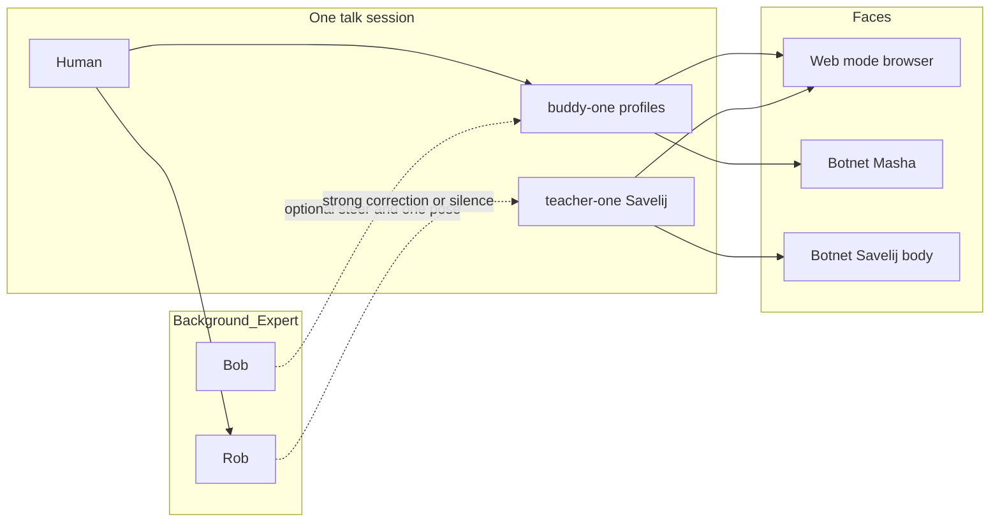
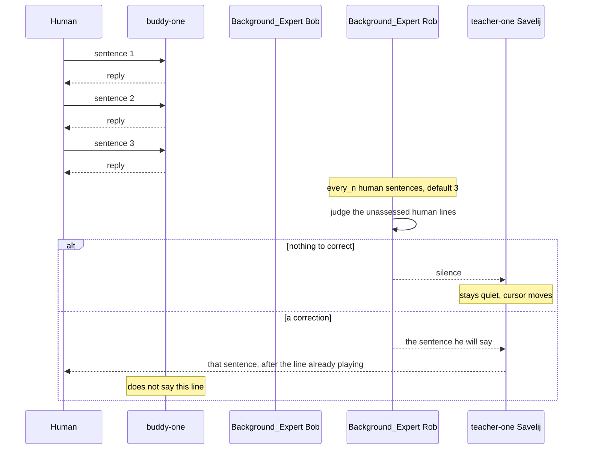

# Group: buddy, teacher, and the two background experts

This file is the design for Savelij and Rob. It does not open `buddy-two`. It does not rewrite the buddy graph. Architecture §2, §6, and §8 stay as written.

The loop in items 1–5 of the work plan below is what the hub and the page do. Item 6, the body package on Savelij's Jetson, is not started.

## Names

| Name | Kind | Speaks | Body |
|---|---|---|---|
| Peter, Mary, Lucas, Ingrid | Profiles of actor `buddy-one` | Yes | Web page, or Masha when Botnet mode is on |
| Bob | `Background_Expert` for the buddy | No | None |
| Savelij | Profile of actor `teacher-one` | Yes, and only when Rob has a correction | Web page, or the Savelij robot when Botnet mode is on |
| Rob | `Background_Expert` for the teacher | No | None |

`Background_Expert` is the abstract name for a loop that does not speak, has no avatar, and does not attach. Bob and Rob are the two experts. Each one has its own prompt, its own clock, and its own speaker. Neither one is `buddy-two`.

Savelij is the same level of thing as Mary or Peter: a profile with a character. He is not a second buddy. His shoes are the teacher's. He is a man, pedantic, serious, and unapologetic. He speaks as I. He does not soften a correction and he does not tell a story after it.

His profile is `config/teachers/savelij.json`. It is not under `config/buddies/`, so the Talk panel does not list him as a choice of `buddy-one`. The same person teaches English and Norsk. The talk language picks the voice and Rob's prompt. English uses `en_US-ryan-medium`. Norsk uses `no_NO-talesyntese-medium`. `config/prompts/rob_nb.md` is Bokmål of its own, not the English file.

## What each one may do

The buddy answers the human. Bob may store one steer and one pose for a later buddy line. That steer stays optional in the way it is today: the buddy answers the human first, then may use the steer.

Rob does not steer the buddy. After a gap of human sentences he reads only the stretch he has not judged yet. The prompt asks one question: which of those human responses should be corrected, if any. He returns either nothing, or one strong suggestion. A strong suggestion is the sentence Savelij says. It is already in Savelij's character. The hub does not ask a second model to rewrite it.

The human line stays in the log as heard. Savelij's sentence is a new spoken turn. It does not replace the human line.

When Rob returns nothing, Savelij stays silent and the buddy keeps the floor. In relaxed mode, when Rob returns a correction, Savelij has priority. His line is the next spoken turn. The buddy does not say that correction. A line already playing is not cut off. Savelij speaks after it, before the next buddy reply. The hub does not hold the buddy line that just finished in order to wait for Rob. Pedantic mode keeps that correction stored until Hear.

On the robots, only one of them speaks at a time. The body that is playing sends `played` when that sentence's audio ends. The hub holds the other voice until then, in either direction. A fallback timer uses the PCM length so a missing report does not freeze the talk.

## Clocks

Bob counts buddy replies. The default gap stays 3.

Rob counts human sentences, not buddy replies. He does not run on every human sentence. The gap is 2, 3, or 4. The default is 3. The gap is fixed in `config/rob.json` as `every_n`. When the count of human sentences since the last Rob call reaches `every_n`, Rob runs once on the whole unassessed stretch, then the cursor moves forward whether or not he found a correction. A late result from an older call is dropped only when a newer call starts.

The unassessed stretch is the human sentences after the last Rob cursor, plus the buddy lines between them, so the correction has a context. Rob does not re-judge lines already marked assessed.

## Teacher mode

The Talk panel lists Teacher mode under Teacher: Relaxed and Pedantic. The choice is stored on the session. A new talk keeps the choice already showing. Relaxed is the default.

Relaxed is the clock above. One correction, or silence. Savelij says a correction at once.

Pedantic counts human responses, not sentences. A response is one Send or one recognized Speak. The gap is `pedantic_every_responses` in `config/rob.json`, shipped as 2. Inside those responses every human sentence is judged. A sentence is one piece of the split on `.`, `!`, and `?`. The prompts are `config/prompts/rob_pedantic_en.md` and `config/prompts/rob_pedantic_nb.md`. They are not the relaxed prompts, and they are not on the trainer allow-list.

Each sentence returns the same kind of result as relaxed: a better sentence, or nothing, and a short reason. When there is a correction, the explanation names that sentence, gives the better alternative, and says why. That explanation is one spoken whole. It may be more than one sentence, capped at 600 characters. The hub synthesizes it in Savelij's voice and stores the text and the PCM. It does not play them. No teacher line is added to the log. The buddy's reply is not held.

A red Correction button appears at the end of each corrected human sentence, after the text and the voice are both stored. Pressing it opens a popup with the explanation and Hear. Close does not play. Hear plays the stored PCM in the browser. The stage mouth stays still, and Botnet mode does not send this PCM to the teacher body. A sentence with no correction has no button. With QA on, the Rob block shows the explanations as text, or `nothing to correct`. It does not play.

Switching mode does not rewind the cursor. The next call uses the new mode on the stretch not yet judged.

## What the page shows

The stage shows two faces when the language has a teacher. The buddy stays on the left. Savelij stands beside him, with his name and summary. He is not a button in the buddy list. A language with no teacher file shows only the buddy, and the Talk panel says there is no teacher. His mouth moves while his line plays.

Savelij's phrase is a line in the talk, with his name, whether QA is on or off. The talk log is where that phrase is read.

While QA is on, a separate block shows that Rob has a suggestion: the sentence he stored, or that he found nothing to correct, and the short reason. That block is not BOB's block. QA off hides Rob's suggestion and still shows the phrase Savelij spoke. The QA switch is the one already on the Talk panel.

## The two faces

Web mode and Botnet mode use the same minds.

- Web mode: the browser records and plays. The buddy is heard in the browser. When Savelij has priority, his PCM is played in the browser too. No robot is required.
- Botnet mode: Masha may attach as the buddy body. Savelij's robot may attach as the teacher body. Each body plays only its own actor's PCM. Masha does not speak Savelij's line. Savelij's robot does not speak Mary's line. Until his robot is attached, the page still shows his phrase and does not play it.

A teacher attach is allowed beside one buddy. It is not a second buddy, so it is not refused as a second buddy. A second buddy is still refused. A second teacher is refused. `buddy-two` stays inactive. Speak still asks the ready buddy to record.

Savelij's body, when it is built, registers like Masha: its own `body_id`, role `teacher`, actor `teacher-one`, steerer `rob`, its own speaking action, and its own mimic list. That body work is not the first slice.

On an English talk his voice is `en_US-ryan-medium`, the male Piper voice already in the audio image. Peter uses that same file. On a Norsk talk he uses `no_NO-talesyntese-medium`, the same file as Lucas and Ingrid. A distinct voice is a later choice.

## Component diagram

## Sequence

Bob may still run on his own clock during these turns. His steer never becomes Savelij's line, and Rob's correction never becomes the buddy's steer.

## Work plan

1. Add actor `teacher-one` and the Savelij profile. He is listed as the teacher, not as another choice of `buddy-one`. `buddy-two` stays inactive.
2. Add `Background_Expert` as the shared shape: settings file, prompt file per language, `every_n`, one stored suggestion, drop a late result when a newer call starts, no speech of its own. Bob is the existing expert. Rob is the new one, `config/rob.json`, prompt `config/prompts/rob_en.md`. The prompt is not on the trainer allow-list.
3. Count human sentences. When the gap is reached, call Rob with the unassessed stretch. Store either silence or one strong suggestion. Move the cursor.
4. On a strong suggestion, compile one `ElementSolution` for `teacher-one` and speak that sentence before the next buddy reply. Web mode plays that PCM in the browser. Botnet mode delivers it only to a player whose role is `teacher`. The buddy's reply does not contain the correction.
5. Tests: a gap of 3 does not call Rob on sentence 1 or 2. Sentence 3 calls Rob once. Silence leaves Savelij quiet. A correction is spoken by `teacher-one` and not by `buddy-one`. A second Rob call sees only the new stretch.
6. Body package: `lk_body` is installed on Savelij at `/home/jetson/yahboomcar_ros2_ws/yahboomcar_ws/src/lk_body`. It dials as role `teacher`. It plays PCM on the USB PnP speaker port and does not open a microphone. It does not publish Rosmaster motion. The loop and the line stay the same.

## Savelij's body package

Masha's package, on her Jetson, is `lk_body`: `listen.py`, `playback.py`, `poses.py`, `node.py`, `mode.py`, `envfile.py`, `config/mimics.json`, and `deploy/`. It dials the hub, records, plays PCM, and runs action files on her hexapod. Her mic is the iFlytek array. Her speaker is the GeneralPlus USB device. Her motion files are `.d6a` groups for that servo bus.

Savelij is also a Jetson Orin NX with ROS Humble. He is not that hexapod. He is a Yahboom Rosmaster. His Pulse default is the Jetson analog jack, `platform-sound`, not Masha's USB speaker. A USB PnP mic is plugged in and is not the Pulse default. He has no `lk_body`, no action-group folder, and no gripper.

His package follows Masha's shape: `listen.py`, `playback.py`, `poses.py`, `node.py`, `mode.py`, `envfile.py`, `config/mimics.json`, and `deploy/lk_bot_mode`. It registers as role `teacher`, steerer `rob`, actor `teacher-one`. It does not copy her servo map, her `.d6a` files, her mic gain, or her `speaking_masha` jaw. `poses.py` does not publish actions. The microphone is not opened. Playback uses `pacat` on the USB PnP device whose port is Speakers (`alsa_output.usb-Solid_State_System_Co._Ltd._USB_PnP_Audio_Device_000000000000-00.analog-stereo`). The built-in `platform-sound` jack is not the speaker. The onboard and USB inputs are not recorded. While he speaks, `speaking_savelij` strafes out and back. The target is 8 cm each way. A pulse of only the raw 8 cm at 0.12 m/s lasts 0.7 s and this chassis barely creeps in that time, so each leg is held 1.25 s at 0.15 m/s. The wheel command is sent steadily for that whole leg. The chassis otherwise stops a move after 0.6 s without a command. The driver timeout used by this mode is 2 s. The first trip is not cancelled when the sentence ends or the next one arrives. The next sentence starts with the other side, then returns. He comes back on the same trip, so he stays on the patch. The command is `cmd_vel` on ROS domain 28, and `enter` starts `Mcnamu_driver_X3` if it is not already up. `leave` stops that driver only when this mode started it. Web mode does not need this package. Botnet mode does, and only then does his robot speak the same line the browser would have played.

He is listed in `config/players.json`. The attach token stays in his `.env` and in the hub environment. The dial key is `SAVELIJ_HUB_WS`.
