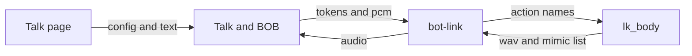
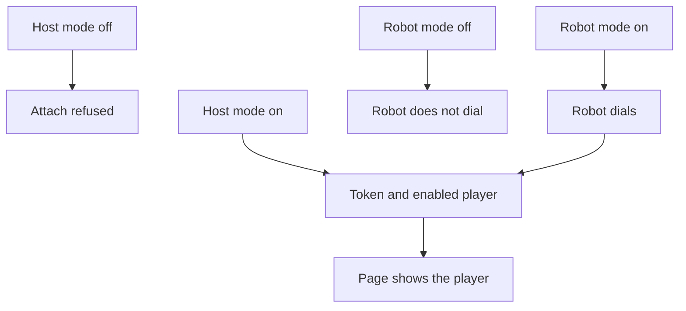
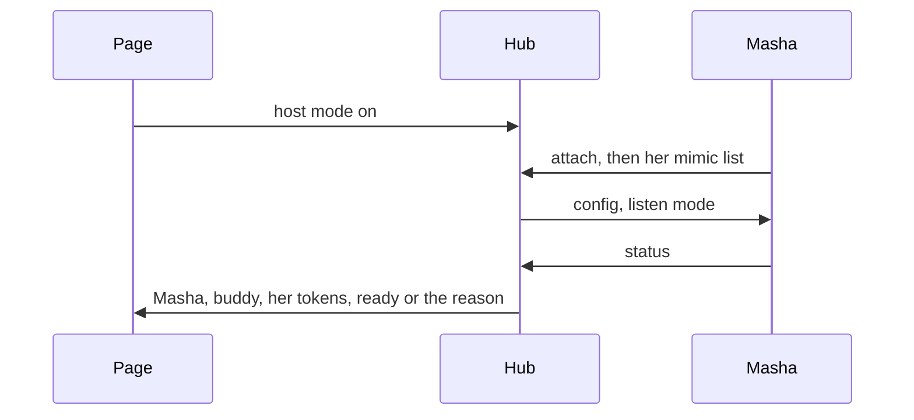
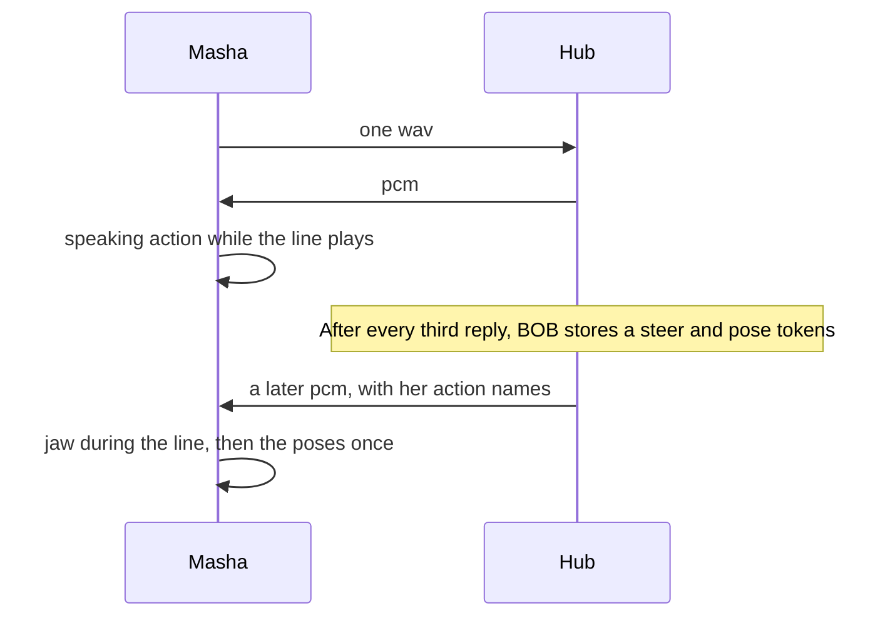
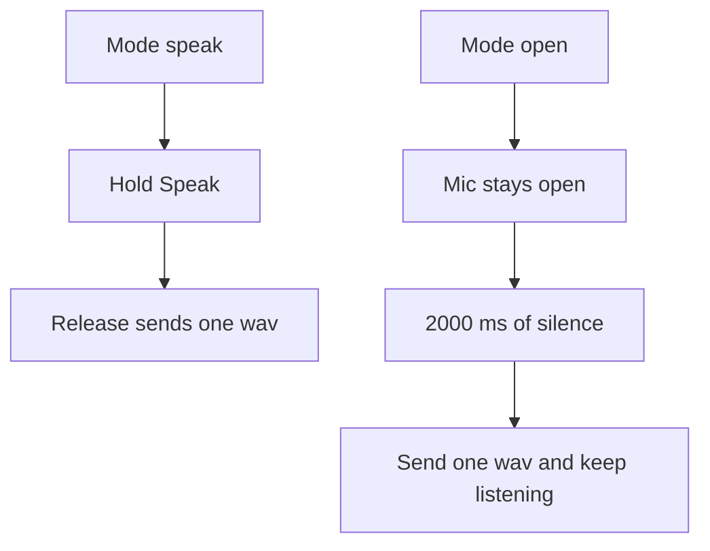

# Masha design

Approved design for work-plan item 9. Item 9 is open. It stays unfinished until the last step in `masha-02-work-plan.md`.

The page is the console: language, profile, raw material, transcript, typed lines, host mode, listen mode, and the player list. It is not a body. It has no servos.

Masha is the body of `buddy-one`. She listens on her microphone and answers on her speaker. On every spoken line her gripper plays her speaking action: the end effector opens and closes so it looks like a jaw, and the legs stay a stand. A change of stance happens only when BOB’s suggestion says so. That suggestion carries the next speech steer and the pose list together. The jaw is not one of those poses.

The SVG buddy was a stand-in. This stage puts that same mind on her. There is no Screen/Masha picker and no `body_id: screen`.

A later robot, such as Savelij, can register as its own player with its own role, its own mimic list, and its own steerer. The example role is `teacher`. The example steerer is Rob. BOB stays Masha’s steerer. This stage does not build Savelij, Rob, or that role. `buddy-two` stays inactive. Work-plan items 10–12 stay unstarted. Item 11 is a second copy of `buddy-two`, which is a different stage from a teacher.

Log in as `ubuntu@<masha-ip>`. SSH is how you administer her. The talk does not go over SSH.

## Decisions

1. Same buddy role. Masha is the body. She is not a second mind and not a new profile. Peter, Mary, Lucas, and Ingrid stay. Both languages stay. One `ElementSolution` per turn. The graph stays `speak` then `compile`.
2. The hub emits words, PCM, and pose tokens. Servo files, Pulse, and ROS stay in the robot package and in `bot-link`’s map. The talk modules do not open a robot socket.
3. Robots dial the host at `ws://<host>:8090/players`. The host does not scan the LAN and does not SSH to them. The page socket stays `/ws`.
4. Both sides enter `lk_bot_mode` before a player is ready. The page switch is Web mode when off and Botnet mode when on. Off is the default. The wire flag stays `host_mode`. Her mode stops the keyword voice launch and starts `lk_body`. Leave starts that launch again. Web mode does not attach a robot. Speak records and plays in the browser. Botnet mode is the robot face.
5. She carries her mimic list and registers it. The host does not keep `config/masha.json`. The same token can name a different action file on a later robot. `bot-link` does that map.
6. BOB is the steerer for the buddy player only. He returns the steer and the pose tokens together. Stance poses run once, on the next reply that uses that new steer, after the jaw for that line. Later replies may keep the steer text and do not repeat the poses. The speaking model stays `line` and `emotion`.
7. Her speaking action is the default jaw on every spoken line. For Masha the registered name is `speaking_masha`. It is not a BOB token.
8. Listen mode `speak` is optional and is the one we build first. Hold Speak, release to send. A pause while the button is held does not cut the sentence.
9. Listen mode `open` is the target. She listens without the button. 2000 ms with no voice ends the sentence. She sends that wav and keeps listening. A shorter pause stays in the sentence. The Speak button remains the other mode.
10. While her speaker is playing, and for 300 ms after it stops, mic sound is not a new sentence.
11. The 2000 ms cut is on the robot, before she sends the wav. Whisper on the host keeps its own gate: 100 ms minimum speech, 400 ms silence, 300 ms pad.
12. `lk_body` is a new package in `ganapetya/masha`, next to `proud_up`. It is not added to `JetSpider/ros2_ws.git`. Pose files stay on her disk and out of git.
13. One enabled player this stage: Masha, role `buddy`, actor `buddy-one`, steerer `bob`. A teacher attach is refused. A second buddy is refused.
14. The laptop microphone and the laptop speaker are not a stand-in. If her link is down, the page shows text.

## The talk

1. You speak into her mic. The listen mode decides when the take ends. Host Whisper transcribes it. The page shows the words as heard.
2. She answers on her speaker. While that line plays, her gripper runs her speaking action. The page shows the line and does not play it.
3. BOB runs after every third reply. The suggestion is the speech steer and a list of pose tokens from the set she registered. The next reply uses that steer. On that reply she still jaws while the line plays, and after the line she runs those poses once. Later replies may still use the steer text. They jaw while they speak, and they do not run that pose list again.

## What she is, measured

- Jetson Orin NX Super, Ubuntu 22.04.5, ROS 2 Humble, `ROS_DOMAIN_ID=27`.
- Her address and this host's address come from DHCP and change. With Compose down, port 8090 was refused in tens of milliseconds, so the route was up and nothing was listening.
- Mic: iFlytek XFM-DP-V0.0.18, Pulse default source, 16000 Hz mono. Busy at login because `asr_node` had it.
- Speaker: GeneralPlus USB, Pulse default sink. Playback is raw 22050 Hz mono PCM into `pacat`, so the first bytes can sound before the rest of the line arrives. English plays at 0.8 of that stream. Norsk plays at 1.3.
- Servos: publish `interfaces/msg/RunActionSet` on `/controller/run_actionset`. `action_path` is a basename with no directory and no `.d6a`. The callback uses `action_path` and ignores `interrupt`. A name plays only while `/action_complete` is true. The flag starts true. A missing file does not move. `stop` ends the roll and then plays `init_pose`.
- Each `.d6a` is SQLite. Table `ActionGroup` has `Index`, `Time` in milliseconds, and `Servo1` through `Servo24`. A file moves every channel. Legs are servos 1–18. Head and arm are servos 19–23. The gripper is `r_joint`, servo 24. `init_pose.d6a` is one row, `Time` 1000, and holds the gripper at the stand. Pick groups already open and close servo 24 and also move the arm. `wave_and_grip.d6a` skips servo columns. Do not copy either as a template.
- Boot runs `ros2 launch bringup bringup.launch.py` as pid 1’s child. `startup_check` starts `ros2 launch xf_mic_asr_offline startup_test.launch.py` when `/dev/ring_mic` exists. That launch owns `asr_node` and `voice_control_move`. It does not respawn. After it exits, `startup_check` does not start it again.
- `proud_up_node` may stay. It sets the arm once at boot. `masha_interaction_node`, `large_models`, and `follow_the_cat_node` stay stopped. The kinematics study crate on this host is not her gait.

## Where the modules go

The host repo is this one. The robot repo is `git@github.com:ganapetya/masha.git`, checkout `/home/ubuntu`. `JetSpider/ros2_ws.git` is the vendor workspace nested at `/home/ubuntu/ros2_ws/.git`. `JetSpider/software.git` stays the action editor. `ganapetya/learning-bots-sharing` stays the learning notes.

| Module | Repo | Path | This stage |
| :--- | :--- | :--- | :--- |
| `bot-link` | logoskittens | `bot-link/` | New. Sockets, host mode, body to connection, token to that body’s action name. |
| Talk | logoskittens | `cognitive-hub/src/logoskittens/` `session.py`, `talk.py`, `bob.py` | Calls `bot-link`. Does not open a robot socket. |
| Page | logoskittens | `virtual-stage/src/App.tsx` | Mode switch, listen mode, player rows, QA. |
| Who may attach | logoskittens | `config/players.json` | One enabled row, Masha. |
| `lk_body` | ganapetya/masha | `ros2_ws/src/lk_body/` | New ament Python package. |
| Her mimic list | ganapetya/masha | `ros2_ws/src/lk_body/config/mimics.json` | Tokens, action basenames, intents. No pulse numbers. |
| Pose files | On her disk | `/home/ubuntu/software/actionset_editor/ActionGroups/*.d6a` | Authored in the editor. Not committed. |

`bot-link` is a package the hub process imports. It is not a second server. `api.py` mounts its router and does not parse attach frames.

The talk side asks three things: the mimic tokens registered for a role, delivery of PCM plus those tokens, and the listen mode. `bot-link` maps a token through the registration for that body and sends the action basename. The talk stores the token on `KinematicGesture.primitive_name`.

`lk_body` files: `listen.py`, `playback.py`, `poses.py` (no rclpy), `node.py` (the only rclpy import), `mode.py`, `config/mimics.json`, `deploy/lk_body.service`, `deploy/lk_bot_mode`. The unit runs as `ubuntu`, domain 27, and sources Humble and the workspace. Inside the node: `rclpy.spin` on the main thread, the socket on an asyncio thread, playback and poses on a queue. `pacat` is one process group. Python 3.10. No 3.11-only syntax. `__init__.py` does not import `node`.

Commit `lk_body` from `/home/ubuntu`. Adding it with the git directory inside `/home/ubuntu/ros2_ws` sends it to the vendor remote.

## Players

`config/players.json` lists who may attach. Each entry is `body_id`, `display_name`, `role`, `actor`, `steerer`, `enabled`, and `token_env`. The token value stays in the host environment, named by `token_env`, 32 characters or more. Compare with `hmac.compare_digest` only when both sides are non-empty strings. A missing, empty, or short token is refused before the compare. The socket is cleartext on the LAN. The token is not a defense against a sniffer.

This stage has one enabled entry: Masha, role `buddy`, actor `buddy-one`, steerer `bob`, token env `MASHA_ATTACH_TOKEN`. A second enabled entry whose steerer is not `bob`, or whose role is not `buddy`, is refused with `role_not_open`. A second buddy while she is already attached is refused with `one_player`.

She dials `MASHA_HUB_WS` from `/home/ubuntu/ros2_ws/src/lk_body/.env`. First frame is `attach` with `body_id` and the token. The next frame is `register`: speaking action (`action`, `intent`) and stance rows (`token`, `action`, `intent`). `bot-link` keeps that map until the socket drops. The next attach registers it again. The env file is not in git. There is no `hub_ws` key in json. An empty env var does not fall through to a file.

Host mode off refuses every attach with `host_mode_off` and closes player sockets. The page keeps the transcript and the config controls.

## Steerers

BOB is the steerer named on Masha’s row. He runs after every third buddy reply, as he does today. A late result from an older call is dropped only when a newer call starts. The hub does not hold her line to wait for him. A failed call leaves the previous steer and does not invent a move.

His prompt, `config/prompts/bob_en.md` and `config/prompts/bob_nb.md`, is given the tokens and intents she registered. Norwegian text stays its own text. Pose tokens stay the English catalog names. The prompts stay off the trainer allow-list.

```json
{"steer": "<one or two short sentences>", "why": "<one short reason>", "poses": ["curiosity", "agreement"]}
```

`poses` is an ordered list of tokens from this connection. Empty means she speaks the steered line, jaws, and does not change stance. Unknown tokens are dropped. The list is cut to `max_poses` (default 3). A bad list does not throw away the steer. Both are stored when the steer is non-empty, the same way `bob_steer` is stored today. The next compiled reply gets the steer in the prompt and the tokens on that one solution. The poses are then consumed. The steer text can remain until the next BOB save.

Rob is the name reserved for the teacher’s steerer. Same return shape, his own prompt files, and only the mimics that teacher robot registered. Those files are not added in this stage. A later `rob.py` would call the same mimic query for role `teacher`.

## lk_bot_mode

Host mode lives in `bot-link`. The switch is on the Talk page.

Her command is `lk_bot_mode enter` and `lk_bot_mode leave`. Enter stops the process group of `ros2 launch xf_mic_asr_offline startup_test.launch.py`. It leaves bringup, `servo_controller`, `move_controller`, and `proud_up_node` running. It does not start `masha_interaction_node`, `large_models`, or `follow_the_cat_node`. It then starts `lk_body`. If the controller is not up, it does not start `lk_body`. Leave stops `lk_body` and starts that same voice launch again.

A later robot ships its own package, its own stop list, its own `mimics.json`, and its own speaking action name. It uses the same frames. This stage does not write that package.

## Listen modes

`config` carries `listen_mode` and whether the mic should be open.

`speak`, built first. The mic stays closed. Hold the Speak button and she records. Release sends one wav. A pause during the hold stays in that wav. The button is sent only to a ready player whose role is `buddy`.

`open`, the target, and the default once that step is done. When she is Ready and host mode is on, the mic stays open. She ends the utterance after 2000 ms with no voice. Minimum speech is 100 ms. She sends the wav and listens again. The page still offers `speak` as the other mode.

In both modes, sound during playback and for 300 ms after the player exits is discarded. A new human utterance during a pose list still sends `stop`, so the servos return to `init_pose` and she can listen.

If the source is busy she reports `mic_busy`.

## Mic, speaker, jaw

Capture is 16000 Hz mono WAV, one finished utterance per hub audio turn. Piper stays on the host. She plays the PCM with `pacat` at 22050 Hz mono. A newer line kills that process group. First sample within 1 second of Piper finishing. Do not open raw ALSA while Pulse owns the device. In Botnet mode the page message for that turn has the words and no PCM, so her speaker is not waiting behind a second copy.

Her speaking action is whatever she registered. Masha’s value is `speaking_masha`. `bot-link` sends that basename when PCM starts. The talk does not emit it.

Author the file by copying `init_pose` and changing only `Servo24`. Several open-and-close rows, last row back on the stand. One play finishes inside the 4000 ms lock. While PCM is still playing and `/action_complete` is true, publish it again. When PCM ends, do not publish it again and do not send `stop` only because the line ended. A missing file logs, and she still speaks. At 300 ms with no false, log `not-started` and keep the audio. Do not send `stop` for that.

The controller plays one group at a time. On a reply with poses, the jaw runs during the audio. When the audio ends, wait until `/action_complete` is true, then start the pose list.

## Stance poses

First rows in her `mimics.json`:

| Token | File basename | Servo intent |
| :--- | :--- | :--- |
| `agreement` | `lk_agreement` | One in-place nod, legs stay a stand. |
| `disagreement` | `lk_disagreement` | One in-place rock, legs stay a stand. |
| `frustration` | `lk_frustration` | One short dip, legs stay a stand. |
| `curiosity` | `lk_curiosity` | Head up, small lean, legs stay a stand. |

A new pose is a new row and a new file copied from a stand. No pulse numbers in git. Do not reuse `speaking_masha`, `stop`, `dance_1`, `dance_2`, `dance_3`, `init_pose`, `master_dance`, or the walk files.

`duration_ms` on each gesture is the lock budget, 4000 ms. A larger value is clamped. The file’s `Time` column is what the servos follow. The cap is armed at publish. At 300 ms with no false, log `not-started` and keep the cap. A false at 301 ms stays inside the cap. Cancel the cap when `/action_complete` goes true, or when the cap fires after a false that never returned true. `stop` goes out only in that second case. `lk_body` does not publish `/controller/cmd_vel` and does not write servo pulses.

## The page

The Talk aside shows host mode, listen mode, and one row per player: display name, role, steerer, speaking action, stance tokens, and Ready or the first reason (`mic_busy`, `speaker_missing`, `controller_down`, `file_missing` plus the basename). While host mode is on, the page also shows the dial URL.

Language, profile, raw material, the transcript, typed lines, and the BOB QA block stay. QA shows the pending steer, the pose names, “Outside the theme”, and the line that used a suggestion. The jaw does not appear as a suggestion.

Language, profile, raw material, and prompts stay on the host. She is not told them. Her capture rate does not change with language, and she plays PCM that Piper already rendered.

## Diagrams











## What the robot is told

The dial URL and the token are written on the robot before it connects. After register, `config` carries role, actor, `listen_mode`, and listen on or off. She answers with status. A listen-mode change sends `config` again.

## Risks

- Her mode left off: the keyword launch still owns the mic, and a wake word can walk her. Host mode left off: she dials and the page shows the refusal.
- Killing bringup to silence the mic also kills the controller. Stop only the `startup_test` launch.
- A pose file copied from a walk group walks. A speaking file copied from a pick group moves the arm. Copy `init_pose` and edit servo 24 only.
- Publishing a stance pose while the jaw roll is still false drops that pose. Wait until `/action_complete` is true.
- Open listen without the playback mute sends her own voice back as the human line.
- The LAN socket is cleartext. DHCP can change the host address. The URL lives in her env file.
- Adding `lk_body` from the vendor git inside `/home/ubuntu/ros2_ws` sends it to `JetSpider/ros2_ws.git`.

## Out of scope

Walking, lidar, camera tracking, LogosCat, a second live buddy, Zenoh, MQTT, and a screen body. Proto, the graph, architecture §2, §6, and §8 stay as they are. Items 7, 8, and 10–12 stay unstarted.
